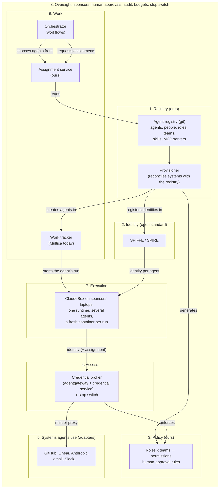
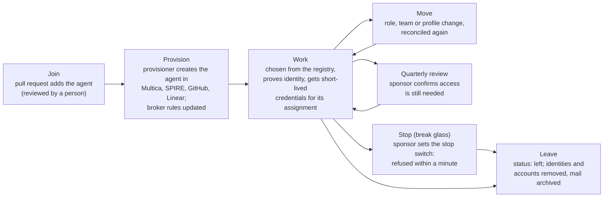
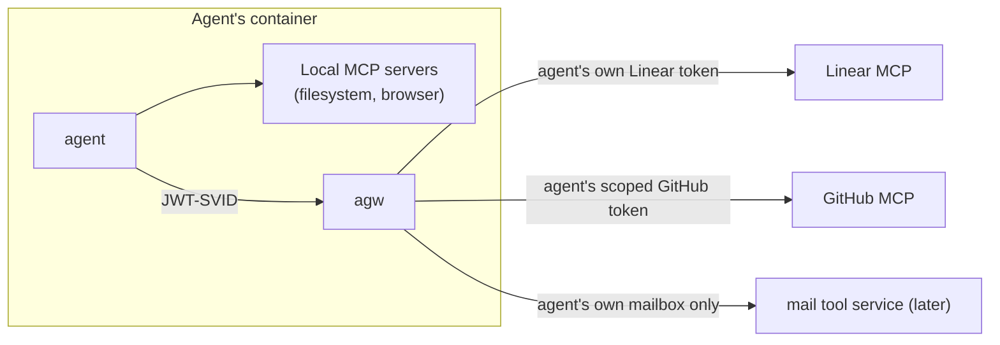
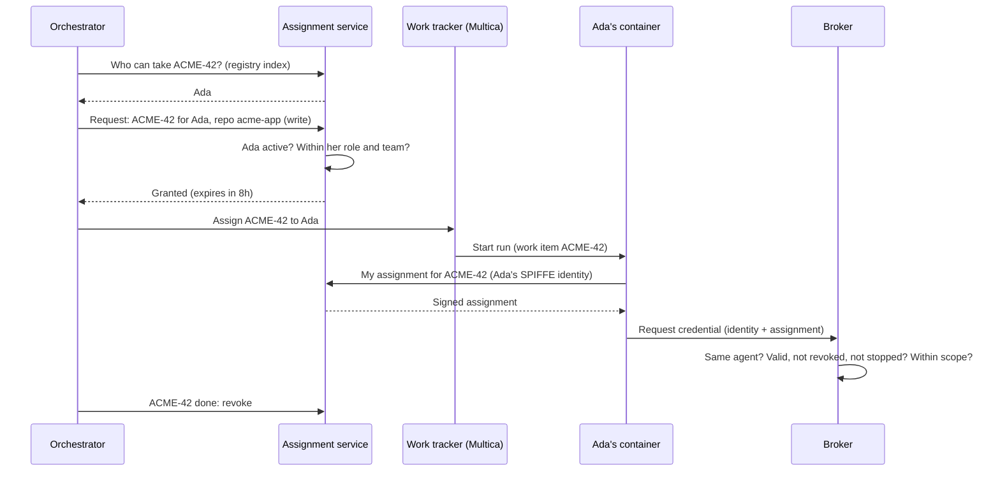
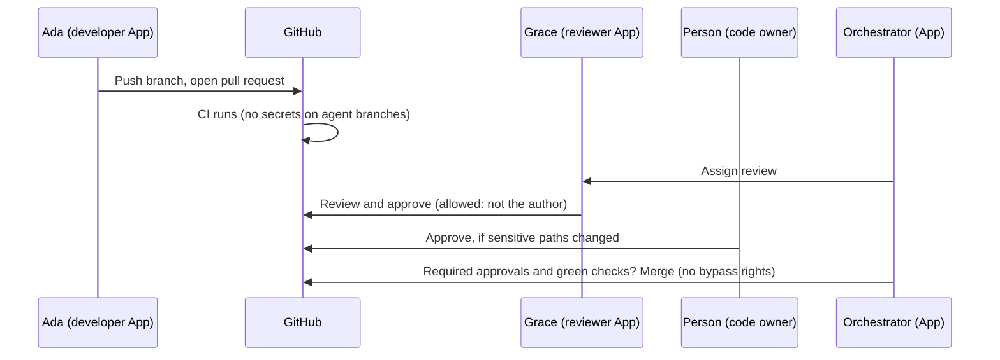
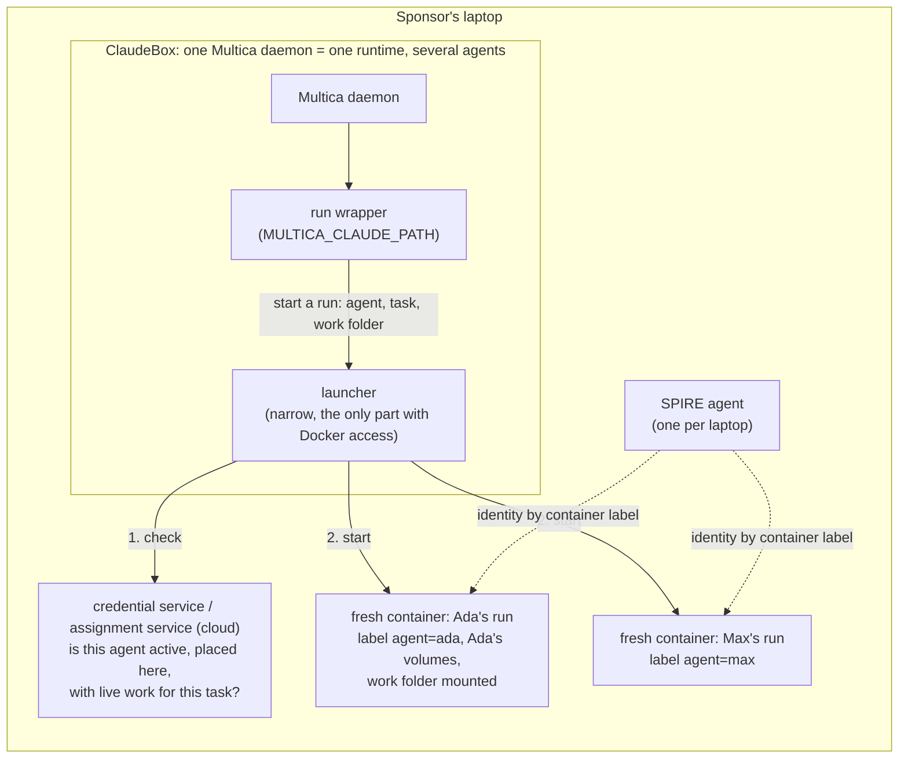
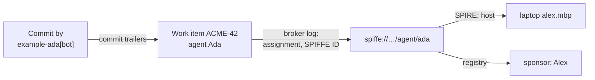

# Agent organisation: architecture

Status: draft for validation. An independent solutions architect and a devil's advocate reviewed it, and we revised it after the reviews (2026-10-10; see [Appendix G](#appendix-g-review-findings-and-how-they-were-resolved)). Nothing is deployed yet.

This document describes how AI agents become working members of the organisation. It goes from the top down. It gives the vision and the principles that every design choice must follow. It then gives the necessary capabilities (as layers) and the tool that fills each layer now. Use this document to validate decisions.

[plan.md](docs/plan.md) describes what the Terraform in `infrastructure/` builds in the cloud to host a part of this, and in which sequence. [threat-model.md](docs/threat-model.md) analyses the threats to this design with STRIDE and LINDDUN, and gives a test for each threat (`TM-` IDs in this document refer to it).

**Where the code is (D51):** this repo, `example-org/workspace`, holds the infrastructure (`infrastructure/`), the orchestrator (`orchestrator/`), the agent runtime (`claudebox/`) and the credential broker (`broker/`, not started yet). This document is at the root of the repo, and the plan is in `docs/plan.md`. Agents work in this repo too, but a person approves every merge, because this code sets the limits that agents work within. The agent registry is a separate repo, `example-org/agent-registry`, and only people change it.

## Contents

1. [Vision](#1-vision)
2. [Principles](#2-principles)
3. [Overview](#3-overview)
4. [Security ideas used here](#4-security-ideas-used-here)
5. [Layers](#5-layers)
   - [5.1 Registry: who our agents are](#51-registry-who-our-agents-are)
   - [5.2 Identity: proving who is running](#52-identity-proving-who-is-running)
   - [5.3 Policy: what each agent may do and read](#53-policy-what-each-agent-may-do-and-read)
   - [5.4 Access: reaching systems without holding secrets](#54-access-reaching-systems-without-holding-secrets)
   - [5.5 Communication: receiving and sending messages](#55-communication-receiving-and-sending-messages)
   - [5.6 Work: what agents work on](#56-work-what-agents-work-on)
   - [5.7 Execution: where agents run](#57-execution-where-agents-run)
   - [5.8 Oversight: how people stay in charge](#58-oversight-how-people-stay-in-charge)
6. [Replaceability](#6-replaceability)
7. [Threats and what stops them](#7-threats-and-what-stops-them)
8. [One piece of work, end to end](#8-one-piece-of-work-end-to-end)
9. [Architecture decisions](#9-architecture-decisions)
10. [Open architecture questions](#10-open-architecture-questions)
- [Appendix A: How Multica starts an agent run](#appendix-a-how-multica-starts-an-agent-run)
- [Appendix B: Claude access and Anthropic's terms](#appendix-b-claude-access-and-anthropics-terms)
- [Appendix C: Broker options compared](#appendix-c-broker-options-compared)
- [Appendix D: Mailbox options compared](#appendix-d-mailbox-options-compared)
- [Appendix E: Other alternatives considered](#appendix-e-other-alternatives-considered)
- [Appendix F: Registry options compared](#appendix-f-registry-options-compared)
- [Appendix G: Review findings and how they were resolved](#appendix-g-review-findings-and-how-they-were-resolved)
- [Appendix H: Resolved questions](#appendix-h-resolved-questions)

## 1. Vision

> We run as an organisation in which AI agents are working members, doing tasks that range from software development to financial analysis, with people overseeing the work.

This vision has these requirements:

- **Agents are treated like human team members.** An agent joins, has a role and a team, and leaves.
- **Agents have an identity they communicate with.** Agents receive and send messages by email, by Slack and in the tools that the team uses.
- **Agents may do and read certain things, and not others.** As for people, identity and access management controls this (the same as Entra ID or a cloud IAM does for people). A request in a prompt does not control it.
- **Agents run anywhere.** Agents run on laptops, in Docker containers, on virtual machines and on serverless containers. Frequently, agents share a host with other agents.
- **We choose agents for work from our own registry**, which is the equivalent of an employee list. We do not choose them from inside a tool.
- **Tools come and go.** Multica is the tool that links work to agents now, and we can replace it. We expect only first-principle foundations (open standards such as SPIFFE) to stay.

**How we get there:** in thin slices. Each slice delivers real work. The first slice has two agents: a developer and a reviewer, on the laptops of two different sponsors. They produce merged pull requests on one repo. Each agent has its own identity and short-lived credentials for each system that it uses. A person can stop each agent in one minute or less. We add all other items slice by slice. The number of agents increases in waves (2, then approximately 6, then towards 50) when the work and the measured cost justify it (D39).

## 2. Principles

Each design choice comes from one of these principles.

| # | Principle | What it means |
|---|---|---|
| P1 | **Agents are members, not tools** | Each agent has an identity, a name, a role, a team, a human sponsor and a life cycle (it joins, changes role, leaves), as an employee does. |
| P2 | **Control is deterministic and enforced outside the agent** | The identity of the agent and the policy decide what the agent may do or read. Each system applies this at its boundary. Prompts, instructions and guardrails (OpenAPPA) are extra layers. They are never the control. |
| P3 | **We own the systems of record; tools are replaceable adapters** | The agent registry, identity, policy, work assignments and audit are ours. We build them on open standards (SPIFFE, OIDC, JMAP, MCP). Products such as Multica, Linear, Slack, GitHub, agentgateway and Stalwart connect as adapters. |
| P4 | **People oversee** | Each agent has a sponsor. Important actions need the approval of a *person*. An approval by a different agent is a quality check, not oversight. The reason: the agents use the same model, and the same text can mislead them. We record all actions. We can stop each agent in one minute or less. |
| P5 | **The same identity model everywhere; trust depends on the host** | An agent has the same type of identity and the same rules on each host. The trust in that identity depends on who controls the host. We trust a dedicated host that we control more than a laptop, because the owner of a laptop can act as each agent on it. Thus each agent runs on the laptop of its own sponsor, and an author and its approver run on the laptops of different people (D49). |
| P6 | **Least privilege, short-lived access, central revocation** | Each agent gets only what its current work needs. Credentials expire quickly. No long-lived secret is on a host where an agent runs. We can remove access in one place. |
| P7 | **People and agents are both principals** | We describe people and agents with the same terms (role, team, permissions, approvals), although their identities come from different directories. |

## 3. Overview



| Layer | Question it answers | Today's choice | Status |
|---|---|---|---|
| 1. Registry | Who are our agents, and what are they for? | Files in `example-org/agent-registry`. Our provisioner applies them | Designed (D32, D34, D37) |
| 2. Identity | How does a running process prove that it is Ada? | SPIFFE/SPIRE; machine certificates for laptops; one container for each run | Designed; macOS check in stage 0; serverless containers later (Q22) |
| 3. Policy | What may Ada do and read? | Roles and teams in the registry, generated into the rules of the broker; human approvals for important actions | Designed for actions; data classes deferred (Q24) |
| 4. Access | How does Ada get access to a system without holding secrets? | Credential broker: agentgateway and our credential service; a stop switch. For now, model access uses the Team seat of the sponsor | Designed |
| 5. Communication | How does Ada receive and send messages? | GitHub and Linear with her own name; email in two steps; Slack later | Designed |
| 6. Work | What must Ada work on, and who decides? | Multica (work items, dispatch), our orchestrator (workflows), our assignment service | Designed |
| 7. Execution | Where does Ada run? | ClaudeBox on the laptop of her sponsor: one runtime that hosts several agents, and a new container for each run. A narrow launcher starts each container | Designed; dedicated VM hosts optional later |
| 8. Oversight | What did agents do, what did it cost, how do we stop one? | Sponsors, the stop switch, one log store with agent and task as keys; model usage shown for each Team seat | Designed for the first slice; model cost for each agent when model calls go through the broker |

**Components at a glance:**

| Component | Layer | What it does |
|---|---|---|
| Agent registry | 1 | The list of agents, people, roles, teams, approved skills and MCP servers, as reviewed files |
| Provisioner | 1 | Makes each system agree with the registry, reports drift, and removes manual changes |
| SPIRE server and agents | 2 | Issue and check identities for hosts and agents |
| Policy files | 3 | Roles, teams and human-approval rules |
| agentgateway | 4 | Checks identities, applies rules, forwards requests with credentials added (also model calls), and logs each call |
| Credential service | 4 | Holds the stop switch; mints GitHub tokens; refreshes long-lived tokens; replies to the check of the launcher |
| Assignment service | 6 | Grants signed work assignments; serves the registry index |
| Multica | 6 | Links work items to agents and starts runs |
| Orchestrator | 6 | Moves work through workflows; chooses agents; merges when the rules are satisfied |
| ClaudeBox | 7 | The Multica daemon (one runtime for each host), the run wrapper and the launcher. Each run gets a new container with Claude Code and OpenAPPA |
| Launcher | 2, 7 | Starts a new container for each run, after it checks with the central services that the agent may run there |
| OpenAPPA | 7 | Checks each tool call against a policy (a guardrail, not a control) |
| GitHub rulesets, CODEOWNERS, CI | 3, 8 | No change gets to `main` without the correct approvals and passed checks |

## 4. Security ideas used here

| Idea | What it means here |
|---|---|
| **Principal** | Each thing that can act: a person, an agent or a service. We describe all principals by role, team and permissions (P7). |
| **Identity** | Who or what a thing is. |
| **Authentication** ("who are you?") | Proof of identity. People prove it with Google sign-in. Hosts prove it with their cloud instance identity or a certificate. Agents prove it with a SPIFFE identity. |
| **Authorisation** ("what may you do?") | The decision about what an identity may do. Its role and team set the limits. Its current work assignment makes the limits smaller. If someone stopped the identity, it may do nothing. |
| **Identity life cycle** (joiner, mover, leaver) | A controlled process creates, changes and removes identities. |
| **Separation of duties** | One identity cannot make a change and also approve it. An approval is oversight only when the approver is independent, and that means a person. |
| **Sponsor** | A named person who is accountable for an agent. |
| **Credential or token** | Data that proves that you may do a thing, as a key card does. |
| **Short-lived versus long-lived** | A lost key card that stops working after one hour causes much less damage than a lost key card that works for one year. |
| **Least privilege** | Only what the job needs. |
| **Blast radius** | The quantity of damage that one broken part can cause. |
| **Trust boundary** | A line where we stop trusting what is on the other side. Examples: between hosts and the cloud, between the internet and the inbox of an agent, and between our cloud account and production. |
| **Defence in depth** | Several independent layers, so that one failure does not cause the loss of all protection. |
| **Deterministic control** | A control whose result comes from rules and identity, not from the judgement of an AI. When GitHub refuses the approval of an author for its own change, that is deterministic. A prompt that says "don't approve your own work" is not deterministic. |
| **Attestation** | Proof of a fact about yourself, with evidence that a different party can check. SPIRE attests hosts and workloads. |
| **mTLS** | An encrypted connection where the two sides each show a certificate. |
| **JWT** | A signed token that nobody can change without detection. It has claims such as "this is agent Ada" and an expiry time. A JWT-SVID is the SPIRE version. Its *audience* tells which service it is for. |
| **Mint versus proxy** | When the broker mints, it gives the agent a new, narrow, short-lived token. When the broker proxies, the real token stays in the cloud and the broker forwards requests for the agent. |
| **Prompt injection** | Text that someone writes to trick an agent. Each text that an agent reads, and that a person outside the team could write, can contain it. Examples: issues, comments, pull requests, CI output, web pages, emails, package READMEs. |
| **Exfiltration** | Data that goes out through a channel. Each channel that an agent may use is a possible route, also allowed channels such as GitHub and the model API. |
| **Information flow** | Where data goes after an agent reads it: to the model provider, and out through each channel that the agent has. |

## 5. Layers

### 5.1 Registry: who our agents are

**Purpose (P1, P3):** the employee list for agents, and the single source of truth for all data about them. We configure tools *from* the registry, never in the opposite direction (D28).

**Where it lives (D34):** a git repo, `example-org/agent-registry`. Each change is a pull request that a person reviews. CODEOWNERS makes each team or sponsor approve changes to its agents. The git history is the audit trail. No GitHub App of an agent is installed on this repo. No open-source product is an "employee list for agents" ([Appendix F](#appendix-f-registry-options-compared)).

**Repo layout:**

```
agent-registry/
  agents/ada.yaml             # one file per agent
  principals/alex.yaml      # one file per person, same fields (P7)
  services/orchestrator.yaml  # our own services as principals, with their rights
  roles/developer.yaml        # what each role may do
  teams/acme.yaml             # where: workspace, repos, Linear team, contacts
  skills/tdd.yaml             # approved skills (D32)
  mcp-servers/linear.yaml     # approved MCP servers (D32)
  profiles/developer.md       # instructions
  schema/                     # JSON Schema or CUE, checked in CI
```

**What an agent entry holds:**

| Group | Fields | Used by |
|---|---|---|
| Who | ID, name, role, team, sponsor, status (`active`, `suspended`, `left`), joined date | All components |
| Contact | Email address, GitHub App, Linear app, Slack app (later) | Communication, provisioning |
| Profile | Instructions, model and effort, skills and MCP servers (by ID, from the approved lists) | Provisioning into the work tool and runtime |
| Capabilities | The work that the agent can take | The orchestrator, to choose agents |
| Placement | The host (laptop) that runs the agent | Provisioning, SPIRE registration, the check of the launcher |

Examples:

```yaml
# agents/ada.yaml
kind: Agent
id: ada
name: Ada
role: developer
team: acme
sponsor: alex
status: active
joined: 2026-10-12
contact:
  email: ada@agents.example.com
  github_app: example-ada
  linear_app: Ada
profile:
  model: claude-opus-5-5
  instructions: profiles/developer.md
  skills: [tdd, code-review-response]      # must exist in skills/
  mcp_servers: [linear, github]            # must exist in mcp-servers/
capabilities: [go, terraform]
placement: alex.mbp            # the sponsor's laptop (D49)
```

```yaml
# roles/developer.yaml
github: { permissions: { contents: write, pull_requests: write } }
linear: { scopes: [read], tools: [list_issues, get_issue, list_comments] }
mail:   { send_to: [internal] }
data:   { classes: [internal] }
approver: false                # may never count as an approver
```

```yaml
# mcp-servers/linear.yaml
id: linear
owner: platform
endpoint: https://mcp.linear.app/mcp     # reached only through agentgateway
data_classes: [internal]
risk: medium
reviewed: 2026-10-10
```

**Rules CI enforces on every change:**

- Each agent refers only to approved skills and MCP servers (D32).
- The registry places each agent on the laptop of its own sponsor. It places an author-role agent and its approver-role agent on the laptops of different people (D49).
- No agent has the `analyst` role, a `confidential` data class or external mail contacts until the design of data classes is complete (Q24).
- People in `principals/` generate Multica membership and CODEOWNERS teams, so a real system enforces P7.

**The provisioner (D37):** the component with the most privileges, so it has an explicit design.

- It is a **reconcile loop**. The registry is the desired state. The provisioner makes Multica, SPIRE, the rules of the broker, GitHub, Linear and (later) mailboxes agree with it. It is safe to run it many times.
- It runs as a container task **inside the cloud account**, with its own identity. The CI of the registry can only *start* it (and publish `registry.json`). The CI never acts on systems itself.
- The registry CI **signs** `registry.json`. The provisioner and the assignment service refuse an index that has no signature or an incorrect signature.
- It **detects drift** (for example, a manual edit to the instructions of an agent in Multica) and removes it. It reports what it changed. Only a small number of people have Multica admin rights.
- Broker *rules* are data that the provisioner publishes. A person releases broker *code* manually (D18). A join or a leave never needs a broker release.
- Some steps stay manual by design: the creation of a GitHub App and of a Linear app. The GitHub App manifest flow needs one click for each App. The provisioner prepares these steps and lists what a person must do.

**Life cycle:**



**Stopping an agent is not a pull request (D35).** The `status` in the registry is the record, but a change to it needs a review and a pipeline. In an emergency, a sponsor or an admin sets the **stop switch** in the credential service. They use a small command with Google sign-in for authentication. The broker checks the stop switch on each request, so the broker refuses the agent in one minute or less. The registry gets the update after this. Then the stop runbook revokes the GitHub tokens that are still valid, cancels the running tasks of the agent and removes its SPIRE entry.

**Querying the registry:** CI publishes the signed `registry.json` at each merge. The assignment service serves it through a small query API. Thus the orchestrator can ask "which active agents on Acme can do Go work?". Later, we can add Backstage as a UI.

**Standard formats (D33):** capabilities use the OASF skill vocabulary where it is applicable. We defer two tasks: the generation of OASF records and publication to an AGNTCY Agent Directory. We do these tasks only when we share agents with clients or partners, or when the inventory has hundreds of entries.

**People as principals (P7):** the sign-in of people stays in Google Workspace. Their role and team are files in `principals/`. We add a shared account directory for people and agents (Authentik or Keycloak) only if agents must sign in as people do.

**What this changes elsewhere:** today, the orchestrator builds its roster from Multica (its DESIGN.md: "Roster. Derived from Multica per workspace… There is no roles file"). The roster moves to the registry, and this needs an ADR in the orchestrator repo. The `fleet.yaml` file of `onboard` becomes the start of the registry.

### 5.2 Identity: proving who is running

**Purpose (P2, P5):** a running process proves which registry agent it is, with evidence that a machine can check.

**Standard:** SPIFFE, with SPIRE as the implementation. The run of each agent gets an ID such as `spiffe://workspace.example.com/agent/ada`, in two steps:

1. **The host proves its identity** to the SPIRE server (node attestation).
2. **The SPIRE agent on that host identifies the workload**: which container. Each run is **its own container** (D14), so the container identifies the agent. The container has a label that names the agent. The launcher sets this label after its check with the central services. The container uses our published, signed ClaudeBox image. **Labels are not proof:** each process that can use Docker on the host can start a container with the same labels, and SPIRE gives it the same identity (TM-S1). Thus the host's owner can always act as the agents on that host, and D49 and D53 limit what that gives.

**Per platform:**

| Where agents run | How the host proves itself | Trust | Status |
|---|---|---|---|
| Laptop of the sponsor, or Docker host outside the cloud | A machine certificate from our node CA (`x509pop`). Enrolment is a logged action by two people | Low: the owner, and each process that runs as the owner, can get the identity of the agents on that host. D49 keeps this risk in the responsibility of the sponsor | **First** (D38) |
| Dedicated VM host in our workspace account | The cloud identity document of the instance | High: nobody logs in; changes come only through deployment | Later, optional |
| Serverless containers | Open (Q22): a SPIRE agent next to each task, or identity from the IAM role of the task | High | Later |

**What identity on a host cannot fix:** the person or process that controls the container runtime on a host can get the identity of each agent on that host. For this reason:

- Each agent runs on the laptop of its own sponsor.
- An author and its approver run on the laptops of different people (D49).
- The launcher asks the central services before each run (D50). This stops a compromised daemon, but not a person or program with Docker access on the host (TM-S1).
- From stage 4, the broker gives credentials only for a live assignment of the task (D53), so a false run gets only work that a person or the orchestrator assigned.

**macOS:** Docker Desktop runs containers inside a hidden virtual machine, so the SPIRE agent must also run inside that machine. Stage 0 of the plan checks that the SPIRE agent can identify each container there.

**SPIRE itself:**

- Two SPIRE servers share one database, so one server can restart and the agents keep their identities.
- JWT-SVIDs are valid for 15 minutes.
- SPIRE manages its own signing keys in KMS.
- The server is on its own load balancer, and it is open to the internet (laptops connect to it).

**Services inside the cloud account** (the orchestrator, the provisioner) prove their identity to our services with their cloud IAM role. They send a signed identity request, and the receiving service verifies it with the cloud provider (D42). They use this method until Q22 also gives them SPIFFE identities.

### 5.3 Policy: what each agent may do and read

**Purpose (P2, P6):** decide what each agent may do and read with rules, not with judgement, and enforce this at the boundary of each system.

**Where permissions come from:**

1. **Role**: *what type* of access (a developer writes code, a reviewer reviews, a project manager manages issues).
2. **Team**: *where* (the repos, Linear team, workspace and contacts of the team).
3. **Work assignment**: *what this task needs*, where a system can enforce it. For GitHub, this is one repo. For Linear, this is the Linear workspace of the team (Linear cannot reliably limit access to one issue).
4. **Stop switch**: no access, if someone stopped the agent.

Provisioning generates the rules of the broker from roles and teams (D23).

**Where it is enforced:**

| Boundary | Control |
|---|---|
| Credential broker | Refuses each credential or request outside the role, team and assignment of the agent. Refuses all requests from a stopped agent |
| GitHub | The App of each agent has only the permissions of its role. Rulesets require approvals and passed checks. Human code owners on sensitive paths |
| GitHub Actions | Agent branches run CI with **no secrets** and no cloud access. Cloud roles trust only `main` or protected environments (D40) |
| Linear | The app of each agent has only the scopes of its role |
| Model API | The Team seat of the sponsor; usage limits for each seat (D15) |
| Mail | Send rules in the mail tool service. Incoming mail only from approved senders whose mail passes DMARC |
| Container | A new container for each run. The launcher starts it only after its check with the central services. No shared credential volumes |
| Network | The egress proxy of ClaudeBox on each laptop |

OpenAPPA and the instructions of the agent add more layers, but no permission depends on them.

**Approvals (P4):** an approval by a different agent improves quality, but it is not oversight. The two agents are the same model, and they read the same pull request, with any injected text in it. Thus:

| Action | Approval needed |
|---|---|
| Merge code in an ordinary repo | A reviewer agent (quality check) and passed checks |
| Merge changes to CI, workflows, infrastructure, authentication, dependency manifests | A person (human code owners) |
| Merge any change in a repo that deploys to production | A person |
| Merge any change in the workspace repo (orchestrator, broker, ClaudeBox, infrastructure) | A person, always. Agents can propose changes, but an agent's approval never counts there (D51) |
| Changes to the registry repo | A person, always (agents have no write access there) |
| Email to a new external recipient | The sponsor of the agent |
| Publish financial analysis outside the team | A person on the team |
| Change production systems (later support agents) | A person, each time |

The capacity of people to review is the real limit on throughput, so we plan it as we plan all other capacity.

**Data classes and information flow (deferred, Q24):** "not reading certain things" is more difficult than "not doing certain things". When an agent reads data, the data goes to the model provider. The data can then go out through each channel that the agent has. OpenAPPA sees tool calls, not behaviour, so it cannot reliably stop this. Thus confidential data needs structural separation (for example, runtimes without internet access that use a model in our own cloud account), not filters. Until this design is complete, no agent gets confidential data, and CI enforces this.

### 5.4 Access: reaching systems without holding secrets

**Purpose (P2, P6):** agents never hold long-lived credentials for the systems that they use. Each credential for GitHub, Linear, mail and other systems comes from the credential broker (D16). For now, the model credential is the only exception (D15).

**What the broker checks on every request:**

1. **Identity:** the JWT-SVID of the agent, with the broker as its audience. This is the only authenticator.
2. **Stop switch and status:** the agent is not stopped, and its status is `active`.
3. **Authorisation:** the request is in the role and team of the agent. When assignments exist (D29), the request must also be in the scope of the current assignment.

Important: this is one proof of identity and some authorisation records. The agent gets the assignment with the same identity. Thus the assignment limits what an agent can do, but it is not a second, independent proof. The launcher also asks the central services before it starts a container as an agent (D50). That check stops a compromised daemon, but a person or program with Docker access on the host can start a container without the launcher (TM-S1). Thus the limit that holds also on a compromised host is the broker's own check: from stage 4, each credential needs a live assignment for the task (D53).

**Mint or proxy:**

| Kind of system | Examples | What the broker does |
|---|---|---|
| Can issue short-lived, narrowly scoped tokens | GitHub App installation tokens (1 hour, selected repos and permissions), cloud temporary credentials, database IAM sign-in | **Mints** a token with exactly the permissions of the agent |
| Only long-lived or broad tokens | Linear app tokens (30 days), Slack bot tokens, mailbox tokens; later an Anthropic API key | **Proxies**: forwards each request with the correct credential added, so the agent never sees the credential |

**Model access (D15, owner's decision):** for now, each agent uses the Claude Team seat of its sponsor on the laptop of the sponsor. The broker does not touch model traffic, because Anthropic's terms forbid intermediating subscription credentials. The model proxy of the broker has a design, but it is off. We can activate it with an organisation API key or workload identity federation (Q21). Then we get cost for each agent, budgets and the stop switch for model calls. Claude Code then sends model calls to the broker (`ANTHROPIC_BASE_URL`).

**How the broker is built (D17, D18):**

- The open-source **agentgateway** does the work at the boundary: it checks identities, applies the rules of each agent (down to individual MCP tools), injects credentials and logs each call.
- Our small **credential service** holds the stop switch. It mints GitHub tokens with the App key of each agent in KMS. It also refreshes long-lived tokens (one writer, which renews each token at approximately half of its lifetime).
- Our services behind agentgateway also check the JWT-SVID of the caller themselves, each with its own audience (`broker`, `assignments`, `mail`). Thus no component inside the cloud account trusts a forwarded header (D42).
- The code of the broker is in its own folder (`broker/`) of the workspace repo (D51), separate from the code of the orchestrator. Agents can propose changes, but only people approve them, and people make its releases manually. Its rules come from the provisioner.

[Appendix C](#appendix-c-broker-options-compared) compares the options.

**When a request is refused,** the agent gets a reason code (for example `stopped`, `outside_assignment`, `budget_exceeded`). The log records the refusal with the agent and the task. Thus a person can see the reason without a manual join of logs.

**Credentials reach tools when needed:**

| Tool | Mechanism |
|---|---|
| Claude Code itself | The Team seat token of the sponsor. The launcher gives it to Claude Code (later: the model proxy of the broker) |
| `git` | A git credential helper. It also sets the commit author to the bot of the agent and adds `Agent-Id`, `Task-Id` and `SPIFFE-Id` trailers |
| `gh` | A wrapper that sets `GH_TOKEN` for one call |
| Remote MCP servers (Linear, GitHub, mail) | One MCP address for each agent at agentgateway, with a `headersHelper` that sends the identity |
| Cloud CLI and SDKs (later) | The credential-process hook of the cloud SDK |

**MCP traffic (D20):** agents get access to each remotely hosted MCP server only through agentgateway. agentgateway shows each agent only the tools on its list and adds the own credential of the agent. MCP servers that act on the box (filesystem, browser) stay in the container. MCP servers that only wrap an online service run on the cloud side, each as its own container service behind agentgateway. Agents never find or install tools themselves.



**Claude Code hooks** are for control, not for credentials. They come from a managed-settings file that root owns and that is in the image, with `allowManagedHooksOnly`. A `SessionEnd` hook asks the broker to revoke the credentials that it issued. This hook is best effort (it does not run if a process crashes). Thus short expiry is the real limit on a leaked token.

### 5.5 Communication: receiving and sending messages

**Purpose (P1):** agents communicate as colleagues do, with their own names.

| Channel | Account per agent | How |
|---|---|---|
| GitHub | One GitHub App for each agent, `example-<name>` (D22) | Commits, pull requests and reviews with the own bot of the agent |
| Linear | One app user for each agent (D19) | Gets mentions and delegated issues, and writes comments as itself; not billable |
| Email | `<name>@agents.example.com` (D25) | In two steps (D26): first, the system forwards incoming mail to the sponsor; later, agents read and send through the broker |
| Slack (later) | One Slack app and bot for each agent | The broker proxies it |
| Google Workspace | None (D27) | Examine again for each agent, if an agent needs Calendar or Drive |

**Every channel an agent reads is untrusted input (D41).** Email is only one of these channels. The inventory:

| Channel the agent reads | Who can write to it | Handling |
|---|---|---|
| Work items and comments (Multica) | people of the organisation, other agents | The orchestrator starts runs. A comment on an unassigned ticket starts no agent. Today, agents can write comments directly through Multica (an accepted, logged exception; Q30). |
| Linear issues and comments | people of the organisation, client integrations if they are connected | Issues that external integrations create are untrusted. At first, no external integrations on teams that agents use |
| Pull requests, reviews, CI output | Agents, people, and all output that the code under test prints | Content never causes side effects. Human approval on sensitive paths |
| Dependencies, READMEs, web pages | Anyone | Packages come through a mirror. Web fetches only where a role needs them |
| Email | Anyone on the internet | Approved senders only, **and** the message must pass DMARC alignment, because it is easy to make a false From address |

The rule for all channels: content alone never causes an action with side effects. State changes in the orchestrator start work, not text.

**Outgoing messages are governed.** Agents send through the broker, in the limits of recipient rules, approvals and rate limits. Account recovery for the external accounts of an agent goes to its sponsor. The addresses of agents are on a subdomain. Thus they are not part of the sign-in checks for people, and agent mail stays separate from the normal email of the organisation.

**Email in two steps (D26):**

1. **Forwarding:** The email service of the cloud provider receives mail to the address of an agent and stores it in object storage. The system checks it (approved sender, DMARC pass) and forwards it to the sponsor. Agents read no mail. We do not operate a mail server.
2. **Agent mailboxes**, only when a named agent has a named email workflow: Stalwart, with a thin mail tool service behind agentgateway. This service opens only the mailbox of the calling agent and applies send rules. We evaluate e2a at that time ([Appendix D](#appendix-d-mailbox-options-compared)).

### 5.6 Work: what agents work on

**Purpose (P3, P4):** link work to agents, move work through workflows, and keep the tools for this replaceable.

| Part | What it does | Today |
|---|---|---|
| Work tracker | Holds work items; starts a run in the container of the selected agent | Multica (an adapter, D30) |
| Orchestrator | Moves each work item through its workflow; chooses agents from the registry; requests assignments; merges when the rules are satisfied | Our deterministic Go service |
| Assignment service | Grants signed work assignments; serves the registry index | Ours (D29) |

**The orchestrator is held to the same rules as the broker (D36).** It holds a GitHub App that can merge, and it can request work for each agent. Today, it updates itself in a few minutes after each merge to its code, and agents work on that code. Thus in the cloud:

- It runs a pinned image that a person releases.
- It never updates itself.
- Its code has human code owners. Agents can propose changes, but a person approves every merge (D51).
- Its GitHub App is limited to the registered repos.
- It never counts as an approver.

The registry records it as a service principal with exactly these rights.

**Work tools are watched for drift.** Multica is an adapter. The provisioner creates the agents, their instructions, skills and MCP configuration, and it removes all manual edits. We pin Multica and upgrade it deliberately, because it migrates its database when it starts and it has a new release every few days.

#### Work assignments (D29)

An assignment records that a person or service with authority gave this piece of work to this agent. It limits the agent to what the work needs, for a few hours.

**What it is, and isn't:** it is an authorisation record that is bound to the identity of the agent. It limits scope and time, connects each credential to a work item, and makes the work tool replaceable. It is **not** a second proof of identity: the agent gets it with the same identity that it already has.

**What it solves:**

1. **Least privilege per task:** Ada gets access only to `acme-app`, for this work item, for the next few hours.
2. **Independence from tools:** the broker never depends on the tokens or database of Multica. Work can come from Multica, Linear, Slack, email or a schedule.
3. **Asking and granting are separate:** the orchestrator asks. The service checks the request against the registry and grants it.
4. **A link for oversight:** each credential and call points to an assignment. The assignment points to a work item and its requester.

**Contents:** a JWT that is signed with a key in KMS, for example:

```json
{
  "iss": "https://broker.workspace.example.com/assignments",
  "sub": "spiffe://workspace.example.com/agent/ada",
  "aud": "broker",
  "jti": "asg_01JB7Q…",
  "agent": "ada",
  "team": "acme",
  "work_item": { "system": "multica", "id": "ACME-42" },
  "requested_by": "orchestrator",
  "scope": [
    { "type": "github", "repo": "example-org/acme-app", "permissions": { "contents": "write", "pull_requests": "write" } }
  ],
  "iat": 1760090000,
  "exp": 1760118800
}
```

The scope lists only what a system can enforce (GitHub repos and permissions; for Linear, the limit stays at role and team level). The format follows the idea of OAuth Rich Authorization Requests (RFC 9396) and the IETF draft on Transaction Tokens.

**Life cycle:**

1. The orchestrator **requests** the assignment. A person can also request it, with Google sign-in, for agents that they sponsor or that are on their team.
2. The service **checks** that the agent is active and that the scope is in the limits of its role and team. Then it **grants** the assignment.
3. The run of the agent **pulls** the assignment with its SPIFFE identity. It gives only the ID of the work item.
4. The broker **checks** the assignment on each request.
5. The orchestrator **renews** the assignment while the work item is open (8 hours as the initial value, Q27). It **revokes** the assignment when the work ends.

The scope can only become smaller. A requester that is tricked cannot give an agent more than its role and team allow.



**Runs without an assignment** get no credentials, except read access to the repos of their team. An example is a run that Multica starts when someone mentions an agent. The system posts the refusal reason on the work item.

**Order of building:** the first slice works without assignments (identity, status, and role-and-team rules). A minimal assignment service comes immediately after the first slice. There is no temporary phase that reads the database of Multica.

**The service:**

- A small Go service, with two copies, in the `broker/` folder of the workspace repo.
- An `assignments` database, and a signing key in KMS.
- Agents get access to it through agentgateway. The orchestrator gets access to it inside the cloud account with its IAM role.
- If the service is down, it grants no new assignments (it fails closed).

#### Separation of duties on GitHub (D24)

GitHub refuses approvals by the author of a pull request. Each change goes through three identities, and no identity has bypass rights:

1. A developer agent writes the change.
2. A reviewer agent or a person approves it.
3. The orchestrator merges it.

The approval of a reviewer agent counts only on ordinary paths. Each item in [Approvals](#53-policy-what-each-agent-may-do-and-read) needs a person. The developer agent and the reviewer agent run on the laptops of different people (D49).



### 5.7 Execution: where agents run

**Purpose (P5):** run agents with the same identity model on all hosts, and put each agent on a host that has the necessary level of trust.

**One runtime, several agents, a fresh container per run (D14).** In the Multica model, one runtime (one daemon) hosts several agents, and we keep this model. One ClaudeBox on each host runs one Multica daemon. Each agent on that host is bound to its runtime. The change is the location of each *run*:



- **Multica sees one runtime with several agents**, as today. The daemon starts each run through our run wrapper, and the run wrapper gives the run to the launcher.
- **Each run is a fresh container** from the pinned, signed ClaudeBox image. The container has a label with the name of the agent. It has the own volumes of that agent (for the session files of Claude Code, so that Multica can resume sessions). It also has the work folder of the task. The input and output of Claude Code stream back to the daemon.
- **Agents are separated by containers,** not by Unix users or a privileged binary. SPIRE identifies each agent by the container label.
- **Nothing survives a run** except the work folder and the own session volume of the agent. Thus a run that is tricked cannot leave an item for a different agent.
- **The launcher is narrow:** it can only start the pinned image with fixed options. It selects only the agent and the work folder. It is the only part with Docker access. The daemon never gets the Docker socket.
- **The launcher checks with an authority outside the host before starting a container (D50).** In the first slice, it asks the credential service if the agent is active and is on this host. When assignments exist, it asks if the agent has a valid assignment for this task. Thus a compromised daemon cannot start runs as agents that have no work there. This is the only check whose answer does not come from the laptop itself. It does not stop a person or program with Docker access on the laptop, who can start a container with an agent's labels without the launcher (TM-S1). The broker's assignment check (D53) is the limit for that case.
- **The wrapper** also adds `--strict-mcp-config` (Multica does not give it). It also forwards the `--version` probe of the daemon.

**Hosts (D38):**

1. **First: the sponsors' own laptops**, enrolled with machine certificates, with three placement rules (D49):
   - Each agent runs on the laptop of **its sponsor**. Thus the only person who can act as the agent is the person who is already accountable for it.
   - An author agent and its approver agent run on **laptops of different people**.
   - Sensitive paths and production repos always need **a person's approval** (D24).
2. **Later, optionally: dedicated VM hosts** (attested with their cloud instance identity, no human login, central egress controls), for roles that need more trust or must always be on.
3. **Later: serverless containers**, when we have a decision on Q22.

**What laptops cost in trust:** the person or process that controls Docker on a laptop can get the identity of each agent on it. Also, egress control is weaker (the own proxy of ClaudeBox, not central controls). The placement rules keep this risk in the responsibility of each sponsor. Human approval on sensitive paths is the last control if other controls fail.

**Hardening, ranked by how much risk each removes:**

1. **No long-lived secrets in the container except the model credential** (see below). GitHub, Linear and mail all go through the broker. No host credential folders are mounted.
2. **Egress controls, with an honest scope** (not built yet; today a run can connect to any address, TM-I2): the egress proxy of ClaudeBox on each laptop allows only the broker, GitHub (for git), Multica, Anthropic and a package mirror. This decreases exfiltration, but it does not stop it, because allowed channels can carry data. Thus packages come only through the mirror (no publication), and the App token of the agent limits git pushes to the GitHub organisation.
3. **A fresh container per run**, no shared credential volumes, dropped Linux capabilities, `no-new-privileges`, and limits on memory, CPU and processes (TM-D4, TM-E1). A read-only root filesystem is next (Q43).
4. **Managed Claude Code settings** that agents cannot change: hooks, deny rules, and `sandbox.credentials.envVars`. With this setting, commands that the agent runs cannot see the model credential in their environment. Not done yet: today commands in a run can read the token (TM-I1), and this must be fixed before a second sponsor's laptop runs agents.
5. **OpenAPPA rules** as a guardrail: against commands that print or send tokens, unknown git remotes and destructive commands. They also mark external content as untrusted.
6. **A host-level Multica runner account**, not the login of a person.

**Model access (D15, owner's decision):** the organisation uses Claude **Team**. Each agent uses **its sponsor's own Team seat**, on the sponsor's own laptop. The launcher gives the sponsor's token to the container of the run. We never collect tokens centrally, share them between people, or send them through the broker, because Anthropic's terms forbid intermediating subscription credentials. [Appendix B](#appendix-b-claude-access-and-anthropics-terms) gives the risks. We review them before Anthropic's updated Usage Policy starts on 12 November 2026 (Q34). A later move to an organisation API key or workload identity federation is a configuration change. We then configure Claude Code to use the broker's model proxy, which is designed but off.

**Supply chain (D44):** we publish ClaudeBox as one signed image, pinned by digest. We copy agentgateway, SPIRE, Multica and our services into our registry, pin them by digest and scan them. One named owner reviews upgrades each month.

### 5.8 Oversight: how people stay in charge

**Purpose (P4):** people can see what agents do, approve important actions, control cost and stop each agent immediately.

| Capability | How | When |
|---|---|---|
| Sponsor per agent | Registry field; quarterly access review | First slice |
| Stop switch | A sponsor or an admin sets it. The broker checks it on each request. Target: the broker refuses the agent in 60 seconds or less (D35). Each stop and each start, with who did it, stays in a history that nobody can change (TM-R1) | First slice |
| Human approvals | The approvals table in 5.3. The systems themselves enforce it | First slice for GitHub; others when their channels become available |
| Model spend | For each Team seat while agents use the seats of sponsors (D15). For each agent, with budgets that the broker enforces, when model calls go through the broker (D43) | For each seat now; for each agent later |
| Audit | Broker logs (each credential, tool and model call, with agent, task and reason), commit trailers, work-tracker history, the cloud audit log. All are in tamper-proof storage | First slice |
| One timeline per agent | One log store with agent and task as keys (the cloud provider's log queries at the start) | First slice; a UI later (Q25) |
| Alerts | Sudden increases in refusals or in spend, new destinations, unhealthy services | First slice |
| Incident runbook | Stop, revoke, investigate, with a named owner | Before the first agents run |

**Watch usage, not just cost.** On Team seats, the model cost for each seat is fixed, but each seat has a usage limit. Thus agents that share the seat of a sponsor share its limits, and a seat with much use makes all of these agents slower. Measure the completed work for each seat on the first agents before you add more agents (D39). If agents move to API billing later, the cost for each token becomes the largest cost (possibly much more than the cloud hosting). For this reason, we keep the model proxy and budgets of the broker ready (D43).

**Tracing an action back to a person:**



## 6. Replaceability

**Open standards and our own data are the core. Products are adapters around the core (P3).**

| Component | Kind | If it is replaced |
|---|---|---|
| SPIFFE / SPIRE | Open standard | Foundation; we keep it |
| Registry, policy files, assignments, audit | Ours | Foundation; we keep it |
| Multica | Product: links work to agents | Write a new adapter in the provisioner and orchestrator. There is no effect on assignments and the broker |
| Orchestrator | Ours | Connects to the tracker through its `Tracker` interface |
| agentgateway | Product: enforces rules | We generate its rules from our files |
| Stalwart (later) | Product: mail | Standard protocols (SMTP, JMAP) |
| GitHub, Linear, Slack, Anthropic | Products that agents use | One account for each agent, or a proxied key, through provisioning and the broker |
| ClaudeBox, Claude Code, OpenAPPA | Runtime and guardrails | Identity, policy and access do not depend on them |

Multica is still part of the runtime (its daemon in each container, its environment variables, its method to start runs). We accept this dependency for now, and we contain it:

- The provisioner creates the Multica agents.
- Assignments do not use Multica tokens.
- The broker never reads the Multica database.

If we replace Multica, only the run wrapper and the provisioner adapter change.

## 7. Threats and what stops them

**What we protect against**, ranked by likelihood:

1. **An agent is tricked** by an item that it reads (an issue, a comment, a pull request, CI output, a web page, an email, a package). The agent then tries to send data out, push bad work, or leave an item behind.
2. **A host is compromised**, or a laptop is lost or infected. The person or process that controls the host controls each agent on it.
3. **A person with access misuses it:** a laptop owner, a Multica admin, or a person who can change the workspace repo or the registry repo.
4. **A component that we depend on is compromised:** an image that we run, or a service with broad rights (the provisioner, the orchestrator).

| If this happens | What limits the damage |
|---|---|
| An agent is tricked by an item that it reads | Narrow, short-lived credentials; the model API and packages only through controlled routes; human approval on sensitive paths; CI without secrets on agent branches; OpenAPPA as a guardrail |
| A tricked agent tries a tool that it must not use | The tool is not in its list at agentgateway. agentgateway refuses the call and logs it |
| A tricked agent tries to use the access of a different agent | Separate containers. The broker accepts only the own identity of the caller |
| A tricked reviewer agent approves bad work | Sensitive paths and production repos need a person. CI must pass |
| A person sends instructions to an agent by email | Approved senders with DMARC pass. At first, agents do not read mail |
| A tricked agent tries to leak data | Allowed channels are narrow (model access only through the broker, package mirror, git tokens limited to the organisation). Agents get no confidential data until structural controls exist |
| A credential leaks | GitHub tokens expire in one hour or less. Linear and mail credentials never leave the cloud account. The exception is the Team seat token of the sponsor in the container of the run. Commands that the agent runs must not see it (`sandbox.credentials.envVars`, not done yet: TM-I1), egress must be limited (not built yet: TM-I2), and the sponsor can revoke it with a sign-out of the seat |
| An agent must be stopped now | Stop switch: the broker refuses the agent in one minute or less |
| A host (laptop) is compromised | Agents only on the laptop of their sponsor; author and approver on the laptops of different people; from stage 4, credentials only for live assignments (D53), because Docker labels do not stop a host owner (TM-S1); SPIRE `agent ban`; short-lived identities; human approval on sensitive paths |
| A person or web page changes identities through Tornjak | A read-only proxy is the only way to Tornjak's API: reads only, and only from Tornjak's own UI (TM-T6, plan D52) |
| Someone changes the broker rules or the registry index | The provisioner is the only writer; both are signed, and the broker and provisioner refuse anything unsigned (D54) |
| An agent's work exposes personal data | No client personal data until data classes exist (Q24); a DPIA and retention schedule before stage 3; agents say that they are AI agents (D55) |
| An agent proposes a change to the workspace repo that widens its own access (broker code, IAM, CI, hooks) | A person approves every merge there, and agent approvals do not count (D51). CI on agent branches has no secrets and no cloud access (D40). Releases and `apply` happen only from `main` after a person approves |
| A person makes a malicious change to the code of the orchestrator | Human code owners; a pinned image that a person releases; the orchestrator cannot approve |
| A person misuses the provisioner or the registry pipeline | Registry changes need the review of a person; the index is signed; the provisioner runs only inside the cloud account with its own identity; CI can only start it |
| A person makes an unauthorised change to an image | Pinned by digest, copied to our registry and scanned; signed ClaudeBox image |
| A person attacks the part of the broker that is open to the internet | Standard agentgateway, not our own code; our services check identities again; signing keys stay in KMS; the broker holds no orchestrator credentials |

**What remains:** we can trust agents on laptops only as much as we trust the laptop owner and each process that runs as the owner. The placement rules (D49) keep this risk in the responsibility of each sponsor. Human approval on sensitive paths is the last control if other controls fail. The subscription token on each laptop is a long-lived credential and a risk under the terms (D15, Q34). We cannot fully prevent prompt injection; we can only contain it. Before the agents use client data or get production access, a person with security experience must review this threat model one time. The full analysis, with STRIDE, LINDDUN and a test for each threat, is in [threat-model.md](docs/threat-model.md).

## 8. One piece of work, end to end

The agents are on the Acme team:

- **Ada** (developer, sponsored by Alex, on the laptop of Alex).
- **Grace** (reviewer, sponsored by a colleague, on the laptop of the colleague).

1. **A person signs in** to Multica with Google and creates a work item.
2. **The orchestrator chooses Ada** from the registry index. It requests an **assignment** for this work item and repo. The assignment service checks the request against the registry and grants it. *Control: the orchestrator asks; the service grants in the limits of the role and team of Ada.*
3. **The Multica daemon on the laptop of Alex starts the run of Ada.** The launcher asks the central services if Ada has valid work on this laptop. Then it starts a fresh container with the label for Ada. *Control: a check from outside the laptop before the system issues an identity.*
4. **SPIRE** gives the run the identity of Ada. It does this because the container has the label for Ada, on an enrolled laptop where the registry places Ada. The run pulls its assignment.
5. **Ada works,** and uses the Team seat of Alex for model calls. Tool calls go through OpenAPPA. Outbound traffic goes through the egress proxy of ClaudeBox.
6. **Ada pushes.** The git helper asks the broker. The broker checks the identity of Ada, that she is not stopped, and that the repo is in her assignment. Then it mints a **1-hour token** for that repo with **Ada's own GitHub App**. The push shows as `example-ada[bot]`.
7. **Ada opens a pull request.** CI runs with no secrets.
8. **The orchestrator assigns Grace**, and Grace approves as `example-grace[bot]`. If the change is to CI or infrastructure, a person must also approve.
9. **The orchestrator merges** when the necessary approvals and passed checks are present, with no bypass rights.
10. **The work ends.** The orchestrator revokes the assignment. The tokens of Ada expire in one hour or less.

If Alex sees a problem at step 5, Alex sets the stop switch of Ada. The broker then refuses her next request in one minute or less.

## 9. Architecture decisions

[plan.md](docs/plan.md#infrastructure-decisions) contains the infrastructure decisions (D1–D13, D45–D48, D52). "Revised" identifies decisions that we changed after the review (2026-10-10).

| # | Decision | Status | Notes |
|---|---|---|---|
| D14 | **One runtime hosts several agents (Multica's model); every run gets a fresh container**, which a narrow launcher starts | Confirmed (2026-10-10) | Replaces "Unix users in one container" and "one runtime per agent" (5.7) |
| D15 | **Model access uses each sponsor's own Claude Team seat, on the sponsor's own laptop**. We never collect tokens, share them or send them through the broker | Owner's decision (2026-10-10); risk accepted | Anthropic's terms describe subscription login as for "ordinary use of Claude Code" and forbid intermediating it. The terms do not explicitly allow a fleet of unattended agents on seats. Review before the Usage Policy update on 12 November 2026 (Q34). The broker's model proxy is designed but off. A change to API keys or federation is a configuration change |
| D16 | Each agent credential, for each system, comes from the credential broker | Decided | |
| D17 | The broker is agentgateway and some small services of our own | Decided | Appendix C |
| D18 | The broker is not part of the orchestrator. Its code is in its own folder, only people approve changes to it, and people make its releases manually | Revised (2026-10-11) | Was "its own repo"; see D51 |
| D19 | Each agent has its own Linear app, with the scopes of its role | Decided | |
| D20 | All remotely hosted MCP traffic goes through agentgateway. Agents never find or install tools themselves | Decided | |
| D21 | Agents are named colleagues with identity, role, team and sponsor. We manage them through the registry | Decided | |
| D22 | Each agent has its own GitHub App | Decided | The number increases in waves (D39). A script creates each App with the manifest flow. A runbook for key import and rotation must exist before the first App |
| D23 | Permissions come from role and team. We never write them for each agent | Decided | |
| D24 | **Author, approver and merger are different identities, with no bypass rights; a person approves sensitive paths and production repos; author and approver agents never share a host** | Revised | An agent approval is a quality check, not oversight (P4) |
| D25 | Each agent has an address `<name>@agents.example.com` | Decided | |
| D26 | **Email in two steps: cloud email receiving and forwarding to sponsors first; Stalwart mailboxes only for a named workflow** | Revised | We evaluate e2a at step 2 |
| D27 | Agents do not get Google Workspace accounts | Decided | |
| D28 | The registry is the source of truth. We configure tools from it. The orchestrator chooses agents from it | Decided | Needs an orchestrator ADR |
| D29 | **Work assignments are authorisation records** that our assignment service grants. They are bound to the identity of the agent, and they limit the scope to the task | Revised | Not a second proof of identity. We build it immediately after the first slice. No temporary phase with the Multica database |
| D30 | Work tools are adapters. They hold no identity, policy or agent profile of their own | Decided | The provisioner detects drift and removes it (D37) |
| D31 | People and agents are both principals. We describe them with the same vocabulary | Decided | |
| D32 | The registry is the inventory of approved skills and MCP servers | Decided | |
| D33 | **OASF vocabulary for capabilities; OASF records and the AGNTCY Directory deferred** | Revised | No component uses them yet |
| D34 | The registry is the git repo `example-org/agent-registry`. CI publishes a signed index, and the assignment service serves it | Decided | |
| D35 | **A stop switch outside git**. A sponsor or an admin sets it. The broker checks it on each request and refuses the agent in 60 seconds or less. Each stop and start is recorded with who did it, and nobody can change the record | Revised (2026-10-12) | The registry gets the update after this. The record was added after the threat model (TM-R1) |
| D36 | **The orchestrator follows D18's rules**: pinned image that a person releases, no self-update in the cloud, human code owners, an App limited to registered repos, never an approver, registered as a service principal | New | Needs an orchestrator change |
| D37 | **The provisioner is a reconcile loop running inside the cloud account** with its own identity. Registry CI can only start it. The index is signed. The provisioner removes drift. Broker rules are data; a person releases broker code manually | New | |
| D38 | **Agents run first on sponsors' laptops**; dedicated VM hosts later, optionally; serverless containers later | Confirmed (2026-10-10) | Decision of the owner, after the review recommended dedicated VMs first. D49 and D50 make it acceptable |
| D39 | **Start with two agents** (Ada, Grace), then approximately six, then more when the work and the measured cost justify it | Confirmed (2026-10-10) | |
| D40 | **CI on agent branches gets no secrets**; cloud roles trust only `main` or protected environments | New | |
| D41 | **Every channel an agent reads is untrusted input**. Content alone never causes side effects. We keep an inventory of channels | New | 5.5 |
| D42 | **Our services check the caller themselves**: for agents, JWT-SVIDs with an audience for each service; for services inside the cloud account, signed IAM requests | New | Until Q22 |
| D43 | **Model spend budgets** for each agent and team, enforced by the broker | Deferred | Needs model calls through the broker (D15). Until then, usage is visible for each Team seat |
| D44 | **Supply chain:** images pinned by digest, copied to our registry and scanned; ClaudeBox published as one signed image; a named owner reviews upgrades each month | New | |
| D49 | **Placement rules for laptops:** each agent runs on its sponsor's own laptop. An author agent and its approver run on the laptops of different people. CI enforces the two rules | Confirmed (2026-10-10) | Keeps the risk of false identity in the accountability of each sponsor (P5) |
| D50 | **The launcher checks with the central services before starting any run**: first, that the agent is active and is on this host; then (with assignments), that it has valid work for this task | Revised (2026-10-12) | The only check whose answer does not come from the host itself. It stops a compromised daemon. It does not stop a person or program with Docker access on the host (TM-S1); D53 covers that case |
| D51 | **One repo for the workspace**: `example-org/workspace` holds the infrastructure, the orchestrator, ClaudeBox, the broker and these documents. Agents work in it like in other repos (branches and pull requests), but a person approves every merge, and an agent's approval never counts there. Agent changes are released only after a person merges them. The agent registry stays a separate repo, where only people make changes | Decided (2026-10-11) | The parts change together (for example, the launcher check spans ClaudeBox, the broker and Terraform), and all of them have the same rule: a person approves each change, because this code sets the limits for agents. The registry stays separate because other people approve it (each team or sponsor), it changes more often, and its CI role must only start the provisioner. GitHub OIDC trust is set for each repo, not for each folder |
| D53 | **The broker, not the launcher, is the limit on a compromised host.** From stage 4, the broker gives each credential only for a live assignment of the task, also to a run with a valid identity. The launcher check (D50) stays, for a compromised daemon | New (2026-10-12) | SPIRE gives identities by Docker labels, and anyone with Docker on the host can set them (TM-S1). With D53, a false run gets only the work that is assigned to the agent, and the broker log shows it (Q38) |
| D54 | **The broker rules and the registry index are signed.** The signing key is in KMS, and only the registry CI's protected environment on `main` can use it. The broker and the provisioner refuse rules or an index without a valid signature | New (2026-10-12) | Whoever writes these files sets every agent's rights (TM-T2, TM-T3) |
| D55 | **Privacy by design.** A data protection impact assessment and a retention schedule before agents work on real data (stage 3). Agent timelines are for security and audit only, never for the performance of a person. Each agent's profile and email signature says that it is an AI agent and names its sponsor. No personal data of clients until data classes exist (Q24) | New (2026-10-12) | From the LINDDUN analysis (TM-LI1, TM-NR1, TM-DD1, TM-UN1, TM-NC1). The EU AI Act requires that people know when they interact with an AI system |

## 10. Open architecture questions

[plan.md](docs/plan.md#open-infrastructure-questions) contains the infrastructure questions. [Appendix H](#appendix-h-resolved-questions) contains the resolved questions.

| # | Question | Recommendation |
|---|---|---|
| Q5 | Do rulesets require signed commits? | Commits that a GitHub App pushes with `git push` are never "Verified". If signed commits are necessary, agents commit through the GitHub API. |
| Q6 | Which GitHub plan do we need? | Required reviews on private repositories need GitHub Team or Enterprise. Check the current plan in the stage 0 checks. |
| Q9 | Does Claude Code remove variables with token names from an MCP `headersHelper`? | Do not depend on it: helpers read identity from the SPIRE Workload API, not from the environment. |
| Q14 | Does the approval of a GitHub App count towards required approvals? | Check in stage 0. D24 depends on it. |
| Q15 | When the orchestrator updates a branch, the approvals are reset. | Use "require approval of the most recent reviewable push", or make the orchestrator request a new approval. Needs an orchestrator change. |
| Q16 | Are the `example-<name>` App names available on GitHub? | Check for each agent. The registry records the actual slug. |
| Q19 | Which repos and paths need the approval of a person? | Start from the approvals table in 5.3. Confirm for each team. |
| Q21 | When does workload identity federation replace the organisation Anthropic key? | When SPIFFE identities work and Anthropic confirms pricing and terms. The broker continues to proxy in the two cases, for metering. |
| Q22 | How do agents and services on serverless containers get SPIFFE identities? | Decide before agents run on serverless containers. Until then, services use IAM (D42). |
| Q23 | How do we implement human approvals outside GitHub? | Assignment requests or outgoing messages that need approval become a work item that a person approves. |
| Q24 | What are the data classes, and which models and channels may each class go to? | **Deferred** (2026-10-10). No agent gets confidential data until structural controls exist. CI enforces this. |
| Q25 | Which UI do people use for the timeline of each agent? | First, log queries in the cloud provider's log service. Later, a UI (Backstage or a similar tool). |
| Q27 | How long is an assignment valid? | 8 hours. The orchestrator renews it while the work item is open. |
| Q28 | How much human review capacity do we have, and how does it limit the number of agents? | Measure on the first slices. Add agents only where the reviews can stay current. |
| Q29 | Must we add a truly independent second proof to the broker (for example, a one-time value that the work tracker gives for each run)? | Not for the first slices. Examine again before powerful roles run on laptops. |
| Q30 | Agents can post to Multica directly with the token of their run, and not through the broker. | Accept this for now and log it. Later, send Multica calls from runs through agentgateway, with tool limits for each role. |
| Q34 | Does Anthropic accept unattended agents on Claude Team seats? | Ask Anthropic (account team or support) in writing before 12 November 2026, when the updated Usage Policy starts. If the answer is no, activate the model proxy of the broker with an organisation API key or workload identity federation. |
| Q35 | Can the launcher stream the input and output of Claude Code from a separate container to the Multica daemon, and keep session resume working? | Stage 0 check. |
| Q38 | How do we connect each credential call to a run that the launcher started? | Send the launcher's and OpenAPPA's logs to the central log store, with the run's container name and task. Alert on agent calls to the broker that have no launcher start (TM-S1, TM-R2, TM-R4). |
| Q39 | Can machine keys stay in hardware (TPM, Secure Enclave), so that a copied key file is not sufficient? | Examine SPIRE's TPM node attestor for Windows and Linux laptops, and the options for macOS, before the wave of about six agents (TM-S2). |
| Q40 | Must the broker in the cloud also require the run's X.509-SVID (mutual TLS), so that a leaked JWT-SVID alone is not sufficient? | Yes, if agentgateway can check both on one listener. Decide in stage 3 (TM-S3). |
| Q41 | Can each run mount only the sessions of its own issue? | Yes: mount the session folder of the task's work folder, not all of the agent's sessions. Change the launcher in stage 3 (TM-T1). |
| Q42 | How many runs may run at one time on one laptop? | Start with two for each sponsor, set in the launcher, so that one agent cannot use all of the seat's limits (TM-D1). |
| Q43 | Can runs have a read-only root filesystem? | Yes, with temporary folders for the files that Claude Code and OpenAPPA write when they start. Test it with a live run in stage 3 (TM-E2). |

## Appendix A: How Multica starts an agent run

We checked this against the Multica source at `github.com/multica-ai/multica`, commit `a3ff0f5`, release v0.6.1.

- **Runtimes and agents.** A daemon registers one runtime for each agent tool in each workspace that it can see. Each agent is bound to exactly one runtime (`agent.runtime_id`). One runtime can serve many agents.
- **The run.** For each task, the daemon starts `claude -p ... --permission-mode bypassPermissions --mcp-config <tmpfile>` through the program that `MULTICA_CLAUDE_PATH` points to (`server/pkg/agent/claude.go:1078-1136`). In ClaudeBox, that program is a wrapper. Our unprivileged run wrapper replaces it and adds `--strict-mcp-config`, which Multica does not give.
- **Working folder.** One for each task, under `~/multica_workspaces/<workspace>/<issue>-<task>/workdir`. Later tasks on the same agent and issue use it again. Instructions go into `CLAUDE.md`, and skills go into `.claude/skills/`.
- **What a run knows about itself.** `MULTICA_AGENT_ID`, `MULTICA_AGENT_NAME`, `MULTICA_TASK_ID`, `MULTICA_WORKSPACE_ID`, `MULTICA_SERVER_URL` and `MULTICA_TOKEN`, which is a `mat_` task token for each run (`server/internal/daemon/daemon.go:178-194`).
- **The `mat_` task token** is bound on the server to one user, agent, task and workspace. The server deletes it when the task ends, and it is valid for 24 hours or less. No endpoint tells a third party which agent owns it. `GET /api/me` only confirms that it is valid.
- **Same Unix user, no sandbox.** The Multica documentation: "Treat every run as unsandboxed".
- **Readable secrets today:** the personal access token of the daemon in `~/.multica/config.json`; and the environment variables and MCP configuration of each agent, which Multica stores unencrypted and sends to the daemon in plain text. Never put secrets in the settings of a Multica agent.
- **Plugin hooks** are HTTP calls from the Multica server to a plugin backend. They do not run in the box.
- **How to run our own code at the start of a run:** a wrapper at `MULTICA_CLAUDE_PATH` (it must forward `--version`), a `--settings` file, or Claude Code settings in the home folder of the daemon user. A wrapper is the most reliable method.

## Appendix B: Claude access and Anthropic's terms

**Current decision (D15):** agents use the own Claude Team seats of their sponsors on the own laptops of the sponsors. Team is a commercial plan, so the ban on automated access in the Consumer Terms does not apply directly. But the Claude Code legal page still describes subscription login as for "ordinary use of Claude Code". No text explicitly allows a fleet of unattended agents on seats. The practical risk is suspension of the account, which stops all agents at the same time. Never collect, share or route the tokens centrally. Confirm with Anthropic before 12 November 2026 (Q34).

What the terms say:


- The Claude Code [legal page](https://code.claude.com/docs/en/legal-and-compliance.md): subscription login is for "ordinary use of Claude Code" by the purchaser. Developers "may not collect, store, or intermediate Claude.ai credentials or session tokens", nor "route requests through Free, Pro, or Max plan credentials on behalf of their users".
- [Consumer Terms](https://www.anthropic.com/legal/consumer-terms): no access "through automated or non-human means… bot, script, or otherwise", except through an API key. No sharing of account credentials.
- [Usage Policy](https://www.anthropic.com/legal/aup), from 12 November 2026: no services "that route requests through consumer subscriptions".
- **Allowed:**
  - Workload identity federation with SPIFFE. The SPIFFE token of an agent is exchanged for a Claude API token. This token is valid for 60 seconds to 24 hours and is tied to an organisation service account ([WIF](https://platform.claude.com/docs/en/manage-claude/workload-identity-federation), [SPIFFE guide](https://platform.claude.com/docs/en/manage-claude/wif-providers/spiffe)).
  - An organisation Console API key.
  - Claude models through a cloud provider's model service.
- **Consequences:**
  - Anthropic bills usage for each token.
  - Claude Code uses a saved login or `ANTHROPIC_API_KEY` before federation. Thus, when we use federation, runtimes must have neither of these.
  - For federation, Anthropic must be able to read the SPIRE OIDC discovery endpoint.

## Appendix C: Broker options compared

Checked October 2026.

| Tool | Licence | What it covers | What it lacks |
|---|---|---|---|
| [agentgateway](https://agentgateway.dev) (Agentic AI Foundation, v1.6) | Apache-2.0 | Checks JWT-SVIDs against the keys of SPIRE; SPIFFE client certificates; rules for each agent in CEL, down to MCP tools; credential injection; `extAuthz` calls to our service; cloud request signing; several MCP servers behind one address; access logs | Cannot mint GitHub App tokens |
| [OpenBao](https://openbao.org) (v2.7) | MPL-2.0 | Roles and policies for each identity; audit; cloud and database credentials; a third-party GitHub App plugin | Cannot proxy requests. No assignment check without a custom plugin. Much work to operate. Later, behind agentgateway, when many more systems need minting. |
| HashiCorp Vault | BSL | The same as OpenBao; native SPIFFE login is only in Enterprise | Licence |
| [octo-sts](https://github.com/octo-sts/app) | Apache-2.0 | Exchanges an OIDC token for a GitHub token; we can host it ourselves | GitHub only; the policies are in repos that agents can edit; no second check |
| Pomerium, ToolHive, Obot, Agent Router, Infisical Agent Vault | various | MCP gateways or secret proxies | No SPIFFE; tied to Kubernetes or human sign-in; important features cost money |
| Teleport, Aembit, Keycard, Composio, Arcade | commercial | Full products | Not open source |

**Why not the orchestrator (D18):**

- The broker accepts requests from the internet, and the orchestrator holds the most powerful credentials.
- Agents change the orchestrator, and the orchestrator releases itself at each merge.
- The two work differently: the orchestrator is a deterministic polling loop, and the broker is a request service.

Shared code goes into a library.

## Appendix D: Mailbox options compared

Checked October 2026.

| Option | Licence | Cost per mailbox | Verdict |
|---|---|---|---|
| [Stalwart](https://github.com/stalwartlabs/stalwart) | AGPL-3.0 (no obligations for unmodified internal use) | $0 | **Chosen.** Mature (approximately 15,000 stars), JMAP/IMAP/SMTP, PostgreSQL and object storage, relay through a cloud email service, filters for each account. Pre-1.0: pin versions; its management API changed in 0.16. |
| [e2a](https://github.com/tokencanopy/e2a) | Apache-2.0 | $0 | **One-week trial.** Made for agents: credentials for each agent, webhooks, MCP, an outbound review queue. New. |
| AgentMail | Hosted | Approximately $1.30–2 for each inbox each month | We cannot host it ourselves |
| AgenticMail | MIT | $0 | **Avoid:** its README contains instructions for AI agents to run an installer. This is a prompt-injection pattern |
| Mailu, mailcow, docker-mailserver | various | $0 | Made for people on one server; a small API or no API |
| Cloud email receiving into object storage and a serverless function | — | Very low | We must build the inbox ourselves |
| Google Workspace account per agent | — | One licence for each agent | Not chosen (D27) |

## Appendix E: Other alternatives considered

| Option | Why not (for now) |
|---|---|
| Several agents per container, separated by Unix users and a privileged run launcher | Rejected after review. With a privileged launcher, a compromise of the Multica daemon becomes a compromise of each agent. Also, the agents still share a network and volumes. We use one agent per container (D14) |
| A fresh container per task | Needs a component that holds the Docker socket. It conflicts with the reuse of work folders by Multica |
| Fetching all credentials in a `SessionStart` hook | Cannot block a session, does not get to MCP servers, and leaves tokens in the environment |
| Deploy keys or personal tokens on machines | Long-lived, not tied to an agent, always on disk |
| One GitHub App per role | Agents with the same role look identical |
| GitHub machine users per agent | Each needs a paid seat and long-lived credentials |
| Agents acting as the person who runs them | A person cannot approve the work of "their own" agent. Each action looks human |
| Parsing Linear requests to block writes | It is easy to make errors. App scopes for each agent let Linear enforce this |
| IAM federation in front of a serverless function as the broker | Needs a public SPIRE OIDC endpoint and adds no check that the broker cannot do |
| An LLM gateway holding Claude subscription tokens | Against Anthropic's terms |
| Google login enforced at the load balancer for Multica | Closes the email-code and invitation gaps of Multica, but needs exceptions for daemon tokens. Examine again if those gaps become important |

## Appendix F: Registry options compared

Checked October 2026. No open-source project is an "employee list for agents". The agent registries that exist are catalogues of software artefacts (what an agent *is*), not of organisational facts (sponsor, team, status, accounts, life cycle).

| Option | Licence and maturity | What it is | Fit |
|---|---|---|---|
| Git repo with schema, CI and generators | Ours | Files that people review in pull requests; "teams as code" is an established pattern (The Turing Way, Jenkins, Xebia) | **Chosen (D34)** |
| [AGNTCY Agent Directory](https://dir.agntcy.org/latest/) with [OASF](https://github.com/agntcy/oasf) | Apache-2.0, v1.7 | Signed records for agents, MCP servers and Agent Skills; search by skill; federation between organisations; an MCP server that lets agents search, pull and push records and convert formats (A2A, Copilot, Agent Skills). It has no install tool; "wires it in" means that agents connect what they find at runtime. | **Vocabulary adopted, service deferred (D33).** No owner, team, status or review workflow. Discovery at runtime conflicts with D20. |
| [agentregistry](https://github.com/agentregistry-dev/agentregistry) (Solo.io, given to CNCF) | Apache-2.0, v0.4 | Catalogue of agents, MCP servers, skills and prompts as versioned artefacts | Early; possibly later for versioned skills and prompts |
| A2A Agent Cards | Apache-2.0 (Agentic AI Foundation) | A standard card that describes an agent; the spec defines no registry | We can generate the cards from the registry as an output |
| kagent | Apache-2.0, CNCF sandbox | Agents as Kubernetes resources | A runtime; needs Kubernetes |
| MCP Registry | Preview | Catalogue of MCP servers | Our `mcp-servers/` list does this |
| Backstage | Apache-2.0, CNCF, v1.55 | Software catalogue that reads YAML from git; a custom `Agent` kind is possible; REST API, MCP interface, UI | **Later, for a UI.** Much work to operate for 50 agents |
| Authentik / Keycloak | MIT / Apache-2.0 | Account directories that can hold people and agents | Only if agents must sign in as people do; data comes from the registry |
| OpenFGA, SpiceDB, OPA, Cerbos | Apache-2.0 | Permission engines | They get data from the registry; possibly for the rules of the broker |
| Frappe HR, OrangeHRM | GPL-3.0 | Open-source HR systems | Nobody uses them for agents; poor fit |
| Microsoft Entra Agent ID, Workday Agent System of Record | Commercial | Products for exactly this purpose | Not open source |

## Appendix G: Review findings and how they were resolved

Two independent reviews occurred on 2026-10-10: a **solutions architect** (findings SA-1 to SA-29) and a **devil's advocate** (DA-1 to DA-26). If the two reviews had the same finding, the list shows it one time. [plan.md](docs/plan.md) resolves the infrastructure findings. We list them here so that the full review is in one place.

**Both reviewers agreed on the most important points:**

| Finding | Resolution |
|---|---|
| The workspace was in the production account and network, with services open to the internet next to production (SA-1, DA-19) | **Changed:** a separate cloud account in the existing cloud organisation, with its own private network. Later, a narrow, explicit connection gives access to production (plan D5) |
| The Anthropic key of the organisation in each container contradicted "no long-lived secrets", and it made budgets for each agent impossible (SA-4, DA-8) | Recommended: model calls through the broker. **Owner chose sponsors' Team seats** (D15). The model proxy of the broker stays ready; budgets are deferred (D43) |
| "Stopped at once" needed a pull request, a review and a pipeline (SA-3, DA-9) | **Changed:** a stop switch outside git, checked on each request (D35) |
| The orchestrator, with merge rights, updates itself from code that agents write (SA-5, DA-3) | **Changed:** it follows the same rules as the broker (D36) |
| When an agent approves the work of a different agent, that is not independent oversight. Also, on one host, a person could act as the two agents (SA-6, DA-4) | **Changed:** an agent approval is a quality check. People approve sensitive paths and production repos. Author and approver never share a host (P4, D24) |
| Stage 5 needed GitHub credentials that came only in stage 6 (SA-7, DA-21) | **Changed:** we rebuilt the stages as slices. The first slice includes a broker for GitHub only (plan) |
| The provisioner was the component with the most privileges, and it had no design (SA-2, DA-10) | **Changed:** designed as a reconcile loop inside the cloud account, with a signed index (D37) |
| Too much to build before the first value. 50 agents multiply each cost for each agent (SA-26, DA-17b) | **Changed:** two agents first, then waves (D39). OASF output, the e2a trial, Stalwart and the Multica-database phase are deferred or removed |
| Laptops as hosts: the owner can act as each agent; problems with sleep and egress (SA-13, DA-2, DA-24) | Recommended: dedicated VM hosts first. **Owner chose laptops first**, with placement rules (D49) and the launcher check (D50) |
| Email: a sender filter that a false sender address can deceive, a public mail server to operate, shared email-sending reputation (SA-16, DA-20) | **Changed:** email in two steps. The first step is forwarding through the cloud email service with a DMARC check. That service is in the new account (D26) |
| Nobody tested the key facts (DA-22, SA-29) | **Changed:** a stage 0 of one-week checks before we build (plan) |
| Model spend will be the largest cost (SA cost table, DA-18) | **Changed:** budgets and metering for each agent in the first slice (D43) |
| Supply chain: unpinned images, ClaudeBox built locally (SA-8, DA-26) | **Changed:** signed image pinned by digest; copied to our registry, scanned, monthly review by the owner (D44) |
| Logs in many locations; no on-call or runbook (SA-19, DA-23) | **Changed:** one log store with agent and task as keys, reason codes on refusals, alarms, an incident runbook with an owner (5.8, plan) |

**The two reviewers disagreed on these, and this is how they were settled:**

| Point | Solutions architect | Devil's advocate | Settled as |
|---|---|---|---|
| Assignment service | Keep it, build a minimal one early, and do not do the temporary Multica-database check (SA-11) | It is not a second proof. Defer it, and limit by repo from the task (DA-1, DA-15) | **Both partly right.** We corrected the description of the broker: assignments are authorisation records, not a second proof (DA-1). The first slice works without them (identity, status, role and team), with no Multica-database phase (SA-11). A minimal assignment service comes immediately after this. It limits each task and removes the dependency on Multica. |
| SPIRE | Keep it; operate two servers (SA-10) | Think about removing it for v1 and using IAM task roles (the strongest alternative of the DA) | **Keep SPIFFE**: it is the only open standard that works the same on VMs, serverless containers, laptops and Docker hosts (P3, P5). Two servers. They are open to the internet, because agents start on laptops. |
| Several agents per container (Unix users, run launcher) | Specify a home folder for each agent, and make a prototype of the launcher first (SA-14) | Use one container for each agent (DA-13) | Recommended: one agent per container. **Owner kept Multica's one runtime, several agents.** The result: a fresh container for each run, which a narrow launcher starts after a check with the central services (D14, D50). This also gives the independent check that DA-1 asked for. |
| GitHub App per agent | Keep it (SA, "what is good") | One App for each role is sufficient (DA-17) | **Keep per-agent Apps** (agents as colleagues, P1). The number increases in waves, with scripted creation and a key runbook first. |
| Email at all | Defer Stalwart (SA-16) | Remove email until a named workflow exists (DA-20) | **Two steps**: low-cost forwarding through the cloud email service when agents get addresses; mailboxes only for a named workflow. |

**Other findings and their resolutions:**

| Finding | Resolution |
|---|---|
| DA-5 Prompt injection comes from many channels, not only email | Channel inventory and rule (D41, 5.5) |
| DA-6 Allowed destinations are exfiltration routes | Honest text; model API only through the broker, package mirror, git tokens limited to the organisation, central DNS (5.7) |
| DA-7 CI on agent branches runs code that agents changed, with secrets | No secrets on agent branches; cloud trust only on `main` (D40) |
| DA-11 OpenAPPA was called a "real control" for data | Corrected: it is a guardrail. Confidential data needs structural separation (5.3) |
| DA-12 Linear cannot limit access to one issue | The assignment scope lists only what systems enforce (5.6) |
| DA-14 Multica is more than an adapter | The dependency is stated and contained; pinned; the provisioner removes drift (5.6, 6) |
| DA-16, SA-10 SPIRE availability and enrolment | Two servers, 15-minute JWT-SVIDs, KMS keys that SPIRE manages, enrolment by two people (5.2, plan) |
| DA-25 `SessionEnd` revocation is best effort | Stated; short expiry is the real limit (5.4) |
| SA-9 Our services trusted forwarded headers | Check JWT-SVIDs again, with an audience for each service (D42) |
| SA-12 How services inside the cloud account prove identity | Signed IAM requests until Q22 (D42) |
| SA-15 Broker rules needed a manual release for each agent change | Rules are data from the provisioner. A person releases the code manually (D37) |
| SA-17 One load balancer for SPIRE and mail | Separate load balancers. The mail load balancer comes only when mailboxes come (plan) |
| SA-18 Two copies refreshed the Linear token | One writer, which renews at approximately half of the lifetime (5.4, plan) |
| SA-20 Backups and disaster recovery | Plan D47 |
| SA-21 DNS in Google caused manual steps | Subdomains delegated to cloud DNS (plan D7) |
| SA-22 Terraform structure and CI/CD | Plan D45 |
| SA-23, SA-24 Database roles, endpoints, NAT placement | Plan |
| SA-25 Missing parts: server-side MCP compute, people who request assignments, runs without assignments, approvals outside GitHub | 5.4, 5.6, Q23 |
| SA-27 Nothing enforced the "no confidential data" rule; principals had no effect on systems | CI checks; principals generate Multica membership and CODEOWNERS (5.1) |
| SA-28 Agents can post to Multica directly | Accepted and logged for now (Q30) |
| SA-29 Inconsistencies between the documents | One consistency review: decisions are clearly separated, resolved questions are in Appendix H, and our wrapper adds `--strict-mcp-config` |

**The owner's decisions on the revised points (2026-10-10):**

| Revised point | Owner's decision |
|---|---|
| Separate cloud account (plan D5) | Confirmed |
| Subdomains delegated to cloud DNS (plan D7) | Confirmed |
| Dedicated VM hosts before laptops (D38) | **Not accepted:** laptops first, with the placement rules of D49 and the launcher check of D50 |
| One runtime per agent (D14) | **Not accepted:** in the Multica model, one runtime has several agents. Replaced by a fresh container for each run, which a narrow launcher starts (D14) |
| Model access through the broker with an API key (D15) | **Not accepted:** the Claude Team seats of the sponsors, never through the broker. Risk accepted, with a review before 12 November 2026 (Q34) |
| Start with two agents (D39) | Confirmed |

**Not adopted, with reasons:**

| Suggestion | Why not |
|---|---|
| Remove SPIFFE for v1 and use only cloud IAM task roles (DA) | This ties agent identity to one cloud provider, and agents start on laptops (D38). |
| One GitHub App per role (DA-17) | An identity for each agent is necessary when agents are colleagues. Waves and scripts control the cost. |
| The orchestrator starts runs directly (with the container platform's run-task API), not Multica (DA-14) | Examine this again if we replace Multica. Not necessary while Multica works and is contained. |

## Appendix H: Resolved questions

| # | Question | Resolution |
|---|---|---|
| Q3 | GitHub App per role or per agent? | One for each agent (D22). |
| Q4 | Who approves the pull requests of agents? | D24 (revised). |
| Q7 | Anthropic access | Replaced by D15 (revised) and Q21. |
| Q8 | How does the run launcher change users? | No longer necessary: each run is its own container (D14). |
| Q10 | Which Linear MCP server? | The hosted server of Linear, through agentgateway (D20). |
| Q11 | Reading Multica's database for `mat_` tokens | Removed: the broker never reads the database of Multica (D29). |
| Q20 | Where does the registry live? | `example-org/agent-registry` (D34). |
| Q26 | Adopt our own work assignments? | Yes (D29). |
