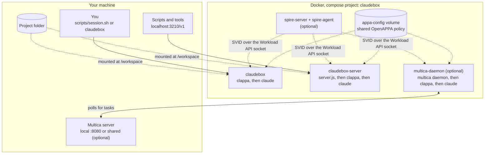
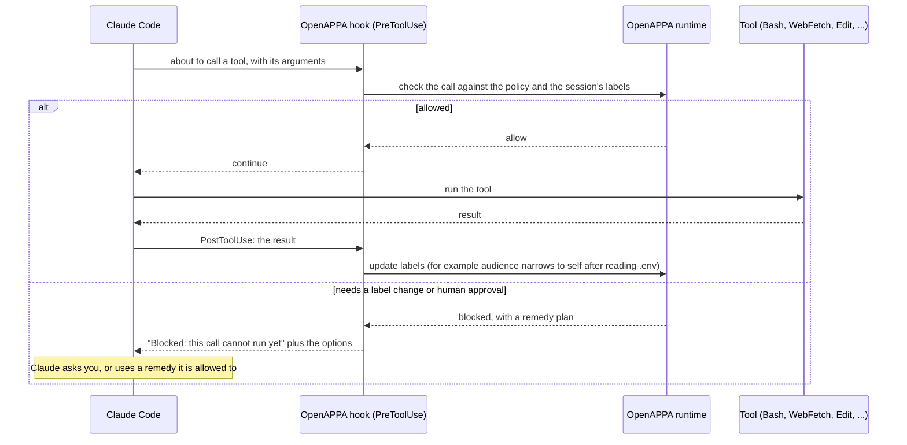

# ClaudeBox: design notes

This document records what ClaudeBox is for, how the pieces fit together, and why each
choice was made. [REFERENCE.md](REFERENCE.md) is the operating reference; this is the
background you need before changing anything.

## Goal

We want Claude Code to do real work on the organisation's projects, including work handed out by
Multica, without giving it the run of a developer's laptop. That breaks into three
questions, and each layer of ClaudeBox answers one of them:

| Question | Layer | Mechanism |
|---|---|---|
| What can the agent touch? | Sandbox | Docker container, one mounted project folder, unprivileged user |
| What is the agent allowed to do with what it has read? | Policy | OpenAPPA, enforced through Claude Code hooks |
| Which agent did this? | Identity | SPIFFE IDs issued by a local SPIRE server |

Multica sits on top as the scheduler: it assigns issues to agents, and the ClaudeBox
daemon picks them up and runs them inside the sandbox.

The sandbox and the policy are always on. They are the minimum we are willing to run an
agent with, so there is no switch for OpenAPPA, and a container whose OpenAPPA install fails
refuses to start. Multica and SPIFFE are optional: people can try ClaudeBox with neither,
and each one switches on without touching the others.

## Components

Every path into Claude goes through `clappa`, which turns OpenAPPA's hooks on for that session.
Dotted lines are mounts and sockets, not network calls.

All three ClaudeBox services use the same image and the same entrypoint. The entrypoint
does the same setup each time (Claude auth, Multica login, SVID fetch, OpenAPPA install)
and then runs whatever the service asked for.

| Service | What it runs | OpenAPPA | SPIFFE ID |
|---|---|---|---|
| `claudebox` | Claude Code CLI, interactive or `-p` | on | `spiffe://claudebox.local/claudebox/claudebox` |
| `claudebox-server` | OpenAI-compatible HTTP API (`server.js`) | on | `spiffe://claudebox.local/claudebox/claudebox-server` |
| `multica-daemon` (optional, `multica` profile) | `multica daemon start --foreground` | on | `spiffe://claudebox.local/claudebox/multica-daemon` |
| `spire-server` | SPIRE server, trust domain `claudebox.local` | n/a | n/a |
| `spire-agent` | SPIRE agent, issues SVIDs over a Unix socket | n/a | n/a |

## What was done, and why

### 1. Porting from Windows to macOS

The repo came from a Windows machine. Four things broke on a Mac.

`HOST_CLAUDE_DIR` pointed at the original developer's Windows profile. It now points at the
local `~/.claude`.

Compose used to bind-mount `.credentials.json` and `settings.json` as single files. macOS
Claude Code keeps credentials in the Keychain, so `.credentials.json` does not exist, and
Docker answers a missing bind source by creating a directory with that name on the host.
That would have left a directory at `~/.claude/.credentials.json` and could break the
host's own Claude Code. Compose now mounts the whole `~/.claude` folder read-only and the
entrypoint copies only the files that exist. Authentication on a Mac uses
`CLAUDE_CODE_OAUTH_TOKEN` from `claude setup-token` instead, which is also the more robust
option on Windows because the container never has to refresh a token.

The host `settings.json` carries hooks for tools that only exist on the Mac (agent-deck,
superset) and OTEL settings aimed at the host's localhost. Copied into the container, every
tool call would try to run a missing binary. The copy is therefore off by default
(`CLAUDEBOX_SEED_SETTINGS=0`); set it to `1` if your host settings are plain preferences.

`docker compose build` built the same image tag twice in parallel and failed on the race.
Only the `claudebox` service builds now; the others reuse its image.

Ports 3000 and 3100 were taken locally (Multica's web app and Loki), so the API server is
published on 3210 through `CLAUDEBOX_PORT`.

### 2. Making ClaudeBox a Multica runtime

Multica's daemon looks for agent CLIs such as `claude` on its `PATH`, registers each as a
runtime, and spawns it when a task arrives. It has no notion of a container. We considered
three ways to bridge that:

| Option | Verdict |
|---|---|
| Run the daemon inside the container | Chosen. No code changes, keeps the sandbox, daemon finds the container's `claude` naturally |
| A `claude` shim on the host that calls into Docker | Rejected. Host paths from the daemon don't exist in the container, and streaming/TTY behaviour is fragile |
| Add a ClaudeBox provider to Multica | Rejected for now. Cleanest result but touches several daemon layers in Multica's Go code |

The image now includes the Multica CLI and a `multica-daemon` service runs it. Details that
needed handling:

- The daemon reads its token only from `~/.multica/config.json` and ignores `MULTICA_TOKEN`
  in the environment. The entrypoint runs `multica login --token "$MULTICA_TOKEN"` on every start, so a
  changed token or server in `.env` takes effect on the next start, and keeps the config in
  the `multica-state` volume.
- By default the Multica server runs on the host, so the container reaches it at
  `host.docker.internal:8080`. `MULTICA_SERVER_URL` points it at a shared server instead.
- Fixed daemon ID and device name (`claudebox`) keep it distinct from the host's own daemon.
  It shows up as the runtime `Claude (claudebox)`.
- Self-update is off because the binary is baked into the image. Upgrading means a rebuild,
  which keeps the version under our control.
- Task checkouts go to the `multica-workspaces` volume, so they never land on the host.

### 3. OpenAPPA: policy on every tool call

The container limits what the agent can reach. It does nothing about what the agent does
with what it reads: an agent that reads a secret from the mounted project can still post it
to the internet, and an agent that reads a hostile web page can still act on its
instructions. That is the prompt-injection and data-exfiltration problem, and a sandbox
alone does not solve it.

[OpenAPPA](https://github.com/archestra-ai/OpenAPPA) addresses it by labelling data as the
session reads it and checking each tool call against a declarative TOML policy before the
call runs. Every session tracks two labels:

- Audience: who may see what the session has read (`self`, `internal`, `public`). Reading
  a `*.env*` file narrows it to `self`.
- Trust: whether the session has read text a stranger could have written. Fetching an
  arbitrary web page drops it to `suspicious`.

A call that would send `self` data to a public sink, or act on suspicious input where trust
is required, is blocked, and the model gets a remedy plan describing what it may do instead.
The decision is deterministic: the same event log always gives the same answer, which is
what makes it auditable. A classifier would only give a probability.

What happens on each tool call:

How it is wired in:

- `appa` is installed in the image from a pinned release (v0.31.1) with its SHA-256 checked
  at build time.
- On every start the entrypoint runs `appa plugin install claude-code`. It is idempotent and
  writes the hook entries into the container's Claude settings, the default policy, and the
  `clappa` launcher.
- The hooks stay inert unless Claude was started through `clappa`, so every path into
  Claude goes through it: the CLI execs `clappa`, `server.js` spawns it (`CLAUDE_BIN`), and
  the daemon is pointed at it through `MULTICA_CLAUDE_PATH`. Multica detects it as Claude
  Code, so the runtime looks the same from Multica's side.
- The policy and data live at OpenAPPA's default Linux paths (`~/.config/appa`,
  `~/.local/share/appa`). This matters: the default policy's self-protection rules (editing
  `*/appa/appa.toml` or `*/appa/batteries/*` needs human approval) only match those paths.
  An earlier layout under `~/.appa/` let Claude edit its own policy without approval; the
  OWASP review caught it (finding F1).
- The policy (`appa-config` volume) is shared so there is one policy to review. Each service
  has its own data volume (`appa-data-cli`, `appa-data-daemon`, `appa-data-server`), because
  each container runs its own OpenAPPA runtime and two runtimes should never write one
  SQLite event log.
- Services starting together contend for the policy's install lock, so the entrypoint
  retries for up to a minute.
- It started out off for `claudebox-server`, because that server's tool bridge kills the
  Claude session as soon as it captures a tool call. Tested with OpenAPPA on, plain
  completions and OpenAI-style tool calls both work, so it is now on there too.
- It is mandatory. An earlier version had a `CLAUDEBOX_APPA` switch; it was removed so that
  "running in ClaudeBox" always means "running under policy".

Verified: in the CLI container, `cat app.env` followed by a `WebFetch` to example.com had
the fetch blocked, and the model received the remedy plan.

### 4. Multica optional, OpenAPPA mandatory

So that people can try ClaudeBox without a Multica account, `multica-daemon` moved into a
compose profile and `MULTICA_TOKEN` is no longer required to parse the compose file. Starting
the daemon without a token stops with a one-line error instead of a restart loop of login
failures. At the same time the OpenAPPA switch was removed (see above).

For a team on macOS, Windows 11, WSL2 and Ubuntu, a few portability fixes went in:

- `scripts/` (`start`, `stop`, `status`, `session`, `use`, each as `.sh` and `.ps1`) wrap the
  Docker commands, and `bin/claudebox` / `bin/claudebox.ps1` run the box on the current folder
  from anywhere.
- `name: claudebox` pins the compose project name, which volume names and the SPIFFE
  selectors depend on, regardless of the folder the repo is cloned into.
- `.gitattributes` keeps scripts LF on Windows clones; a CRLF `entrypoint.sh` fails to start.
- `CLAUDEBOX_UID` / `CLAUDEBOX_GID` let Linux and WSL users build the image with their own
  uid so files written in the project stay theirs.
- `.env.example` defaults to port 3210 (3000 is Multica's web app) and does not copy host
  settings, since host hooks rarely work inside the container.

### 5. SPIFFE: an identity for each agent

Once several agents run in several places, logs and approvals need to say which agent did
something, and services the agents call need a way to tell them apart that does not depend
on a shared API key. [SPIFFE](https://spiffe.io/) gives each workload a short-lived,
automatically rotated identity (an X.509 certificate or a JWT) bound to where it runs,
without anyone handing out secrets.

Locally this is a SPIRE server and agent in the same compose project, trust domain
`claudebox.local`:

- The agent joins the server with a one-time join token. `spire/bootstrap.sh` generates it,
  starts the agent, and creates one registration entry per ClaudeBox service. The script is
  safe to re-run and only issues a new token if the agent cannot start from its stored state.
- Containers are identified by the Docker workload attestor, matching the compose labels
  `com.docker.compose.project=claudebox` and `com.docker.compose.service=<name>`. Any
  container that is not one of our three services gets nothing.
- That attestor needs `pid: host` and a read-only Docker socket on the agent, to map the
  calling process to its container.
- The agent socket is shared into every ClaudeBox container read-only. On start the
  entrypoint fetches the SVID into `~/.spiffe/`, exports `SPIFFE_ID`, and refreshes the files
  every 20 minutes (SVIDs live one hour). If SPIRE is not running, containers start normally
  and skip this.
- The `spire-agent` binary is copied into the image only as a Workload API client, for
  example to fetch a JWT for a given audience.

Verified: all three services receive their own SPIFFE ID.

SPIFFE is groundwork. Nothing checks these identities yet, because neither Multica nor
OpenAPPA can consume them. Their value arrives when a service we control (an MCP server, an
internal API, a model gateway) requires an SVID over mTLS or a JWT-SVID, and logs the
SPIFFE ID with each request.

## Known gaps

These are deliberate omissions or open problems. Fix them before using ClaudeBox beyond one
developer's machine.

| Gap | Why it matters | Possible fix |
|---|---|---|
| Network egress is unrestricted (F5) | OpenAPPA covers Claude's tools, but a process Claude starts can still reach anything | Port the upstream iptables allowlist (`claudebox/allowed-domains.txt`) |
| SPIRE agent uses `insecure_bootstrap` | Trusts the server on first contact | Ship the trust bundle to the agent, or use a real node attestor |
| SPIRE agent has `pid: host` and the Docker socket | Required by the docker attestor; broad access on the Docker VM | Acceptable locally; on Kubernetes use the k8s attestor instead |
| `MULTICA_TOKEN` is a personal access token | Multica actions from the box are attributed to that person | Create a dedicated service account and token for ClaudeBox |
| No git credentials in the container | Multica tasks on private repos fail to clone | Mount a deploy key or a scoped token per repo |
| No Multica task has run end to end through `clappa` yet | The runtime registers and detects `clappa`, but a full task under policy is unproven | Assign a test issue to an agent on `Claude (claudebox)` |
| OpenAPPA is a preview | Its config and wire formats may change without shims | Pin the version (done) and re-test before each upgrade |
| Client-executed tools on the API server | OpenAPPA sees `/v1` tool calls requested, but the HTTP client runs them outside the box | Treat the client as responsible for its own tools |
| SVIDs are issued but unused | No identity is checked anywhere yet | Make the first internal service require them |
| Login tokens readable inside the box (F2) | Commands Claude runs can read `CLAUDE_CODE_OAUTH_TOKEN` and `MULTICA_TOKEN` with `printenv`; sending them out still needs approval | OpenAPPA rules for `printenv`/`env`, unset `MULTICA_TOKEN` after login, egress filtering |
| No CPU, memory or process limits (F3) | A runaway task can take the whole Docker VM | `mem_limit`, `cpus`, `pids_limit` in `docker-compose.yml` |
| Supply chain (F4) | Only OpenAPPA's download is checksum-verified; two versions default to `latest`; base images pinned by tag | Verify checksums, pin versions and image digests, scan in CI |
| On a workspace laptop, a compromised Multica daemon controls the runs of every agent placed there | The launcher checks the agent and its placement with the broker, and accepts only Multica's own Claude options, but the daemon still chooses the agent, the prompt and the work folder | The broker also checks a live assignment for the task before a run starts (ARCHITECTURE.md D50, stage 4) |
| An agent's custom environment in Multica does not reach its runs | The launcher passes only Multica's task variables: a name such as `ANTHROPIC_BASE_URL` could send the sponsor's token elsewhere | The provisioner sets an agent's environment from the registry (ARCHITECTURE.md D37) |
| A stop does not end a run that has started, or revoke GitHub tokens already given out (up to one hour) | The stop switch refuses the next request only | The stop runbook (ARCHITECTURE.md D35); later, the launcher also polls the broker during a run |
| On a workspace laptop, the runner account owns every agent placed there, and a run's Multica task token acts for it | An agent that reads its task token (F2) can change another agent's instructions or MCP servers in Multica. The launcher accepts only remote MCP servers, so it cannot make another agent start a command, but it can still steer that agent | A provisioner account owns the agents, and runner accounts cannot edit them (ARCHITECTURE.md D37) |
| Runs and the daemon share each task's work folder | A run can leave symlinks or a crafted `.git` that the daemon later writes through or runs git in. The daemon pins `core.fsmonitor` and `core.hooksPath` off; other git settings that run commands remain | Do Multica's checkouts and context files in a separate container, or refuse work folders with symlinks or foreign git directories |
| Runs cannot use the daemon's local commands | `multica repo checkout` and other commands that call the daemon need `MULTICA_DAEMON_PORT` and `MULTICA_TASK_CONFIG_ROOT`, which runs do not get: the daemon listens only inside its own container | Agents clone with tokens from the broker (git credential helper, stage L5), or the launcher offers a narrow checkout service |
| One agent's sessions for all its issues share one volume | A prompt-injected run on one issue can edit the session or memory that the agent's run on another issue resumes | Mount only the session folder of the task's work folder |

[OWASP-LLM-TOP10.md](OWASP-LLM-TOP10.md) has the details of F1 to F5, and `tests/run.sh`
reports each open one as a `known` check on every run.

## Where to go next

1. Run a real Multica task on `Claude (claudebox)` and review what OpenAPPA logged and blocked.
2. Tune the policy with `/appa-guide` for the MCP servers and repos we use, add an
   `appa replay` test in `tests/policy/` for each rule, and run `tests/run.sh` in CI as a
   required check on `main`.
3. Add egress filtering so the sandbox and the policy cover the same ground.
4. Pick one internal service (an MCP server is the natural candidate) and require a JWT-SVID
   from ClaudeBox, logging the SPIFFE ID with each call. Done for one service, that gives
   identity, policy and audit for the same request.
5. Replace the personal Multica token with a service account.

## Files

| Path | Purpose |
|---|---|
| `Dockerfile` | Image: Claude Code, Multica CLI, OpenAPPA, SPIRE client, `claude` user |
| `entrypoint.sh` | Auth, Multica login, SVID fetch and refresh, OpenAPPA install, then the requested command |
| `docker-compose.yml` | The five services and their volumes |
| `server.js`, `mcp-bridge.js` | OpenAI-compatible API server and its tool bridge (from ArmanJR/claudebox) |
| `spire/server.conf`, `spire/agent.conf` | Local SPIRE configuration |
| `spire/bootstrap.sh` | Joins the agent and registers the ClaudeBox SPIFFE IDs |
| `.env` / `.env.example` | Local settings and secrets (`.env` is git-ignored) |
| `bin/claudebox`, `bin/claudebox.ps1` | Run the box on the current folder |
| `scripts/` | Start, stop, status, session and use wrappers (`.sh` and `.ps1`) |
| `ONBOARDING.md` | Setup guide for team members, per OS |
| `docs/REFERENCE.md` | Every service, setting and volume in detail |
| `docs/TESTING.md`, `tests/` | How to configure and test the sandbox and OpenAPPA; the test suite |
| `docs/OWASP-LLM-TOP10.md` | OWASP LLM Top 10 mapping, tests and findings |
| `claudebox/` | Vendored upstream project, for reference only |
