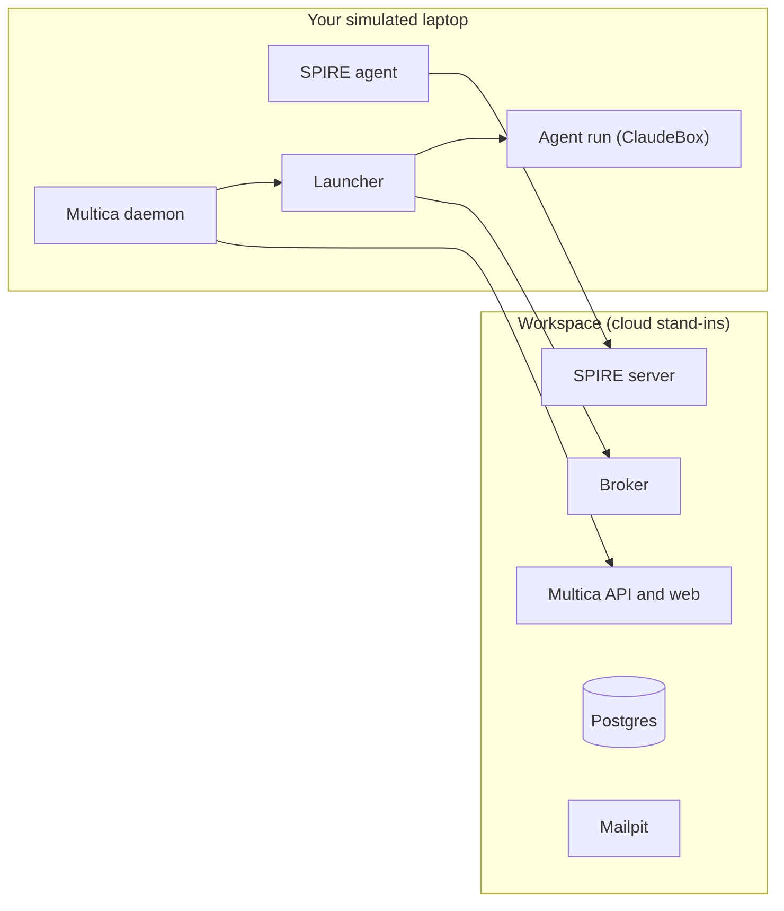

# Onboarding: run the workspace on your computer

This guide tells you how to run the full workspace on one computer. You can then test agents locally before we pay for the cloud. The guide is for macOS and Windows 11.

There are two ways to set up the workspace:

- **Fast:** do all the steps in this guide. You get a working workspace, with few explanations.
- **Learn while you build:** do steps 1 to 5 of this guide. Then do the [tutorial](tutorial.md). It builds the same workspace one part at a time, and explains each part.

## Contents

1. [What you get](#1-what-you-get)
2. [Requirements](#2-requirements)
3. [Prepare macOS](#3-prepare-macos)
4. [Prepare Windows 11](#4-prepare-windows-11)
5. [Get the repository](#5-get-the-repository)
6. [Start the workspace](#6-start-the-workspace) and [the local addresses](#the-local-addresses)
7. [Sign in to Multica](#7-sign-in-to-multica)
8. [Add your Claude token](#8-add-your-claude-token)
9. [Start your laptop](#9-start-your-laptop)
10. [Add an agent](#10-add-an-agent)
11. [Run the checks](#11-run-the-checks)
12. [Give the agent a task](#12-give-the-agent-a-task)
13. [Optional: give the agent a GitHub App](#13-optional-give-the-agent-a-github-app)
14. [Stop, start and reset](#14-stop-start-and-reset)
15. [Troubleshooting](#15-troubleshooting)
16. [Safety rules](#16-safety-rules)

## 1. What you get

You get two groups of containers:

- **The workspace.** These containers are local copies of the cloud services: Multica, Postgres, Mailpit, the SPIRE server and the credential broker.
- **One simulated laptop.** These containers are the parts that run on a team member's laptop: a SPIRE agent, a Multica daemon and the launcher. The launcher starts a new ClaudeBox container for each agent run.



All ports open on `127.0.0.1` only. Other computers on your network cannot connect to them.

The full setup takes about 30 minutes. Most of this time is the first image build.

## 2. Requirements

| Item | Requirement |
|---|---|
| Computer | macOS 14 or later (Apple silicon or Intel), or Windows 11 |
| Memory and CPUs | 16 GB. Give Docker at least 8 GB and 4 CPUs. Each agent run can use 2 CPUs and 4 GB. |
| Disk encryption | FileVault (macOS) or BitLocker (Windows) must be on. Agent work stays on your disk ([threat-model.md](threat-model.md), TM-DD2). |
| Disk | 30 GB free |
| Docker | Docker Desktop with Docker Engine 26 or later and Compose 2.24 or later |
| Accounts | A GitHub account in the organisation, and a Claude Team seat |
| Tools | `git`, `curl`, `openssl`, `python3` and `bash`. Go 1.26 or later is necessary only to run the Go tests. |

On Windows, you run all commands in Ubuntu on WSL 2. The scripts are bash scripts. They do not run in PowerShell.

## 3. Prepare macOS

Do these steps in Terminal.

1. Install the Apple command line tools. This gives you `git`, `curl` and `python3`.

   ```sh
   xcode-select --install
   ```

2. Install [Docker Desktop for Mac](https://docs.docker.com/desktop/setup/install/mac-install/).
3. Open Docker Desktop. Go to **Settings > Resources**. Set **Memory** to 8 GB or more.
4. Install Claude Code:

   ```sh
   curl -fsSL https://claude.ai/install.sh | bash
   ```

5. Optional: install Go to run the Go tests.

   ```sh
   brew install go
   ```

6. Make sure that the tools work:

   ```sh
   docker version --format '{{.Server.Version}}'
   docker compose version
   git --version
   python3 --version
   claude --version
   ```

Go to [step 5](#5-get-the-repository).

## 4. Prepare Windows 11

1. Open PowerShell as administrator. Install WSL 2 with Ubuntu:

   ```powershell
   wsl --install -d Ubuntu
   ```

2. Restart the computer. Open **Ubuntu** from the Start menu. Make a Linux user name and password.
3. Install [Docker Desktop for Windows](https://docs.docker.com/desktop/setup/install/windows-install/). Select the WSL 2 backend during the installation.
4. Open Docker Desktop. Go to **Settings > Resources > WSL integration**. Turn on the integration for **Ubuntu**.
5. In the same window, go to **Settings > Resources > Advanced** if it is there. Set **Memory** to 8 GB or more. If the setting is not there, WSL controls the memory. Then add these lines to `C:\Users\<you>\.wslconfig` and run `wsl --shutdown` in PowerShell:

   ```ini
   [wsl2]
   memory=8GB
   ```

6. Do all the steps that follow in the **Ubuntu** window, not in PowerShell. Install the tools:

   ```sh
   sudo apt update
   sudo apt install -y git curl openssl python3
   ```

7. Install Claude Code in Ubuntu:

   ```sh
   curl -fsSL https://claude.ai/install.sh | bash
   ```

8. Optional: install Go to run the Go tests. Use the Linux instructions on [go.dev/doc/install](https://go.dev/doc/install).
9. Make sure that the tools work:

   ```sh
   docker version --format '{{.Server.Version}}'
   docker compose version
   git --version
   python3 --version
   claude --version
   ```

Important points for Windows:

- Keep the repository in the Linux file system, for example `~/code/workspace`. Do not put it under `/mnt/c`. Docker is slow there, and the files lose their permissions.
- Your Windows browser can open the local addresses, for example [http://localhost:3000/login](http://localhost:3000/login). Docker Desktop forwards the ports to Windows.
- We have not yet tested the full setup on Windows. Tell us what works and what does not.

## 5. Get the repository

1. Make sure that Git can connect to GitHub. If you use SSH, add an SSH key in Ubuntu (Windows) or in Terminal (macOS). Refer to [GitHub's SSH guide](https://docs.github.com/en/authentication/connecting-to-github-with-ssh).
2. Clone the repository:

   ```sh
   mkdir -p ~/code && cd ~/code
   git clone git@github.com:example-org/workspace.git
   cd workspace
   ```

3. Choose a name for your simulated laptop. Use the format `<person>.<machine>`, in lower case. Examples: `jane.mac`, `jane.win`. Set it in your shell. You use it in many steps:

   ```sh
   LAPTOP=jane.mac
   ```

   If you open a new terminal, set `LAPTOP` again.

## 6. Start the workspace

1. Start the workspace containers:

   ```sh
   local/scripts/up.sh
   ```

   On the first run, the script does these things:
   - It makes `local/.env` with a new secret.
   - It makes a local certificate authority for the laptops in `local/.state/node-ca/`.
   - It makes an empty broker rules file, `local/.state/broker/rules.json`.
   - It starts the containers and checks them.

2. Make sure that all lines in the output show `ok`.
3. Open `local/.env`. Set `SPONSOR_EMAIL` to your own `@example.com` address. This address owns your local Multica workspace. Sign in to Multica with the same address in step 7.

   ```sh
   SPONSOR_EMAIL=jane@example.com
   ```

You can use any `@example.com` address. No real mail is sent. Mailpit catches all mail.

### The local addresses

Use these addresses to look at the services. They work only on your computer.

| Service | Address | What you can do there |
|---|---|---|
| Multica (sign in) | [http://localhost:3000/login](http://localhost:3000/login) | Sign in. Make issues, assign them to agents and read the results. |
| Multica (product page) | [http://localhost:3000](http://localhost:3000) | Nothing. This is Multica's product page. Use the sign-in address. |
| Mailpit | [http://localhost:8025](http://localhost:8025) | Read all the mail that Multica sends, for example the sign-in codes. |
| Multica API | [http://localhost:8080/readyz](http://localhost:8080/readyz) | See if the Multica server is ready. |
| Broker | [http://localhost:8443/healthz](http://localhost:8443/healthz) | See if the broker can read its rules and the stop switch. `{"status":"ok"}` is correct. |
| Broker UI (agentgateway) | [http://localhost:15000/ui](http://localhost:15000/ui) | See the broker's listener, routes and the check of the agents' identities. Read-only: change `local/agentgateway/config.yaml` instead. |
| SPIRE server | `localhost:8081` | Nothing in a browser. Laptops connect here. Use Tornjak (next line) or the `spire-server` commands in the [tutorial](tutorial.md#lesson-4-spire-who-is-running). |
| Tornjak (SPIRE web view) | [http://localhost:3001](http://localhost:3001) | See the SPIRE server, the laptops and the registration entries. Refer to [Tornjak](#tornjak). |
| Postgres | `localhost:55432` | Connect with a database tool. User `workspace`, password `workspace`, databases `multica`, `spire`, `assignments` and `broker`. |

Important: **Multica sends all mail to Mailpit, not to a real mailbox.** Look for the sign-in codes at [http://localhost:8025](http://localhost:8025).

Other services, for example the credential service and `spire-oidc`, are on the private network only. You cannot open them from your computer. This is the same as in the cloud.

To use Postgres without a database tool, run:

```sh
docker compose -f local/docker-compose.yml exec postgres psql -U workspace -d multica
```

If you changed a port in `local/.env`, use your port in the address.

### Tornjak

Tornjak is a web view of the SPIRE server. It shows the laptops (SPIRE agents), the registration entries and the server's identity.

`up.sh` starts Tornjak with the workspace. Open [http://localhost:3001](http://localhost:3001).

Tornjak is read-only here. Tornjak's own API can create and delete registration entries, has no sign-in, and answers all web pages. So it has no port on your computer. The proxy `tornjak-api` on port 10000 is the only way to it. The proxy lets only reads through, and only Tornjak's own page can read the answers ([threat-model.md](threat-model.md), TM-T6). If you try to make, delete or ban something in Tornjak, it shows an error (`403`).

The scripts make the registration entries (in the cloud, the provisioner makes them).

## 7. Sign in to Multica

1. Open Mailpit at [http://localhost:8025](http://localhost:8025). Keep it open. Your sign-in code comes here, not to your real mailbox.
2. Open the Multica sign-in page at [http://localhost:3000/login](http://localhost:3000/login). Do not use `http://localhost:3000`. That address shows Multica's product page.
3. Enter your `SPONSOR_EMAIL` address.
4. Find the mail in Mailpit. Copy the 6-digit code into Multica.

The workspace **Example (local)** does not exist yet. Step 9 makes it. If Multica asks you to make a workspace, do not make one.

## 8. Add your Claude token

Agent runs use your Claude Team seat. The token stays on your computer. Do not paste it in a chat, a ticket or a commit.

1. Make a token. A browser window opens. Sign in with your Team seat.

   ```sh
   claude setup-token
   ```

   The command shows a token that starts with `sk-ant-oat`. Copy it.

2. Put the token in the laptop's token file. The command asks for the token and does not show it on the screen:

   ```sh
   mkdir -p local/.state/laptops/$LAPTOP
   printf 'Token: '; read -rs t; echo
   (umask 077; printf 'CLAUDE_CODE_OAUTH_TOKEN=%s\n' "$t" > local/.state/laptops/$LAPTOP/claude.env); unset t
   ```

3. Make sure that only you can read the file:

   ```sh
   ls -l local/.state/laptops/$LAPTOP/claude.env
   ```

   The permissions must be `-rw-------`.

## 9. Start your laptop

1. Start the simulated laptop:

   ```sh
   local/scripts/laptop.sh up $LAPTOP
   ```

   The script does these things:
   - It gives the laptop a machine certificate from the local certificate authority.
   - It makes the Multica workspace (if necessary) and a runner account for this laptop.
   - It registers the launcher's identity in SPIRE.
   - It builds the ClaudeBox image. The first build takes 5 to 15 minutes.
   - It starts the SPIRE agent, the launcher and the Multica daemon.

2. The output ends with `laptop <name> is up`.
3. In Multica, refresh the page. Open the workspace **Example (local)**. Open **Runtimes**. Your laptop shows as a machine with the name of your laptop (`daemon <laptop>`). It can take one minute to show as online. The machine has one runtime, **Claude** (Built-in), and no agents yet. You add an agent in step 10.

Your own account is the workspace owner. The runner account (`runner-<person>-<machine>@example.com`) is a member. Only the daemon uses the runner account.

## 10. Add an agent

An agent needs three things: a Multica agent, a SPIRE registration and an entry in the broker rules. The script does the first two. You do the third, because a person always decides which agent may run.

1. Make the agent. This example makes an agent with the name `ada`:

   ```sh
   local/scripts/agent.sh ada $LAPTOP "You are Ada, a developer. Keep changes small and explain them."
   ```

   Agent names start with a letter and use only lower case letters, digits and hyphens.

2. Open `local/.state/broker/rules.json`. Add the agent. Set `placement` to your laptop name and `sponsor` to your name:

   ```json
   {"agents": {
     "ada": {"status": "active", "sponsor": "jane", "placement": "jane.mac"}
   }}
   ```

   The broker reads the file again on each request. You do not need to restart it.

3. Make sure that the broker can read the rules:

   ```sh
   curl -s http://localhost:8443/healthz
   ```

   The result must be `{"status":"ok"}`. If the file has an error, the result tells you the problem, and the broker refuses all agents until you correct it.

## 11. Run the checks

Run the checks for the workspace and the laptop:

```sh
local/scripts/check.sh
local/scripts/smoke-l1.sh
local/scripts/smoke-l4.sh $LAPTOP
```

All lines must show `ok`. `smoke-l4.sh` changes the rules file for a short time. It puts your file back when it ends.

Then run the threat tests. They check the controls in [threat-model.md](threat-model.md):

```sh
local/scripts/smoke-threats.sh $LAPTOP
```

No line may show `FAIL`. Lines that show `known` are open threats that we know about, for example TM-S1. They are not failures. The [tutorial](tutorial.md#test-the-threats) explains each result.

To run all the tests of the repository, run the commands in the **Checks** table in [CLAUDE.md](../CLAUDE.md#checks). The Go tests need Go.

## 12. Give the agent a task

1. In Multica, make an issue. For example: "Write a haiku about containers in a file `haiku.md`."
2. Assign the issue to **ada**.
3. Watch the launcher start the run:

   ```sh
   local/scripts/laptop.sh compose $LAPTOP logs -f launcher
   ```

   You see `started`, then `finished`. Each run has its own container, `run-ada-<random>`. Push Ctrl+C to stop the log.

4. In Multica, the agent adds a comment and changes the status of the issue.

If the run fails with "Not logged in", the token file is missing or wrong. Do step 8 again, then do step 9 again.

## 13. Optional: give the agent a GitHub App

Each agent has its own GitHub App. The broker uses the App to give the agent a GitHub token for one hour. Do this step only if you test GitHub access.

1. Make the App. Use your agent name and one of the roles `developer`, `reviewer` or `orchestrator`:

   ```sh
   python3 local/scripts/github-app.py create ada developer
   ```

2. Your browser opens. On Windows, the browser can fail to open from Ubuntu. Then open the address that the script shows.
3. On GitHub, approve the App. The App has the name `ws-local-<agent>`.
4. Install the App on the repository **example-org/workspace-sandbox** only. Do not install it on all repositories.
5. Find the installation ID:

   ```sh
   python3 local/scripts/github-app.py installation ada
   ```

6. Ask a team lead to add the `github` part of the agent's rules. Refer to [broker/README.md](../broker/README.md).
7. When you stop testing, delete the App on GitHub: **Organization settings > GitHub Apps**.

The App's private key is in `local/.state/github/`. Do not copy it to other places.

## 14. Stop, start and reset

| Task | Command |
|---|---|
| Stop the laptop | `local/scripts/laptop.sh down $LAPTOP` |
| Start the laptop again | `local/scripts/laptop.sh up $LAPTOP` |
| Remove the laptop completely (for example, after a wrong laptop name) | `local/scripts/laptop.sh remove $LAPTOP` |
| Stop the workspace | `docker compose -f local/docker-compose.yml down` |
| Start the workspace again | `local/scripts/up.sh` |
| Stop an agent at once | `docker compose -f local/docker-compose.yml exec -T credential-service /credential-service stop ada jane "reason"` |
| Let the agent run again (say who you are) | `docker compose -f local/docker-compose.yml exec -T credential-service /credential-service start ada jane` |
| Show who stopped and started the agent | `docker compose -f local/docker-compose.yml exec -T credential-service /credential-service history ada` |

To delete everything and start again, run the reset script:

```sh
local/scripts/reset.sh
```

The script shows what it will delete and asks you to type `reset`. It deletes:

- All simulated laptops, their agent runs and their sessions.
- The workspace services and all their data: Multica, SPIRE, the stop switch.
- `local/.state/` and `local/.env`: the certificates, the tokens, the rules and your Claude token.

It keeps the Docker images, so the next start is fast. It does not touch other Docker containers or volumes on your computer. To see what it would delete without deleting, run `local/scripts/reset.sh --dry-run`.

If you made GitHub Apps (step 13), delete them on GitHub too. The script deletes only their keys.

Then do this guide again from [step 6](#6-start-the-workspace), or do the [tutorial](tutorial.md).

## 15. Troubleshooting

| Problem | Cause and fix |
|---|---|
| `up.sh` fails with "port is already allocated" | Another program uses port 3000, 3001, 8080, 8025, 8081, 8443, 10000, 15000 or 55432. Stop that program, or change the port in `local/.env`. |
| `JWT_SECRET` error | Run `local/scripts/up.sh`, not `docker compose up`. The script makes `local/.env`. |
| The sign-in code does not arrive | Multica sends it to Mailpit, not to your real mailbox. Open [http://localhost:8025](http://localhost:8025). |
| You cannot see the workspace **Example (local)** in Multica | You signed in with an address that is not `SPONSOR_EMAIL` in `local/.env`. Sign out, and sign in with that address. Or set `SPONSOR_EMAIL` to your address before step 9. |
| Tornjak shows no data, or an error when it loads | The backend is not running. Run `local/scripts/up.sh` again, then look at `docker compose -f local/docker-compose.yml logs tornjak-api tornjak-backend`. |
| Tornjak shows `403` when you create, delete or ban | This is correct: Tornjak is read-only. The scripts make the entries. |
| "sign-in rate limit; waiting 15s" | Multica permits 5 sign-in codes each minute for one address. The script waits. |
| `agent.sh` says "no Claude runtime" | The laptop is not up, or the daemon is not online yet. Wait one minute. Then run `laptop.sh up` again. |
| The launcher log shows `refused` with `unknown_agent` | The agent is not in `rules.json`. Do step 10. |
| The launcher log shows `wrong_placement` | `placement` in `rules.json` is not your laptop name. |
| The launcher log shows `rules_unavailable` | `rules.json` has an error. Run `curl -s http://localhost:8443/healthz` to see the error. |
| The launcher log shows `bad_args` | The agent has extra Claude arguments in Multica. A run accepts only the arguments that Multica sets. Remove the extra arguments from the agent. |
| A run says "Not logged in" | The Claude token is missing or wrong. Do steps 8 and 9 again. |
| `volume-subpath` error | Docker Engine is older than version 26. Update Docker Desktop. |
| `!override` or `!reset` error | Docker Compose is older than 2.24. Update Docker Desktop. |
| Windows: scripts fail with `$'\r': command not found` | The files have Windows line ends. Clone the repository again in Ubuntu, not in Windows. |
| Windows: Docker commands fail in Ubuntu | Turn on the WSL integration for Ubuntu in Docker Desktop (step 4 of [Prepare Windows 11](#4-prepare-windows-11)). |

## 16. Safety rules

- Do not commit `local/.state/` or `local/.env`. Git ignores them. Do not change this.
- Do not share your Claude token. It stays in `local/.state/laptops/<laptop>/claude.env`.
- Keep disk encryption on. Agent sessions and work folders stay on your disk.
- Do not use real client data or personal data in the local workspace. Agents send all that they read to Anthropic ([threat-model.md](threat-model.md), TM-DD1).
- Know that each program on your computer that can use Docker can act as your agents (TM-S1). Keep your computer up to date, and do not run software that you do not trust.
- All members of the Multica workspace can see when your runtime is online, and thus when your laptop is on (TM-DT1).
- Do not give an agent more access than the test needs. Install GitHub Apps on `example-org/workspace-sandbox` only.
- Do not change the access rules in the repository (`broker/` rules, `.github/`, `CODEOWNERS`, `.claude/settings.json`) to give an agent more access. A person must approve these changes in a pull request.
