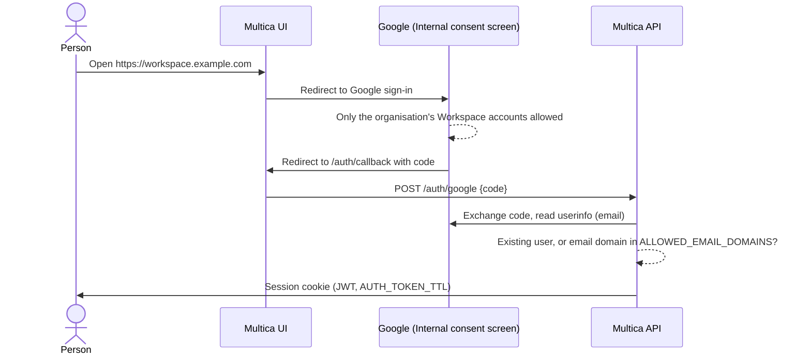

# Workspace infrastructure plan

Status: planning. We revised this plan after the solutions-architect and devil's-advocate reviews (2026-10-10), and again after the threat model (2026-10-12, [threat-model.md](threat-model.md)). The findings and resolutions are in [ARCHITECTURE.md, Appendix G](../ARCHITECTURE.md#appendix-g-review-findings-and-how-they-were-resolved). Nothing is deployed yet.

This plan tells what the Terraform in `infrastructure/` builds in the cloud, and in which sequence. [ARCHITECTURE.md](../ARCHITECTURE.md) tells **why** each part exists. This document tells **what** we deploy and **how**.

## Contents

- [Scope](#scope)
- [Target infrastructure](#target-infrastructure)
- [Infrastructure decisions](#infrastructure-decisions)
- [Open infrastructure questions](#open-infrastructure-questions)
- [Deployment details](#deployment-details): account and network, DNS, Terraform and CI/CD, Multica, people's sign-in, Multica's email, agent runtimes on laptops, SPIRE, credential broker, assignment service, provisioner, orchestrator, agent email, observability, backups, retention
- [Cloud resources](#cloud-resources)
- [Cost](#cost)
- [Stages](#stages)
- [Work in other folders of this repo](#work-in-other-folders-of-this-repo)
- [Work outside this repo](#work-outside-this-repo)
- [Later](#later)

## Scope

| Service | Architecture layer | Deployed by Terraform | Stage |
|---|---|---|---|
| Account, network, DNS, audit, budgets | — | Yes | 1 |
| Multica (UI, API, database) | [6. Work](../ARCHITECTURE.md#56-work-what-agents-work-on) | Yes | 2 |
| SPIRE servers, node CA, public SPIRE endpoint | [2. Identity](../ARCHITECTURE.md#52-identity-proving-who-is-running) | Yes | 3 |
| Agent runtimes on sponsors' laptops (ClaudeBox, launcher) | [7. Execution](../ARCHITECTURE.md#57-execution-where-agents-run) | No. `claudebox/` builds them, and they run on laptops. The cloud account supplies SPIRE, the broker and Multica | 3 |
| Credential broker (agentgateway, credential service) | [4. Access](../ARCHITECTURE.md#54-access-reaching-systems-without-holding-secrets) | Yes (images from `broker/`) | 3 |
| Provisioner | [1. Registry](../ARCHITECTURE.md#51-registry-who-our-agents-are) | Yes (image from the `agent-registry` repo) | 3 |
| Orchestrator | [6. Work](../ARCHITECTURE.md#56-work-what-agents-work-on) | Yes (image from `orchestrator/`) | 3 |
| Assignment service | [6. Work](../ARCHITECTURE.md#56-work-what-agents-work-on) | Yes (image from `broker/`) | 4 |
| Dedicated VM agent hosts (optional) | [7. Execution](../ARCHITECTURE.md#57-execution-where-agents-run) | Yes | 6 |
| Agent email forwarding (cloud email receiving) | [5. Communication](../ARCHITECTURE.md#55-communication-receiving-and-sending-messages) | Yes | 7 |
| Agent mailboxes (Stalwart, mail tools) | [5. Communication](../ARCHITECTURE.md#55-communication-receiving-and-sending-messages) | Yes, only for a named workflow | 8 |
| Agent registry | [1. Registry](../ARCHITECTURE.md#51-registry-who-our-agents-are) | No. It is in `example-org/agent-registry` | — |

## Target infrastructure

The diagram shows the state after stage 5. Agents run on the laptops of their sponsors. The cloud account hosts the shared services. Mail (stages 7–8) adds cloud email receiving and Stalwart.

```mermaid
flowchart TB
    browser["Browser<br/>(people of the organisation)"]
    gdns["Google DNS<br/>example.com<br/>(NS delegation only)"]
    outside["GitHub, Linear, Google"]
    anthropic["Anthropic API<br/>(sponsors' Team seats)"]

    subgraph laptops["Sponsors' laptops"]
        subgraph lp1["Alex's laptop"]
            cb1["ClaudeBox: Multica daemon<br/>+ launcher, SPIRE agent"]
            ada["Ada's run<br/>(fresh container)"]
        end
        subgraph lp2["Colleague's laptop"]
            cb2["ClaudeBox: Multica daemon<br/>+ launcher, SPIRE agent"]
            grace["Grace's run<br/>(fresh container)"]
        end
    end

    subgraph org["Cloud organisation"]
        prod["Production account<br/>(untouched)"]
        subgraph ws["New account: workspace"]
            r53["Cloud DNS<br/>workspace.example.com<br/>agents.example.com"]
            subgraph net["Private network 10.20.0.0/16, zones a and b"]
                subgraph public["Public subnets"]
                    waf["WAF"]
                    lb7["HTTPS load balancer :443"]
                    lb4["TCP load balancer :8081<br/>spire.workspace.example.com"]
                    nat["NAT gateway (zone a)"]
                end
                subgraph private["Private subnets: container cluster 'workspace' (serverless)"]
                    ui["multica-ui"]
                    api["multica-api"]
                    spire["spire-server x2<br/>+ Tornjak sidecar"]
                    subgraph broker["credential-broker x2"]
                        agw["agentgateway"]
                        cred["credential service"]
                    end
                    assign["assignment-service x2"]
                    prov["provisioner (task)"]
                    orch["orchestrator"]
                end
                pg[("Managed PostgreSQL 17<br/>multica, spire, assignments")]
            end
            kms["KMS: node CA, assignment<br/>signing, GitHub App keys"]
            sm["Secret store"]
            objs[("Object storage: state, uploads,<br/>registry index, audit (object lock)")]
            mailsvc["Email service (workspace.example.com)"]
            ct["Audit log, logs and metrics,<br/>budgets"]
        end
    end

    gdns -.->|"NS"| r53
    browser --> waf --> lb7
    lb7 -->|"default"| ui
    lb7 -->|"/ws, /api/daemon/ws"| api
    lb7 -->|"broker.*"| agw
    ui --> api
    api --> pg
    api -->|"SMTP"| mailsvc
    cb1 & cb2 -->|"daemon (HTTPS, WebSocket)"| lb7
    cb1 & cb2 -->|"launcher check, credentials"| lb7
    cb1 & cb2 -->|"SPIRE (mTLS)"| lb4
    lb4 --> spire
    cb1 --> ada
    cb2 --> grace
    ada & grace -->|"model calls"| anthropic
    agw --> cred
    agw --> assign
    cred --> kms
    cred --> sm
    assign --> pg
    assign --> kms
    spire --> pg
    prov -->|"reconciles"| api
    prov --> spire
    orch --> api
    orch --> assign
    agw --> nat
    cred --> nat
    orch --> nat
    nat --> outside
```

## Infrastructure decisions

The architecture decisions are in [ARCHITECTURE.md](../ARCHITECTURE.md#9-architecture-decisions). The status "Revised" identifies decisions that we changed after the review.

| # | Decision | Status | Notes |
|---|---|---|---|
| D1 | **Agents run on their sponsors' laptops**: each laptop has one ClaudeBox (one Multica runtime, several agents). Each run uses a fresh container. Dedicated VM hosts are optional later | Confirmed (2026-10-10) | Architecture D14, D38, D49, D50 |
| D2 | Shared services run on serverless containers, with managed PostgreSQL for data | Decided | One container cluster, `workspace`. VM capacity only if stage 6 is done |
| D3 | People sign in to Multica with its built-in Google sign-in. Sign-in is limited to the organisation's Google Workspace | Decided | |
| D4 | Only people of the organisation have access to Multica | Decided | Consent screen set to Internal, and `ALLOWED_EMAIL_DOMAINS` |
| D5 | **A separate cloud account, `workspace`, in the existing cloud organisation, with its own private network** | Confirmed (2026-10-10) | Replaces "use the existing production network". We do not change production. Later, support agents connect to production through a narrow, explicit connection (a private endpoint or peering) that gives access only to what they need. The NAT gateway costs about $35–45 a month extra. |
| D6 | Domains: Multica uses `workspace.example.com`. The credential broker uses `broker.workspace.example.com`. SPIRE uses `spire.workspace.example.com`. Agents' mail uses `agents.example.com` | Decided | SPIFFE trust domain `workspace.example.com` |
| D7 | **Delegate `workspace.example.com` and `agents.example.com` to cloud DNS** in the workspace account | Confirmed (2026-10-10) | We add four NS records for each subdomain in Google DNS one time. Terraform manages all records below the subdomains. Resolves Q1. |
| D8 | A new Multica instance, with no data migration | Decided | |
| D9 | Terraform state in an object storage bucket in the workspace account, `workspace-v1-tf-state` | Decided | The `bootstrap/` root creates it |
| D10 | **The cloud email service in the workspace account**, sending as `workspace.example.com` (Multica) and later `agents.example.com` | Revised | This keeps the sending reputation and quota of the production account separate. We must request production sending access for the new account (Q31). |
| D11 | No Redis | Decided | One Multica API replica. A WAF rate limit replaces the login rate limit of Multica |
| D12 | SPIRE node attestation: `x509pop` (machine certificates) for laptops, from the first slice. Cloud instance identity for VM hosts, if stage 6 is done | Confirmed (2026-10-10) | |
| D13 | Naming | Decided | Account `workspace`; container cluster `workspace`; container registry `workspace-v1/<component>`; secret store `workspace-v1/<name>`; KMS aliases `alias/workspace-v1/<name>`; other resources `workspace-v1-` |
| D45 | **Terraform in three roots** (`bootstrap/`, `foundation/`, `services/`). GitHub Actions with OIDC runs `plan` on pull requests, and runs `apply` after a person approves. A person approves every merge to this repo (architecture D51) | New | |
| D46 | **Observability and audit from stage 1:** the cloud audit log, an audit bucket with object lock (1 year), log retention, alarms, cloud budgets | New | |
| D47 | **Backups and recovery:** database point-in-time recovery (14 days), deletion protection, a quarterly restore test; KMS keys protected against deletion; recovery targets 4 hours (time) and 1 hour (data) | New | A multi-zone database when agents depend on it daily |
| D52 | **Tornjak shows the SPIRE servers to people.** Its backend runs as a sidecar in each `spire-server` task. It has no public address. A workspace admin reaches it through a port-forwarding session of the container platform and runs the Tornjak UI on their own computer | New (2026-10-11) | Tornjak can change every registration entry through the server's admin socket. So people use it to look, and the provisioner stays the only writer (D37): its hourly run reports and removes entries that are not in the registry. A read-only proxy in the sidecar is the only way to Tornjak's API: it lets only `GET` through, and only from the Tornjak UI's origin (TM-T6; resolves Q37) |
| D48 | The broker code (credential service, assignment service, mail tools) is in `broker/`, in the workspace repo, where a person approves every merge. People make its releases by hand | Revised (2026-10-11) | Was Q13. Was a separate `credential-broker` repo; see architecture D51 |

## Open infrastructure questions

The architecture questions are in [ARCHITECTURE.md](../ARCHITECTURE.md#10-open-architecture-questions).

| # | Question | Recommendation |
|---|---|---|
| Q31 | Who creates the workspace account in the cloud organisation, and how soon can production email sending be granted there? | An organisation admin creates it. Request production sending access immediately after the account exists, because approval can take a day or more. |
| Q32 | When does a package mirror replace direct access to package registries from laptops? | After stage 3. Use a managed package repository, with short-lived tokens that the broker mints, so that agents cannot publish packages. |
| Q17 | Stalwart or e2a for mailboxes? | Decide at stage 8, if a named workflow needs mailboxes. |
| Q36 | When do the orchestrator's releases move from `example-org/orchestrator` to `example-org/workspace`? | `scripts/run-local.sh`, the self-update of `onboard`, and the `check` launcher in project repos (from the kit) download releases from `example-org/orchestrator`. Change these three to `example-org/workspace`. Then publish one last release in `example-org/orchestrator` with that change, so that installed copies move over, and archive that repo. The release workflow here continues at v0.5.0. Only the orchestrator publishes GitHub releases; the other parts publish images to the container registry, so "latest release" stays the orchestrator's. |

Resolved: Q1 (DNS delegation, D7), Q2 (separate account, D5), Q12 (moved into stage 0 checks), Q13 (D48), Q18 (cloud email receiving first, stage 7), Q37 (a read-only proxy in front of Tornjak, D52).

## Deployment details

### Account and network

- **Account:** `workspace`, a member of the cloud organisation. An organisation admin creates the account one time. Then Terraform creates all other resources.
- **Private network:** `10.20.0.0/16`. We chose a range that does not overlap production. Thus a later connection to production is possible.
- **Subnets:** public and private subnets in zones a and b. One NAT gateway in zone a. Add a second NAT gateway only if the workspace must continue to operate during a zone outage.
- **Endpoints:** a private endpoint for object storage (container image layers come from object storage). Private endpoints only for KMS and the secret store, because each GitHub token request uses KMS.
- **Security groups** allow only the traffic that the arrows in the diagram show. Only agentgateway can connect to the credential service and the assignment service. The public TCP load balancer forwards only port 8081 to SPIRE.

### DNS

- `example.com` stays in Google. We delegate two subdomains to cloud DNS in the workspace account. To do this, we add their NS records in Google one time (D7).
- Terraform manages all records below the two subdomains: managed certificate validation, the load balancer records, and later the mail records (MX, SPF, DKIM, DMARC, custom MAIL FROM).
- This removes the manual record steps and the first `apply` in two steps.

| Zone | Records |
|---|---|
| `workspace.example.com` | Apex and `broker` → HTTPS load balancer (alias); `spire` → public TCP load balancer (alias); certificate validation; DKIM for Multica's email |
| `agents.example.com` | Stage 7: MX → cloud email inbound; SPF, DKIM, DMARC, custom MAIL FROM. Stage 8: MX → mail load balancer |

### Terraform and CI/CD

- **Roots (D45):**
  - `bootstrap/` (state bucket, GitHub OIDC roles; local state, run one time);
  - `foundation/` (network, DNS, KMS, database, load balancers, WAF, audit; changes rarely, protected with `prevent_destroy`);
  - `services/` (container services, task definitions, IAM for each service; changes frequently).
- **Pipeline:** GitHub Actions with OIDC. It runs `plan` on every pull request. It runs `apply` after a person approves in a protected environment. Variables pin the image digests, and a pull request changes them.
- **Agents work in this repo, but a person approves every merge** (architecture D51). The ruleset on `main` requires the approval of a human code owner on all paths, and an agent's approval does not count. The orchestrator does not merge in this repo.
- **Workflows run only for the folders a change touches.** On agent branches they have no secrets and no cloud access (architecture D40). `plan` on an agent's pull request runs only after a person approves it in a protected environment, because Terraform `plan` can run code from the change. The GitHub OIDC role for `apply` trusts only the protected environment on `main`.

### Multica

We checked this section against the source at `github.com/multica-ai/multica`, commit `a3ff0f5`, release v0.6.1. [ARCHITECTURE.md, Appendix A](../ARCHITECTURE.md#appendix-a-how-multica-starts-an-agent-run) tells how Multica runs agents.

- **Images:** `ghcr.io/multica-ai/multica-backend` and `multica-web`. We copy them into our container registry and pin them by digest. Upgrades are deliberate decisions, because the backend migrates its database when it starts. Also, new releases come every few days.
- **Database:** `multica` on the shared PostgreSQL instance, with its own database role. PostgreSQL 17 with `pgcrypto` and `pg_trgm`.
- **No Redis (D11):** one API replica. Thus each deployment causes a short outage. A WAF rate-based rule on `/auth/*` (for example, 20 requests per 5 minutes per IP) replaces the login rate limit of Multica.
- **Uploads:** object storage, through the task role.
- **Routing:** the load balancer sends `/ws` and `/api/daemon/ws` directly to the API, with a long idle timeout. It sends all other requests to the UI.
- **Settings that must be right:** `FRONTEND_ORIGIN=https://workspace.example.com`; `CORS_ALLOWED_ORIGINS`; `MULTICA_TRUSTED_PROXIES`; `APP_ENV=production`; `JWT_SECRET`; `DO_NOT_TRACK=1`.
- **Health checks:** `/health` and `/readyz`.
- **Configured by the provisioner (architecture D37):** the provisioner creates the Multica agents from the registry, with their instructions, skills, models and MCP configuration. The provisioner resets manual edits. Only a few people have Multica admin rights.
- **Licence:** free to use inside one organisation.

### People's sign-in

Multica has built-in "Sign in with Google" (`server/internal/handler/auth.go`).

1. Create an OAuth client in a Google Cloud project that the organisation's Workspace owns.
2. Set the user type of the consent screen to **Internal**.
3. Set the redirect URI to `https://workspace.example.com/auth/callback`.
4. Set these Multica API settings:
   - `GOOGLE_CLIENT_ID` and `GOOGLE_CLIENT_SECRET` (from `workspace-v1/multica-google-oauth`)
   - `GOOGLE_REDIRECT_URI`
   - `ALLOWED_EMAIL_DOMAINS=example.com`
   - `ALLOW_SIGNUP=false`
   - `DISABLE_WORKSPACE_CREATION=true`

The provisioner generates the Multica membership for people from `principals/` in the registry.

Known gaps (we confirmed them in the source):

| Gap | Effect | Mitigation |
|---|---|---|
| Multica does not check the Google `hd` claim. It also does not check that the email is verified | Access control depends on the consent screen and the domain allow-list | Keep both settings in place |
| You cannot disable the email-code login | It gives access without Google's MFA policy | Codes go to `@example.com` mailboxes, which Google protects. The WAF stops floods of requests. Agents' addresses are on a different domain |
| **A pending invitation lets any address sign up**, and the allow-list does not stop it | An outsider, or an agent's address, could get access as a person | Invite only `@example.com` addresses. Never invite `agents.example.com` addresses. The provisioner reports each Multica user that is not in `principals/` |
| When you remove a person from Google, their Multica access does not end | Sessions last 30 days. CLI and daemon tokens last 90 days | Make `AUTH_TOKEN_TTL` shorter. When you remove a person from `principals/`, this also removes them from Multica |

### Multica's email

- The cloud email service in the workspace account, with the domain identity `workspace.example.com` (DKIM records in cloud DNS). We request production access (Q31).
- Multica sends mail through SMTP as `noreply@workspace.example.com`. It uses the service user `workspace-v1-smtp`, which can send only as that sender. A person creates the SMTP password by hand in `workspace-v1/multica-smtp`. Thus the password is never in Terraform state.
- An alarm monitors the bounce and complaint rates.

### Agent runtimes on laptops

The design is in [ARCHITECTURE.md, 5.7](../ARCHITECTURE.md#57-execution-where-agents-run). Terraform does not deploy any part of this section. This section tells what the cloud side must support.

- **Each sponsor's laptop runs one ClaudeBox**: one Multica daemon (one runtime) that hosts the agents for which that sponsor is responsible (architecture D49); our run wrapper and launcher; and a SPIRE agent.
- **Every run is a fresh container** from the signed ClaudeBox image, pinned by digest. The launcher starts the container with the agent's label, the agent's own session volume and the task's work folder.
- **Before starting a run, the launcher asks the credential service** whether the agent is active and placed on this laptop. The launcher sends the request through agentgateway. It authenticates with its own SPIFFE identity, which names the laptop. From stage 4, the launcher also asks whether the agent has a live assignment for this task. The answer comes from the cloud, not from the laptop (architecture D50).
- **Machine enrolment:** each laptop generates its own key and certificate request. Two people approve the request and sign it with the node CA. Certificates last 90 days. To block a lost laptop, use `spire-server agent ban`.
- **macOS:** Docker Desktop runs containers in a hidden virtual machine. Thus the SPIRE agent runs inside that virtual machine (`pid: host`, Docker socket). Stage 0 checks that the SPIRE agent can distinguish between containers in this configuration.
- **Model access (architecture D15):** each run uses the Claude Team seat token of its sponsor. The launcher passes the token into the container. The managed settings of Claude Code hide the token from the commands that the agent runs (`sandbox.credentials.envVars`). The token never leaves the laptop and never goes through the cloud.
- **Egress:** the egress proxy of ClaudeBox allows only these destinations: the broker, Multica, SPIRE, GitHub (for git), Anthropic and package registries. At this time, laptops connect directly to package registries. Later, we add a mirror (a managed package repository, with tokens that the broker mints).
- **Multica runner account:** the daemon logs in as a runner account for that laptop, not as the person.

### SPIRE

- **Two servers** on serverless containers. They share the `spire` database and are behind a public TCP load balancer on port 8081 at `spire.workspace.example.com`. Laptops connect to this load balancer. SPIRE does its own mutual TLS. Rolling deployments keep one server in operation.
- **Signing keys:** the SPIRE KMS key manager plugin of the cloud provider creates and rotates its own keys. Its task role can create, use and schedule deletion of keys, but only keys that have a SPIRE tag. Terraform does not create a SPIRE key.
- **JWT-SVIDs** last 15 minutes. Each service has its own audience (`broker`, `assignments`).
- **OIDC discovery sidecar:** internal. agentgateway and our services read SPIRE's public keys from it.
- **Registration entries** come from the provisioner, which is in SPIRE's `admin_ids` list.
- **Node CA (stage 3):** an RSA key in KMS (`alias/workspace-v1/spire-node-ca`). Two people sign the machine certificates (CN `<person>.<machine>`, 90 days) with `step` and its cloud KMS plugin. Each signature is a logged action. The server configuration is `mode = "external_pki"`, `agent_path_template = "/x509pop/{{ .Subject.CommonName }}"`. The ClaudeBox setup includes the trust bundle.
- **Launcher identities:** the launcher on each laptop gets its own SPIFFE ID, which names the laptop. The credential service uses this ID to check placement.
- **Tornjak (D52):** a `tornjak-backend` sidecar in each `spire-server` task, from `ghcr.io/spiffe/tornjak-backend` (copied to our container registry and pinned by digest). It shares the server's admin socket through a task volume, and listens on a local port inside the task only. A second sidecar, an `nginx` proxy on `localhost:10000`, is the only way to it: it lets only `GET`, `HEAD` and `OPTIONS` through, and it allows only the Tornjak UI's origin to read the answers (TM-T6). `local/` runs the same proxy (`local/tornjak/api-proxy.conf.template`). No load balancer, DNS name or security group rule reaches it. A workspace admin opens a port-forwarding session of the container platform to one task, and runs the Tornjak UI on their own computer (`local/` has it). IAM allows only port forwarding, so the session cannot start a shell. The cloud audit log records each session. All servers share one datastore, so one task shows everything. Tornjak keeps its own metadata (agent groups) in a SQLite file in the task, which is lost on restart; we do not use that metadata.
- **Runbooks before stage 3 is done:** how to upgrade SPIRE, how to recover from a failed server, and how to rotate the node CA.

### Credential broker

- **Container service `credential-broker`, two copies in two zones.** Each copy runs agentgateway and our credential service.
- **agentgateway:**
  - checks JWT-SVIDs (audience `broker`) against SPIRE's public keys;
  - applies per-agent rules;
  - has a model proxy that is designed but **switched off** while agents use sponsors' Team seats (architecture D15). To enable it later, it needs only an organisation API key and configuration;
  - proxies MCP servers with per-agent tool lists;
  - logs every call.
- **Its rules are data**. The provisioner publishes them to object storage, and agentgateway reloads them while it runs. People release its code by hand (D48).
- **The rules are signed** (architecture D54). The signing key is `alias/workspace-v1/registry-signing`, which only the registry CI's protected environment on `main` can use. The credential service and agentgateway refuse rules without a valid signature, and keep the last signed rules (TM-T2).
- **Credential service:**
  - holds the **stop switch** (architecture D35). The stop switch is a table in the `assignments` database. Sponsors use it through a small command, which authenticates them with Google sign-in. Each stop and start is a row in an append-only history, with the person's Google identity (not a name that they type) (TM-R1);
  - from stage 4, gives each credential only for a live assignment of the task (architecture D53), also to a run with a valid identity;
  - mints GitHub tokens with each agent's App key through a KMS sign operation. It checks the JWT-SVID of the caller itself;
  - answers the **launcher's check** (architecture D50): is this agent active and placed on the laptop that asks (and, from stage 4, does it have a live assignment for this task);
  - returns reason codes when it refuses a request;
  - from stage 5, keeps each agent's Linear token current. One scheduled task renews each token at about half of its 30-day lifetime and stores it in `workspace-v1/linear-tokens`. This task is separate from the two broker copies. The two broker copies only read the token.
- **Load balancer:** a host rule for `broker.*`, and a long idle timeout for streaming.
- **Stage 3 runs it without assignments:** the broker uses identity, the stop switch, status, role and team. The broker never reads Multica's database.

### Assignment service

The design is in [ARCHITECTURE.md, 5.6](../ARCHITECTURE.md#56-work-what-agents-work-on). This is stage 4.

- **Container service `assignment-service`, two copies.** A small Go service from `broker/`.
- **Data:** an `assignments` database with its own role. The signing key is `alias/workspace-v1/assignment-signing` (asymmetric). Its public keys are published for the broker.
- **Reached by agents** through agentgateway at `https://broker.workspace.example.com/assignments/…`. **Reached by the orchestrator** inside the private network, with a signed IAM request for authentication (architecture D42). The signed request includes a header with the name of the receiving service, and each service refuses requests for a different name, so a captured request cannot be sent again to another service (TM-S6). **Reached by people** (requests for agents they sponsor) through a small command with Google sign-in.
- **Registry index:** the service loads the signed `registry.json` from `workspace-v1-registry` and serves the query API.
- **Fails closed.**

### Provisioner

The design is in [ARCHITECTURE.md, 5.1](../ARCHITECTURE.md#51-registry-who-our-agents-are) (D37).

- **A container task** (`provisioner`). The `agent-registry` CI starts it after a merge. The GitHub OIDC role of that CI can only run this task and write to the index bucket. A schedule also starts the task every hour, to find drift.
- **Its own IAM role and SPIFFE identity** (listed in SPIRE's `admin_ids`). It also has: a Multica admin token (`workspace-v1/provisioner-multica-token`); a GitHub organisation token for Terraform (from its own GitHub App); Linear API access; and write access to the broker-rules bucket.
- **Checks the index signature first;** then reconciles in a fixed sequence (SPIRE entry, then Multica agent, then broker rules, then outside accounts). It is idempotent. It reports each change and each drift.

### Orchestrator

- **Image:** `orchestrator/` builds it. The image contains the release binary, the `multica` CLI, `gh` and `git`. It runs in a loop, as `scripts/run-local.sh` does.
- **Pinned by digest, released by a person, never updating itself in the cloud** (architecture D36).
- **One copy,** no inbound port.
- **Configuration:** `MULTICA_SERVER_URL` (internal name), `ORCH_CACHE_DIR`, `ORCH_LOG`, `ORCH_WORKSPACE_CONCURRENCY`.
- **Identities:**
  - a Multica identity (`workspace-v1/orchestrator-multica-token`);
  - its own GitHub App `example-orchestrator`, limited to the registered repos, with its key in KMS;
  - its IAM role for the assignment service.

### Agent email

**Stage 7, addresses and forwarding:**
- Cloud email domain identity `agents.example.com` with its own configuration set.
- A receiving rule stores mail in `workspace-v1-mail` and starts a serverless function. A lifecycle rule deletes each message, and its old versions, after 30 days (TM-DD3).
- The function forwards a message to the agent's sponsor only if the sender is approved for that agent **and** the DMARC verdict of the email service is a pass. The function drops and logs all other messages.

**Stage 8, mailboxes,** only for a named workflow:
- Stalwart on serverless containers (0.5 vCPU, 1 GB) with a `stalwart` database and the mail bucket.
- Its own TCP load balancer with static IPs for port 25. The load balancer uses PROXY protocol, not client IP preservation. An ACME certificate for `mx.agents.example.com`.
- The cloud email service relays outgoing mail.
- The `mail-tools` service behind agentgateway.

### Observability

- **Audit (D46):** the cloud audit log. We copy the broker, assignment, provisioner and mail logs to `workspace-v1-audit` (object lock, 1 year).
- **Logs:** log groups for each service, with 90-day retention. One query set in the log service uses agent and task as keys. This query set gives the timeline for each agent. Only workspace admins and the agent's sponsor can read the timelines, and they are for security and audit only (architecture D55, TM-LI1).
- **Laptop logs:** each launcher sends its start, finish and refusal records, and OpenAPPA's decisions, to a log group through the broker. An alarm starts when the broker gives a credential to an agent that has no launcher start in the last hour (architecture Q38; TM-S1, TM-R4).
- **Alarms:**
  - unhealthy container services, load balancer 5xx, and database storage and CPU;
  - sudden increases in broker refusals and in per-agent spend;
  - email bounce rate, refused launcher checks, and scheduled KMS key deletions.
- **Budgets:** cloud budgets on the account, and the broker's model-spend metrics for each agent and team. Alerts occur at 50%, 80% and 100%.
- **Incident runbook** with a named owner, before the first agents run.

### Backups

- **Database (D47):** point-in-time recovery for 14 days, deletion protection, a final snapshot, a quarterly restore test, a separate database role for each database, and a master password that the cloud manages. Multi-zone when agents depend on it daily.
- **KMS:** key policies do not let the deploy role schedule a key deletion. An alarm starts if any deletion is scheduled. GitHub App private keys exist only in KMS. If you lose one, you must create a new key for that App. The runbook documents this procedure.
- **Object storage:** versioning on the registry, mail and audit buckets.

### Retention

The retention schedule for personal data (architecture D55). The DPIA in stage 0 confirms it.

| Data | Where | Kept for | Then |
|---|---|---|---|
| Service logs and agent timelines | Log service | 90 days | Deleted |
| Audit copies (broker, assignments, provisioner, mail) | `workspace-v1-audit`, object lock | 1 year | Deleted. Records hold IDs, not content (TM-UN2) |
| Stop history | `assignments` database | 1 year | Deleted by a scheduled task |
| Forwarded mail | `workspace-v1-mail` | 30 days | Deleted with its versions (TM-DD3) |
| Work folders and session volumes on laptops | Each laptop | 14 days after the issue closes | Deleted by the launcher (TM-DD2) |
| Multica work items | Multica database | While the project is active | Exported, then deleted, when the project ends |

## Cloud resources

| Area | Resources |
|---|---|
| Account | `workspace` in the cloud organisation |
| State | Object storage bucket `workspace-v1-tf-state` (versioned, encrypted, native locking); GitHub OIDC roles for plan and apply |
| Network | Private network `10.20.0.0/16`; public and private subnets in zones a and b; internet gateway; one NAT gateway (zone a); private endpoints for object storage, KMS and the secret store; security groups |
| DNS and TLS | Cloud DNS zones `workspace.example.com` and `agents.example.com`; managed certificate for `workspace.example.com` and `*.workspace.example.com` |
| Load balancers and WAF | Public HTTPS load balancer (443; `/ws` rule; host rule for `broker.*`; long idle timeout) with a WAF rate limit on `/auth/*`; public TCP load balancer for SPIRE (8081). Stage 8: mail load balancer with static IPs |
| Compute | Container cluster `workspace` on serverless containers: `multica-api`, `multica-ui`, `spire-server` (2), `credential-broker` (2), `assignment-service` (2, stage 4), `orchestrator`, `provisioner` (task), `linear-token-refresh` (scheduled task, stage 5). Stage 6 (optional): VM capacity for agent hosts. Stage 7: a serverless function for mail forwarding. Stage 8: `stalwart`, `mail-tools` |
| Data | Managed PostgreSQL 17 `workspace-v1-postgres` with `multica`, `spire`, `assignments` (and `stalwart` at stage 8), one role for each database |
| Storage | Object storage buckets `workspace-v1-uploads`, `-registry` (signed index and broker rules), `-audit` (object lock), `-mail` (stage 7) |
| Images | Container registry `workspace-v1/<component>` for every image we run, pinned by digest and scanned (package mirror later, Q32) |
| Secrets | `workspace-v1/multica-jwt`, `-multica-database-url`, `-multica-google-oauth`, `-multica-smtp`, `-spire-database-url`, `-orchestrator-multica-token`, `-provisioner-multica-token`, `-assignments-database-url`, `-linear-tokens` and `-linear-apps` (stage 5). The provisioner or a person sets the values. The values are never in Terraform state |
| Keys | `alias/workspace-v1/data` (database, object storage, secrets); `alias/workspace-v1/spire-node-ca` (stage 3); `alias/workspace-v1/assignment-signing` (stage 4); `alias/workspace-v1/registry-signing` (stage 3, the signed index and broker rules, D54); `alias/workspace-v1/github-app-<name>` (one for each agent, plus the orchestrator and provisioner Apps); SPIRE's own keys |
| Email | Cloud email identity `workspace.example.com`; service user `workspace-v1-smtp`. Stage 7: identity `agents.example.com`, configuration set `workspace-v1-agents`, receiving rule set |
| Audit and monitoring | Cloud audit log; log groups (90 days) and alarms; cloud budgets |
| IAM | One task role for each service, limited to its own secrets, keys and buckets. agentgateway: read the broker-rules bucket. Credential service: KMS sign on GitHub App keys, its database. Assignment service: KMS sign on its key, its database, read the registry bucket. Provisioner: only the `agent-registry` CI runs it; its own secrets; write broker rules. Orchestrator: KMS sign on its App key. SPIRE: create and use tagged KMS keys; port-forwarding sessions for the Tornjak sidecar. Workspace admins (people only): port-forwarding sessions to the `spire-server` tasks, with no shell (D52). |

## Cost

Approximate monthly estimate, after stage 5, at typical public cloud prices:

| Item | Estimate |
|---|---|
| Serverless containers (about 10 tasks at 0.25–0.5 vCPU) | $130–160 |
| Load balancers, public IPv4 | $45–60 |
| NAT gateway and data | $40–50 |
| Managed PostgreSQL (single-zone small; multi-zone later about +$30) | $27–55 |
| KMS (a few keys at first; about $55 with 50 GitHub App keys) | $5–60 |
| Private endpoints (KMS, secret store) | about $30 |
| WAF, secret store, logs, object storage, container registry, email | $30–50 |
| **Cloud total** | **about $300–450 a month** |
| **Model usage** | Sponsors' Claude Team seats, paid per person as now. Agents share the seat limits of their sponsor |

## Stages

Each stage delivers a result that works. The number of agents increases in waves (architecture D39). There are two agents in stage 3. After stage 5, there are about six, if the work completed per seat and the human review capacity allow it. Then there are more.

### Stage 0: Checks (about one week)

**Goal:** prove or disprove the facts that the design depends on. Do this before you build.

| Check | Pass when |
|---|---|
| The approval of a GitHub App counts towards required approvals (architecture Q14). Our GitHub plan supports required reviews on private repos (Q6) | A test repo with a ruleset merges after an approval by a second App |
| ClaudeBox runs a real Multica task end to end (its own docs say that this is not done yet) | A ClaudeBox agent completes a Multica issue |
| The launcher can run Claude Code in a fresh container and stream its input and output to the Multica daemon. The daemon's `--version` probe works. Session resume works through a per-agent volume (architecture Q35) | A Multica task completes in a container that the launcher starts, and a follow-up task resumes the session |
| SPIRE on Docker Desktop for macOS can distinguish between containers by their label | Two containers on one Mac get different SPIFFE IDs |
| agentgateway checks SPIRE JWT-SVIDs, calls our service before it allows a request, and proxies an MCP server with per-tool rules | All three work in a local test |
| Our run wrapper can add `--strict-mcp-config` | A run uses only the configured MCP servers |
| We can create a GitHub App with the manifest flow, import its key into KMS, and sign its JWT with a KMS sign operation | We mint a token, and after the import the key is never on disk |
| Linear's client-credentials tokens: what happens to the old token when Linear issues a new one | We record the behaviour |
| The data processing terms and the data region of Claude Team cover the content that agents send (TM-DD1) | A person confirms them in writing |
| A data protection impact assessment and a retention schedule exist for the workspace (architecture D55, TM-NC1) | Both are approved before stage 3 |

We record the results in ARCHITECTURE.md. If a check fails, we change the design before stage 1.

### Stage 1: Foundation

**Goal:**
- The workspace account.
- `bootstrap/`, `foundation/` and the CI pipeline.
- Private network, DNS delegation, managed certificate, KMS data key, database, the audit bucket, the cloud audit log, alarms and budgets.
- Production email sending access requested.

**Success criteria:** `plan` and `apply` run from CI after a person approves. The cloud issues the certificate. Nothing in the production account changed.

**Tests:**
- `terraform validate` and `tflint` pass.
- `dig NS workspace.example.com` returns the cloud DNS name servers.
- Audit log events arrive in the audit bucket.

### Stage 2: Multica

**Goal:** Multica API and UI, its database, uploads bucket, load balancer with WAF, Google sign-in, cloud email.

**Success criteria:** a person of the organisation signs in with Google. Multica refuses an outside account. Live updates work.

**Tests:**
- `/readyz` returns 200.
- An outside account gets `email_not_allowed`.
- The WAF blocks the 21st `/auth/send-code` request from one IP within 5 minutes.
- Login email passes DKIM.

### Stage 3: First slice, two agents end to end

**Goal:**
- **SPIRE:** two servers behind a public TCP load balancer at `spire.workspace.example.com`; the node CA; two-person laptop enrolment; Tornjak for admins (D52).
- **Laptops:** two sponsors' laptops enrolled, each with ClaudeBox, the run wrapper and the launcher.
- **Registry:** the thin registry (`agents/`, `principals/`, `services/`, `roles/`, `teams/`) with the placement checks. The provisioner, which reconciles Multica, SPIRE and the broker rules.
- **Credential broker:** GitHub tokens, the stop switch, the launcher's check, and checks on identity, status, role and team.
- **Orchestrator:** pinned, with its own limited App.
- **GitHub:** Ada's and Grace's GitHub Apps, and rulesets and CODEOWNERS on one repo. No secrets in CI on agent branches.

**Success criteria:** Ada (developer, on Alex's laptop) delivers merged pull requests on one repo. Grace (reviewer, on a colleague's laptop) approves them, and the orchestrator merges them. Each one acts under its own GitHub identity. Neither laptop stores a GitHub credential.

**Tests:**
- Ada's push shows as `example-ada[bot]`, with a token limited to the team's repo.
- Ada cannot approve her own pull request.
- A pull request that changes CI cannot merge without a person's approval.
- The registry CI refuses to place Grace on Alex's laptop. It also refuses to place Ada on the laptop of any other person.
- The launcher on Alex's laptop cannot start a run as Grace (the check with the central services refuses it).
- The commands that Ada runs cannot see the Team seat token.
- When you set Ada's stop switch, her next broker request fails within 60 seconds with reason `stopped`.
- A request with a JWT-SVID for a different service is refused.
- CI on Ada's branch has no secrets.
- The next provisioner run resets manual edits to Ada's instructions in Multica.
- A banned laptop cannot get identities any more.
- Commands in Ada's run cannot connect to an address outside the egress allow-list (TM-I2).
- Ada's run sees only the sessions of its own issue (Q41, TM-T1).
- The broker refuses a rules file with no signature, or with a signature from another key, and keeps the last signed rules (D54, TM-T2).
- The provisioner refuses an index with no valid signature (D54, TM-T3).
- Each stop and start of Ada is in the history with the Google identity of the person, and nobody can change the history (TM-R1).
- A signed IAM request for the assignment service is refused by the credential service (TM-S6).
- Tornjak, through the port-forwarding session, answers reads and refuses writes (TM-T6).
- The launcher's start records for Ada's runs are in the central log store (Q38, TM-R4).
- `local/scripts/smoke-threats.sh` has no `known` result for a threat that this stage fixes ([threat-model.md](threat-model.md#tests)).
- A workspace admin sees the laptops and the registration entries in Tornjak through a port-forwarding session. A person who is not an admin cannot open the session, and the session cannot start a shell.
- The next provisioner run reports and removes a registration entry that a person made in Tornjak.

### Stage 4: Assignment service

**Goal:**
- The assignment service, its database and signing key.
- The signed registry index.
- The orchestrator requests, renews and revokes assignments.
- The launcher and the agents' helpers check the assignments.
- The broker checks the assignments.

**Success criteria:** Ada's runs start only for work assigned to her. Her GitHub tokens give access only to the repo in that assignment. When the assignment is revoked, her access ends.

**Tests:**
- A request for more than Ada's role and team allow is refused.
- Grace cannot fetch Ada's assignment.
- The launcher refuses to start Ada's run for a task that is not assigned to her.
- A revoked or expired assignment is refused within 60 seconds.
- A container that the launcher did not start, with Ada's labels, gets Ada's identity but no GitHub token for a task that is not assigned to Ada (D53, TM-S1).

### Stage 5: Linear

**Goal:** per-agent Linear apps for the first agents, the Linear MCP proxy with per-tool lists, and the single-writer token renewal. A project-manager agent (Max) joins on its sponsor's laptop, as the first agent of the next wave.

**Success criteria:** Max updates Linear as "Max". Ada sees only read tools.

**Tests:**
- Ada's write tools are not in her list, and a call to one is refused.
- Neither copy of the broker breaks the Linear token of the other copy.

### Stage 6: Dedicated VM hosts (optional)

**Goal:** VMs as container capacity with cloud instance identity attestation, central DNS and egress controls, and a package mirror. These are for agents that must always be on, or that need more trust than a laptop gives.

**Success criteria:** an agent placed on a dedicated host completes work in the same way as an agent on a laptop.

**Tests:** the host can connect only to allow-listed destinations. Nobody can log in, except through logged break-glass access.

### Stage 7: Agent addresses

**Goal:** `agents.example.com` in the cloud email service with its own configuration set, the receiving rule, the forwarding function, and the DNS records.

**Success criteria:** mail from an approved sender that passes DMARC arrives at the agent's sponsor. The function drops and logs all other mail.

**Tests:**
- Mail with a spoofed From address (which fails DMARC) is dropped.
- Mail from an unapproved sender is dropped.
- A message is deleted 30 days after it arrives (TM-DD3).

### Stage 8: Agent mailboxes (only for a named workflow)

**Goal:** Stalwart, `mail-tools`, the mail load balancer and certificate. Compare e2a first (Q17).

**Success criteria:** the named agent reads and answers its mail within its sending rules.

**Tests:**
- An agent cannot read the mailbox of another agent.
- Mail to an unapproved outside address is held for approval.

## Work in other folders of this repo

| Folder | Change |
|---|---|
| `broker/` (new) | Credential service (stop switch with its history, GitHub minting, Linear renewal, reason codes), assignment service, mail tools, broker code; signed rules (D54); credentials only for live assignments (D53). People make releases by hand (D48). |
| `orchestrator/` | Container image; pinned, human-released, no self-update in the cloud (architecture D36); choose agents from the registry (an ADR that reverses "roster from Multica"); request, renew and revoke assignments (another ADR, because this adds a service outside its `Tracker` and `Repo` interfaces); wait for required approvals, and handle approvals that branch updates reset. Move its releases to this repo (Q36). |
| `orchestrator/` (onboard) | onboard is now part of the orchestrator. Its agent and fleet configuration moves into the registry. Machine enrolment for laptops (certificate request, two-person signing) in stage 3. |
| `claudebox/` | Publish one signed image; the run wrapper (`--strict-mcp-config`, `--version` pass-through); the launcher (fresh container per run, per-agent session volumes, the check with the central services); credential helpers (commit author, trailers, assignment fetch); managed Claude Code settings (hide the Team seat token from commands, TM-I1); only the session folder of the task's issue in each run (Q41); a limit on runs at one time (Q42); a read-only root filesystem (Q43); the launcher passes in the sponsor's Team seat token, which is never shared; remove host credential mounts; SPIRE agent with `x509pop`, also on Docker Desktop for macOS; egress proxy allow-list (TM-I2); launcher logs to the central log store (Q38). |

## Work outside this repo

| Where | Change |
|---|---|
| agent-registry (new repo) | Registry files and schema; CI checks (approved skills and MCP servers, host trust, author and approver on different hosts, no confidential data yet); signed `registry.json`; the provisioner. Human review only. |
| Multica (upstream) | Optional: an endpoint that tells which agent and task a `mat_` token is for (we do not need it any more). |
| GitHub organisation | Apps for each agent (created with the manifest flow), for the orchestrator and for the provisioner; rulesets without bypass actors; CODEOWNERS with human teams on sensitive paths. |
| Linear | One OAuth app for each agent, with client credentials, `actor=app`, and the scopes of its role. |
| Google Workspace and DNS | OAuth client with an Internal consent screen; NS records that delegate the two subdomains. |
| Cloud organisation | Create the `workspace` account (Q31). |

## Later

- **Agents for production support:** a narrow connection from the workspace account to production, which gives access only to what support agents need. Cloud access for these agents through the broker.
- **Agents on serverless containers** when we have an answer to their identity question (architecture Q22).
- **Model calls through the broker**, with an organisation API key or workload identity federation, if Anthropic does not accept agents on Team seats (architecture Q34). This adds per-agent cost, budgets and the stop switch for model calls.
- **A package mirror** (a managed package repository) for laptops (Q32).
- **Data classes** before any analyst agent (architecture Q24).
- **Slack**, one app for each agent, with the broker as proxy.
- **AGNTCY Agent Directory and OASF records** (architecture D33); **Backstage** as a UI.
- **OpenBao behind agentgateway**, when many more systems need minted credentials.
- **A multi-zone database and a second NAT gateway** when agents depend on the workspace all day.
- **Redis**, if Multica needs more than one API replica.
- **Google login at the load balancer**, if the email-code or invitation gaps of Multica become a problem.
