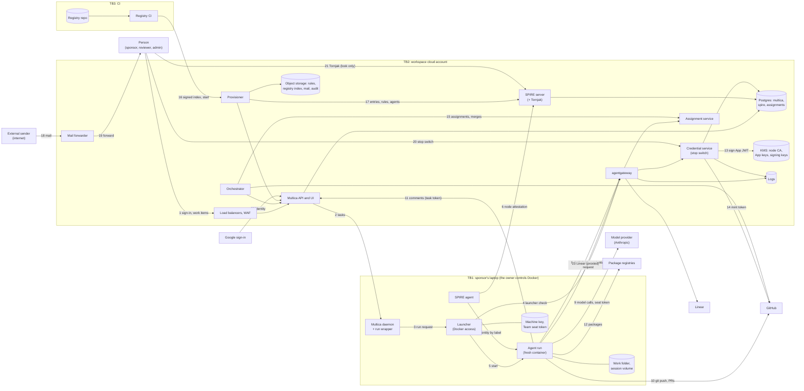

# Threat model

Status: first version (2026-10-12). It covers the design in [ARCHITECTURE.md](../ARCHITECTURE.md) and [plan.md](plan.md), and the local workspace in `local/` as it runs today. Review it again at the end of each stage, and when a change crosses a trust boundary.

This document finds the threats with two methods:

- **STRIDE** for security: Spoofing, Tampering, Repudiation, Information disclosure, Denial of service, Elevation of privilege. We apply it to each element of the data flow diagram.
- **LINDDUN** for privacy: Linking, Identifying, Non-repudiation, Detecting, Data disclosure, Unawareness and unintervenability, Non-compliance. We apply it to each flow that carries personal data.

[ARCHITECTURE.md, section 7](../ARCHITECTURE.md#7-threats-and-what-stops-them) gives the short list of threats. This document is the full analysis, and it gives a test for each threat.

## Contents

- [How to read this document](#how-to-read-this-document)
- [System model](#system-model)
- [Assets](#assets)
- [Trust boundaries](#trust-boundaries)
- [Assumptions](#assumptions)
- [STRIDE analysis](#stride-analysis)
- [LINDDUN analysis](#linddun-analysis)
- [The most important findings](#the-most-important-findings)
- [Tests](#tests)
- [Out of scope](#out-of-scope)

## How to read this document

Each threat has an ID (`TM-` and a letter for its category), a rating, a status and a test.

| Rating | Meaning |
|---|---|
| **High** | Likely, or it gives an attacker the identity or access of an agent, a person or a service. Fix it before the stage that it affects. |
| **Medium** | Possible, with a limited effect, or another control limits it. Fix it in the stage that it affects. |
| **Low** | Unlikely, or the effect is small. Record it, and fix it when it is easy. |

| Status | Meaning |
|---|---|
| **Mitigated** | A control stops it, and a test proves the control. |
| **Partial** | A control limits it, but a gap remains. The gap has a decision or a question. |
| **Open** | No control yet. The test reports it as `known` until it is fixed. |
| **Accepted** | The owner accepted the risk, with the decision that says so. |

The tests are in [Tests](#tests). A `known` result is an open threat that the test still finds. When a `known` test starts to pass, the test says so, and you must update this document.

## System model

The diagram shows the parts of the workspace and the data that moves between them. The numbers on the arrows are the flows in the next table. Dashed boxes are trust boundaries.

| Flow | From → to | What it carries | Personal data |
|---|---|---|---|
| 1 | Person → Multica | Sign-in, work items, comments | Name, email, work content |
| 2 | Multica → daemon | Task: agent, prompt, work folder, task token | Work content |
| 3 | Daemon → launcher | Run request: agent, task, work folder, Claude options | — |
| 4 | Launcher → broker | Launcher check: agent name, the launcher's JWT-SVID | Laptop name (`<person>.<machine>`) |
| 5 | Launcher → run | Container start: labels, volumes, the sponsor's seat token | — |
| 6 | SPIRE agent → server | Machine certificate (x509pop) | Laptop name |
| 7 | SPIRE agent → run | The agent's SVIDs, chosen by Docker labels | — |
| 8 | Run → broker | JWT-SVID, credential requests | — |
| 9 | Run → model provider | Everything the agent reads, the sponsor's seat token | Any content the agent reads |
| 10 | Run → GitHub | Commits, pull requests, comments | Commit trailers |
| 11 | Run → Multica | Comments, status, with the task token | Work content |
| 12 | Run → package registries | Package downloads | — |
| 13–14 | Credential service → KMS, GitHub | App JWT signature; a one-hour token | — |
| 15 | Orchestrator → assignment service, GitHub, Multica | Assignment requests, merges | — |
| 16–17 | Registry → CI → provisioner → systems | Signed index; entries, rules, agent profiles | People's names, emails, laptops |
| 18–19 | External sender → mail forwarder → sponsor | Email (stage 7) | Sender's address and content |
| 20 | Person → credential service | Stop and start | Who stopped or started |
| 21 | Person → Tornjak → SPIRE server | Laptops, entries, identities | Laptop names |
| 22 | Google → Multica | People's identity | Name, email |
| 23 | Run → broker → Linear | Linear calls, with the agent's token added | Work content |

## Assets

| Asset | Where it is | Why it matters |
|---|---|---|
| Agent identities (SVIDs) | SPIRE; each run | They decide what the broker gives |
| GitHub App private keys | KMS (locally: `local/.state/github/`) | They mint tokens for each agent |
| Node CA key | KMS (locally: `local/.state/node-ca/`) | It enrols laptops |
| Machine keys | Each laptop | They prove a laptop to SPIRE |
| Sponsors' Team seat tokens | Each laptop, each run | Long-lived; the full Claude access of a person |
| Stop switch | Postgres (`broker` database) | People's control over agents |
| Broker rules and registry index | Object storage (locally: `local/.state/broker/`) | They define every agent's rights |
| Source code and pull requests | GitHub | The product; also the code that sets agents' limits |
| Work content, sessions and transcripts | Multica; work folders and session volumes | Can hold client data and personal data |
| Audit and logs | Object storage, log groups | Evidence for incidents |
| People's personal data | Registry, Multica, logs, certificates | Privacy of the people who work with agents |

## Trust boundaries

| Boundary | Between | What crosses it |
|---|---|---|
| TB1 | The laptop owner (and each process that runs as the owner) and the workspace | Run requests, SVIDs, the seat token. The owner can do all that Docker can do. |
| TB1a | A run container and the rest of the laptop | Only the work folder, the agent's session volume and the SPIRE socket go in. |
| TB2 | The internet and the workspace cloud account | Laptops, people and external mail reach only the load balancers. |
| TB2a | The edge (load balancers, broker, Multica API, SPIRE server) and the private services | Only agentgateway reaches the credential and assignment services. |
| TB3 | Agent branches and protected CI | CI on agent branches has no secrets (D40). |
| TB4 | The workspace and third-party services (GitHub, Linear, Anthropic, Google) | Tokens, content, model calls. |
| TB5 | The workspace account and production | Nothing today (plan D5). |

## Assumptions

- The cloud provider, GitHub, Google and Anthropic work as documented.
- Each sponsor's laptop has disk encryption, a screen lock and current updates. The onboarding requires this.
- A sponsor is accountable for each agent on their laptop (D49). We do not defend an agent against its own sponsor.
- Prompt injection is always possible. We contain it. We cannot prevent it.

## STRIDE analysis

### Spoofing

| ID | Element | Threat | Rating | Controls now | Status | Next step |
|---|---|---|---|---|---|---|
| TM-S1 | SPIRE agent, launcher (flows 5, 7) | **A container that the launcher did not start gets an agent's identity.** SPIRE selects runs by Docker labels only. Each process that can use Docker on the laptop can start a container with the labels of an agent placed there, and also with the labels of the launcher. Thus the launcher check (D50) does not stop a compromised host. It stops only a compromised daemon, which has no Docker access. | High | Entries are under the laptop's node ID, so only agents placed on that laptop are at risk (D49). SVIDs are short-lived. The broker checks the stop switch and the rules on each request | Partial | D50 now states what it stops (D53). From stage 4, the broker refuses each credential without a live assignment for the task, so a false run gets only assigned work (D53). Send launcher logs to the central log store, and alert on credential calls with no launcher start (Q38) |
| TM-S2 | Machine key (flow 6) | The machine key is a file on the laptop. A copy on another computer acts as that laptop until a ban or the end of its 90 days | Medium | 90-day certificates, `spire-server agent ban`, two-person enrolment, file mode 600 | Partial | Keep keys in hardware (TPM or Secure Enclave) when SPIRE supports it on our laptops (Q39) |
| TM-S3 | Broker (flow 8) | A JWT-SVID is a bearer token. A token that leaks (in a log, a comment or a model message) works for anyone who can reach the broker, until it expires | Medium | 15-minute lifetime, one audience per service (D42), tokens never logged | Partial | In the cloud, the broker also requires the run's X.509-SVID (mutual TLS), so a JWT alone is not sufficient (Q40) |
| TM-S4 | Multica (flow 1) | Gaps in Multica's sign-in: an invitation lets any address sign up; the email-code login has no MFA. A person who signs in can write work items and comments that agents read | Medium | Domain allow-list, Internal consent screen, WAF rate limit, provisioner reports unknown users (plan) | Partial | No change. Stage 2 tests these settings |
| TM-S5 | Mail forwarder (flow 18) | A sender address is easy to make false | Medium | Approved senders and DMARC pass (D26) | Mitigated (design) | Stage 7 tests |
| TM-S6 | Our services (D42) | A signed cloud IAM request that one service receives can be sent again to a different service while the signature is valid | Medium | — | Open | Each service requires a signed header with its own name, and refuses other names (D42, plan) |
| TM-S7 | Broker (flow 4) | The launcher's identity also comes from Docker labels (see TM-S1). A false launcher can ask the launcher check, but only for agents placed on its own laptop | Low | The check answers only for agents on the asking laptop | Accepted | Covered by TM-S1 |

### Tampering

| ID | Element | Threat | Rating | Controls now | Status | Next step |
|---|---|---|---|---|---|---|
| TM-T1 | Work folder, session volume (TB1a) | **A tricked run leaves instructions for later runs.** The work folder (`CLAUDE.md`, `.claude/`, git configuration) stays for the next task on the same issue. One session volume holds the sessions of all issues of the agent, so a run on one issue can change the session that a run on another issue resumes | Medium | Managed settings with `allowManagedHooksOnly`; settings and OpenAPPA policy are fresh in each run; the daemon pins `core.fsmonitor` and `core.hooksPath` off | Partial | Mount only the session folder of the task's own work folder (Q41) |
| TM-T2 | Broker rules (flow 17) | The rules file is not signed. Each identity that can write the rules bucket can give any agent any right | High | Only the provisioner role can write the bucket (plan IAM). Locally the credential service mounts the rules read-only | Partial | Sign the rules with the registry index key, and make the broker refuse rules with no valid signature (D54) |
| TM-T3 | Registry CI (flow 16) | A change to the registry CI, or to its signing key, signs an index that gives agents more rights | High | People review every registry change; the CI role can only start the provisioner (D37) | Partial | The signing key is in KMS, and only the protected environment on `main` can use it (D54) |
| TM-T4 | Images and tools | A changed image or tool runs in every run. Today some images are pinned by tag only, two build arguments default to `latest`, and the run start installs OpenAPPA files from GitHub | Medium | ClaudeBox checks OpenAPPA's checksum; the launcher runs the image by ID | Partial | Pin each image by digest and each tool by version. Install OpenAPPA from files in the image, so nothing downloads when a run starts (D44) |
| TM-T5 | Multica (flow 2) | A Multica admin, or a runner account, changes an agent's instructions, skills or MCP servers | Medium | The launcher accepts only remote MCP servers and drops custom environment variables; the provisioner resets edits (D37, not built) | Partial | Build the provisioner (stage 3). A provisioner account owns the agents (D37) |
| TM-T6 | Tornjak (flow 21) | **Tornjak's API can create and delete registration entries.** It has no sign-in and it answers every web page (`Access-Control-Allow-Origin: *`). A web page in the browser of a person who runs the workspace could give an agent's identity to any container | High | — | Mitigated | A read-only proxy in front of Tornjak: only `GET`, and only the Tornjak UI's origin (plan D52) |
| TM-T7 | Broker admin UI | The agentgateway admin API could change the broker's routes | Medium | Read-only mode; a Unix socket that only the host forwarder reaches | Mitigated | — |

### Repudiation

| ID | Element | Threat | Rating | Controls now | Status | Next step |
|---|---|---|---|---|---|---|
| TM-R1 | Stop switch (flow 20) | **When someone starts an agent again, no record stays.** `start` deletes the stop, so nobody can see who stopped the agent, who started it again, or when | Medium | Logs of the command, if somebody kept them | Mitigated | Each stop and each start is a row in a history table that is never changed. `start` needs a name (D35) |
| TM-R2 | Broker logs | The laptop owner's own actions as an agent (TM-S1) look the same as the agent's actions | Medium | D49: the owner is the sponsor | Accepted | Correlate credential calls with launcher starts (Q38) |
| TM-R3 | Commits (flow 10) | Commit trailers (`Agent-Id`, `Task-Id`) come from the agent's own tools, and an agent can write false trailers | Low | The commit author is the agent's App, which GitHub sets from the token | Partial | Use the broker log (token minted for this agent, this repo, this time) as the evidence, not trailers |
| TM-R4 | Laptop logs | Launcher, OpenAPPA and Claude Code logs stay on the laptop, where the owner can change them | Medium | — | Open | Send the launcher and OpenAPPA logs to the central log store (Q38) |

### Information disclosure

| ID | Element | Threat | Rating | Controls now | Status | Next step |
|---|---|---|---|---|---|---|
| TM-I1 | Run (flow 5) | **Commands in a run can read the sponsor's Team seat token** (`printenv`, `/proc`). The token is long-lived and gives the sponsor's full Claude access | High | OpenAPPA asks before secrets leave; the egress controls (not built) | Open | Make the token unreadable to commands (Claude Code's `sandbox.credentials.envVars`, or a model proxy on the laptop). The threat test checks the laptop's runs; the ClaudeBox test (F2) checks only the box without a laptop, where no token is set |
| TM-I2 | Run (flow 12) | **Runs can connect to any address on the internet.** A tricked agent can send data anywhere | High | OpenAPPA checks Claude's own tools | Open | An egress allow-list for runs: the broker, Multica, SPIRE, GitHub, Anthropic and the package mirror (5.7). The ClaudeBox test reports it as F5 |
| TM-I3 | Multica (flow 11) | The task token in a run can read all of the workspace's issues, and acts as the runner account | Medium | 24-hour token, deleted when the task ends | Partial | Q30: send Multica calls through agentgateway with tool limits |
| TM-I4 | Logs | Tokens in logs give access to whoever reads the logs | Medium | The broker never logs tokens | Mitigated | — |
| TM-I5 | Public SPIRE endpoint | The SPIRE server is open to the internet, so each SPIRE weakness is open too | Medium | mTLS; patches reviewed each month (D44) | Accepted | — |
| TM-I6 | Local stack | Locally, each process on the computer can reach Postgres (fixed password), Tornjak, the broker UI and the files in `local/.state/` | Low | Ports bind to 127.0.0.1; key files are mode 600 | Accepted | Local only. Never use the local stack with real client data |

### Denial of service

| ID | Element | Threat | Rating | Controls now | Status | Next step |
|---|---|---|---|---|---|---|
| TM-D1 | Team seat (flow 9) | One busy agent uses the usage limits of the sponsor's seat, so the sponsor's other agents and the sponsor's own work stop | Medium | — | Open | Limit the number of runs at one time on each laptop (Q42); budgets when model calls go through the broker (D43) |
| TM-D2 | Model provider | Anthropic suspends the account under its terms, and all agents stop | High | — | Accepted | D15, Q34 |
| TM-D3 | People | Agents make more pull requests than people can review well, so reviews become a formality | Medium | — | Open | A limit on open pull requests for each agent in the orchestrator (Q28) |
| TM-D4 | Run (TB1a) | A run uses all of the laptop's CPU, memory or processes | Medium | Memory 4 GB, 512 processes, 2 CPUs for each run | Mitigated | — |
| TM-D5 | Broker | The broker fails closed. If the rules or the stop switch are not available, every agent stops | Low | `/healthz` says why | Accepted | By design (D35) |
| TM-D6 | Broker | Tokens with unknown key IDs make the broker fetch SPIRE's keys again and again | Low | One fetch at a time, at most once each 30 seconds | Mitigated | — |

### Elevation of privilege

| ID | Element | Threat | Rating | Controls now | Status | Next step |
|---|---|---|---|---|---|---|
| TM-E1 | Launcher (flow 3) | The launcher has Docker access. A request that adds a Docker option (a host folder, `--privileged`, the host network) is root on the laptop's Docker VM | High | The launcher fixes every Docker option. It accepts only the agent, a task folder and Multica's own Claude options | Mitigated | — |
| TM-E2 | Run (TB1a) | A run escapes its container | Medium | No root, no capabilities, `no-new-privileges`, no Docker socket | Partial | A read-only root filesystem, as 5.7 says (Q43) |
| TM-E3 | GitHub (flow 10) | A workflow that runs with secrets on an agent's pull request (`pull_request_target`, `workflow_run`) gives the agent's code those secrets | High | D40 | Mitigated (this repo) | Forbid these triggers in every repo that agents work in |
| TM-E4 | GitHub (flow 10) | An agent changes CODEOWNERS or workflows so that its changes need no person | High | CODEOWNERS covers `.github/` and itself; rulesets are org settings | Mitigated (this repo) | — |
| TM-E5 | Multica (flow 11) | The runner account owns all agents on its laptop, so one agent's task token can change another agent | Medium | Only remote MCP servers start | Partial | D37: a provisioner account owns agents |
| TM-E6 | SPIRE agent | The SPIRE agent has `pid: host` and the Docker socket; whoever controls it controls every identity on the laptop | Medium | Pinned image | Accepted | D49 |
| TM-E7 | Provisioner, orchestrator | The services with the most rights are a single target | High | D36, D37 | Partial | Stage 3 tests |

## LINDDUN analysis

**Personal data in the workspace:**

| Data | Data subjects | Where | Retention today |
|---|---|---|---|
| Names, emails, roles, teams | Employees | Registry, Multica, CODEOWNERS | Until removed |
| Laptop names (`<person>.<machine>`) | Sponsors | SPIFFE IDs, machine certificates, Tornjak, Multica runtimes, logs | Until removed; logs 90 days, audit 1 year |
| Activity of each agent | Sponsors (through their agents) | Broker logs, timelines, Multica, GitHub | Logs 90 days, audit 1 year (object lock) |
| Work content, sessions, transcripts | Employees, clients, people named in content | Multica, work folders, session volumes, the model provider | Not defined |
| Email (stage 7) | External senders | Mail bucket, sponsors' inboxes | Not defined |
| Stop records | Sponsors and admins | `broker` database | Not defined |

| ID | Category | Threat | Rating | Controls now | Status | Next step |
|---|---|---|---|---|---|---|
| TM-LI1 | Linking | The agent timeline joins broker logs, Multica, GitHub and SPIRE by agent and task, and the registry joins each agent to its sponsor and laptop. Together they show when a sponsor's laptop works and on what. That is monitoring of employees, which is not the purpose | Medium | — | Open | State the purpose (security and audit, not performance) and who may see timelines (D55) |
| TM-ID1 | Identifying | Laptop names contain the person's name, and SPIFFE IDs, certificates, Multica runtime names and logs show it | Low | — | Accepted | We keep the name for accountability (D49). Never put laptop names in public repos or commit trailers |
| TM-NR1 | Non-repudiation | A sponsor is accountable for each action of their agents, and the audit cannot be changed for one year. A tricked agent's action is recorded against the sponsor | Medium | — | Open | Incident reviews consider prompt injection first; audit records of agents are not used as evidence of a person's performance (D55) |
| TM-DT1 | Detecting | All members of the Multica workspace can see when each runtime is online, so they can see when a sponsor's laptop is on | Low | — | Accepted | Inform sponsors in the onboarding. Dedicated hosts (stage 6) remove it |
| TM-DD1 | Data disclosure | Everything that an agent reads goes to Anthropic under the sponsor's Team seat, also personal data in issues, code, logs and email | High | Team is a commercial plan | Partial | Confirm the data processing terms and the region for Team. No personal data of clients until data classes exist (Q24, D55) |
| TM-DD2 | Data disclosure | Work folders and session volumes keep all that an agent read, on the laptop, with no end date | Medium | Disk encryption (assumption) | Partial | Delete a task's sessions and work folder some days after the issue closes (D55). The threat test checks disk encryption on macOS |
| TM-DD3 | Data disclosure | Forwarded mail (stage 7) stays in the mail bucket, with versions, with no end date | Medium | — | Open | A lifecycle rule: delete after 30 days (D55) |
| TM-UN1 | Unawareness | People who write to an agent (in GitHub, Linear, Multica or by email) may not know that an AI reads and answers. The EU AI Act (Article 50) requires that people know when they interact with an AI system | Medium | GitHub shows `[bot]`; Linear shows an app | Partial | Each agent's profile and email signature says that it is an AI agent and names its sponsor (D55) |
| TM-UN2 | Unintervenability | The audit store's one-year object lock stops the erasure of personal data in it | Low | — | Accepted | Keep personal data in the audit to IDs, not content, and record the legal basis (D55) |
| TM-NC1 | Non-compliance | No data protection impact assessment, no record of processing and no retention schedule exist. Monitoring of employees can need consultation with employee representatives, and Anthropic is a processor outside the EU | High | — | Open | A DPIA and a retention schedule before stage 3, when agents work on real data (D55, plan stage 0) |

## The most important findings

1. **TM-S1: the launcher check does not stop a compromised host.** Docker labels choose identities, and anyone with Docker on the laptop can set them. ARCHITECTURE.md said that "a compromised host can start only the runs that the central services confirmed". That was not correct. D53 corrects it, and moves the real limit to the broker: from stage 4, each credential needs a live assignment.
2. **TM-I1 and TM-I2: a tricked agent can read the sponsor's seat token and send it anywhere.** The design said that commands cannot see the token and that an egress proxy limits destinations. Neither is built. Both must be done before a second person's laptop runs agents (stage 3).
3. **TM-T6: Tornjak could change identities from any web page.** Fixed: a read-only proxy.
4. **TM-T2 and TM-T3: the rules and the index decide all rights.** Sign both, and keep the signing key in KMS for `main` only (D54).
5. **TM-R1: starting an agent again left no record.** Fixed: a history of stops and starts.
6. **TM-DD1 and TM-NC1: privacy work is missing.** A DPIA, a retention schedule and transparency rules for agents (D55) come before agents work on real data.

## Tests

The tests for this document are in four places. Each check names its threat ID.

| Where | How to run it | What it covers |
|---|---|---|
| `local/scripts/smoke-threats.sh <laptop>` | On the running local workspace, with a laptop up | TM-S1, TM-S2, TM-T2, TM-T6, TM-T7, TM-R1, TM-I1, TM-I2, TM-I4, TM-E3, TM-E4, TM-DD2 |
| `broker/` unit tests | `cd broker && go test ./...` | TM-S3 (audience, expiry), TM-R1 (stop history), TM-D5, TM-D6 |
| `claudebox/launcher/` unit tests | `cd claudebox/launcher && go test ./...` | TM-E1, TM-D4, TM-T5 (remote MCP servers only, no custom environment) |
| `claudebox/tests/run.sh` | Offline; `--live` calls Claude | TM-I2 (F5), TM-T4 (F4), and the OpenAPPA policy replays |

Threats with the status "Open" or "Partial" in a later stage have tests in that stage in [plan.md](plan.md#stages).

## Out of scope

- Attacks on GitHub, Google, Anthropic or the cloud provider themselves.
- Production systems (plan D5): no agent reaches them yet.
- The physical security of laptops, other than disk encryption.
