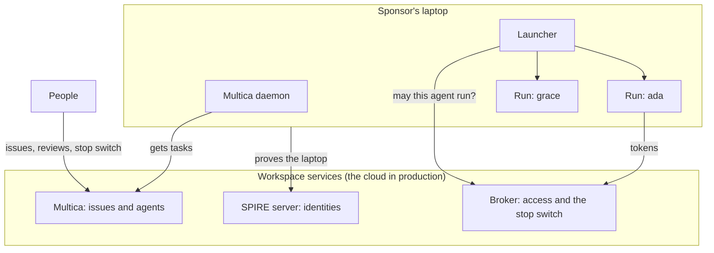
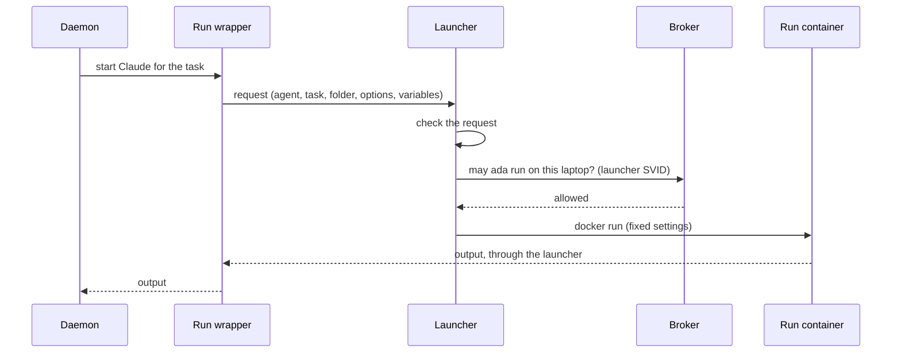
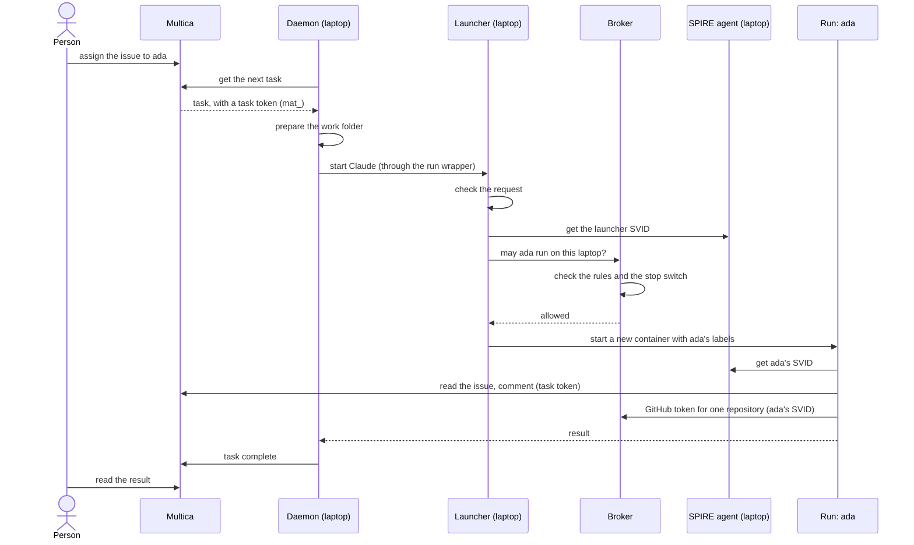

# Tutorial: build the workspace and learn how it works

This tutorial starts from nothing. You build the local workspace one part at a time. After each part, you look at what the part made and learn why it is there. At the end, an agent does a task on your simulated laptop, and you know each step that made this possible.

Each lesson has two types of sections:

- **Do it** sections build the next part.
- **Look at it** sections show you what the part made.

Do the lessons in sequence. Each lesson uses the parts that the lessons before it made. The full tutorial takes approximately two hours.

If you want only a working setup, without the explanations, use the [onboarding guide](onboarding.md).

## Contents

- [Before you start](#before-you-start)
- [Where to look](#where-to-look)
- [Lesson 1: The idea](#lesson-1-the-idea)
- [Lesson 2: Start the workspace](#lesson-2-start-the-workspace)
- [Lesson 3: Multica, where work starts](#lesson-3-multica-where-work-starts)
- [Lesson 4: SPIRE, who is running](#lesson-4-spire-who-is-running)
- [Lesson 5: Your laptop joins](#lesson-5-your-laptop-joins)
- [Lesson 6: The daemon](#lesson-6-the-daemon)
- [Lesson 7: Add an agent](#lesson-7-add-an-agent)
- [Lesson 8: The broker](#lesson-8-the-broker)
- [Lesson 9: The launcher and the first run](#lesson-9-the-launcher-and-the-first-run)
- [Lesson 10: Inside a run](#lesson-10-inside-a-run)
- [Lesson 11: One task, from start to end](#lesson-11-one-task-from-start-to-end)
- [Lesson 12: GitHub tokens](#lesson-12-github-tokens)
- [Lesson 13: What is not complete](#lesson-13-what-is-not-complete)
- [Lesson 14: Stop, remove and start again](#lesson-14-stop-remove-and-start-again)
- [Local parts and cloud parts](#local-parts-and-cloud-parts)
- [Glossary](#glossary)
- [Read more](#read-more)

## Before you start

1. Do steps 1 to 5 of the [onboarding guide](onboarding.md): prepare your computer and get the repository. Do not do step 6 or the steps after it. This tutorial does them, with explanations.
2. If you already have a local workspace, delete it first. This tutorial starts from nothing:

   ```sh
   local/scripts/reset.sh
   ```

   The script shows what it will delete and asks you to type `reset`. It keeps the Docker images.
3. Open a terminal in the repository folder. On Windows, use the Ubuntu window.
4. Choose a name for your simulated laptop, with the format `<person>.<machine>` in lower case. Examples: `jane.mac`, `jane.win`. Make sure that the name is correct. The name goes into a certificate.
5. Set the laptop name and three short helpers. The lessons use them:

   ```sh
   LAPTOP=jane.mac
   PROJECT=laptop-${LAPTOP//./-}
   ws() { docker compose -f local/docker-compose.yml "$@"; }
   lap() { local/scripts/laptop.sh compose "$LAPTOP" "$@"; }
   spire() { ws exec -T spire-server /opt/spire/bin/spire-server "$@"; }
   ```

   - `ws` runs a Docker Compose command on the workspace.
   - `lap` runs a Docker Compose command on your laptop.
   - `spire` runs a command on the SPIRE server.

   If you open a new terminal, do this step again.

## Where to look

Keep these pages open while you do the lessons. Each page works after the lesson that is shown.

| Page | Address | What it shows | From |
|---|---|---|---|
| Multica | [http://localhost:3000/login](http://localhost:3000/login) | Issues, agents, runtimes and the agents' comments | Lesson 3 |
| Mailpit | [http://localhost:8025](http://localhost:8025) | All mail from Multica, for example sign-in codes. No mail goes to a real mailbox. | Lesson 2 |
| Broker health | [http://localhost:8443/healthz](http://localhost:8443/healthz) | `{"status":"ok"}`, or the problem with the rules or the stop switch | Lesson 2 |
| Broker UI (agentgateway) | [http://localhost:15000/ui](http://localhost:15000/ui) | The broker's listener, routes and SVID check. Read-only. | Lesson 2 |
| Multica API health | [http://localhost:8080/readyz](http://localhost:8080/readyz) | If the Multica server is ready | Lesson 2 |
| Tornjak | [http://localhost:3001](http://localhost:3001) | The SPIRE server: laptops, registration entries and identities. `up.sh` starts it. | Lesson 2 (empty until lesson 5) |

Some parts have no web page. Use these commands to look at them:

| Part | How to look at it | From |
|---|---|---|
| SPIRE server | Tornjak, or `spire agent list` and `spire entry show` | Lesson 4 |
| Credential service (broker) | `ws logs -f credential-service` | Lesson 8 |
| Launcher | `lap logs -f launcher` | Lesson 9 |
| Agent runs | `docker ps --filter name=run-` | Lesson 9 |
| Postgres | `ws exec postgres psql -U workspace -d multica`, or a database tool on `localhost:55432` (user and password `workspace`) | Lesson 2 |

The full list of addresses is in the [onboarding guide](onboarding.md#the-local-addresses).

## Lesson 1: The idea

An agent is a member of the team, like a person. It gets work, does the work and reports. People stay in charge. These rules apply:

- **Each agent has its own identity.** The identity proves which agent runs. It does not come from a password or a key that the agent keeps.
- **An agent keeps no secrets.** When an agent needs access, for example to GitHub, it asks the broker. The broker gives a short-lived token for one task.
- **A person can stop an agent at once.** The stop switch is in the broker. The broker checks it on each request.
- **Each run is new.** Each task runs in a new container. A run cannot change the next run.
- **Each agent runs on the laptop of its sponsor.** The sponsor is the person who is responsible for the agent. The agent uses the sponsor's Claude Team seat.

The workspace has two sides:

- **The workspace services.** In production, these run in the cloud account. In this tutorial, they run in Docker on your computer.
- **The laptops.** Each sponsor's laptop runs the sponsor's agents. In this tutorial, one group of containers is your simulated laptop.



You build the workspace in this sequence:

1. The workspace services (lesson 2).
2. Your Multica account (lesson 3).
3. Your laptop, with its identity (lessons 4 to 6).
4. An agent (lesson 7).
5. The agent's access (lesson 8).
6. The agent's first run (lesson 9).

The design is in [ARCHITECTURE.md](../ARCHITECTURE.md). The cloud deployment is in [plan.md](plan.md).

## Lesson 2: Start the workspace

The workspace services are local copies of the cloud services. One script starts them.

### Do it

1. Start the workspace:

   ```sh
   local/scripts/up.sh
   ```

   The first start downloads the images. This can take some minutes. All lines at the end must show `ok`.

2. Open `local/.env`. Set `SPONSOR_EMAIL` to your own `@example.com` address:

   ```sh
   SPONSOR_EMAIL=jane@example.com
   ```

   This address owns your local Multica workspace. You sign in with it in lesson 3. Set it now: the scripts in lesson 5 use it. If it is empty, they stop.

### Look at it

`up.sh` made these things:

| What | Where | Why |
|---|---|---|
| Settings and a new secret | `local/.env` | The secret signs Multica's sessions. Git ignores this file. |
| A certificate authority for laptops | `local/.state/node-ca/` | It signs each laptop's machine certificate (lesson 4). In the cloud, the key is in KMS. |
| Empty broker rules | `local/.state/broker/rules.json` | The broker refuses all agents until a person adds one (lesson 8). |
| The containers | Docker project `workspace-local` | The services, and Tornjak, a web view of the SPIRE server (lesson 4). |
| Two networks | `workspace-local` and `workspace-edge` | The private side and the side that laptops can use (lesson 10). |

1. Show the services:

   ```sh
   ws ps --format '{{.Service}}  {{.Status}}'
   ```

2. Show the files that `up.sh` made. Treat `local/.state/` as a secret:

   ```sh
   ls -R local/.state
   cat local/.state/broker/rules.json
   ```

   The rules have no agents: `{"agents": {}}`.

3. Show the two networks, and which services are on the edge network:

   ```sh
   docker network ls --filter name=workspace
   docker network inspect workspace-edge --format '{{range .Containers}}{{.Name}} {{end}}'
   ```

   Only the Multica API, the SPIRE server and the broker are on the edge network. Laptops can connect only to these three services.

4. Open [http://localhost:8443/healthz](http://localhost:8443/healthz). The result is `{"status":"ok"}`. The broker can read its rules, and the rules are empty.

5. Show the databases:

   ```sh
   ws exec -T postgres psql -U workspace -d multica -Atc "select datname from pg_database where datname not like 'template%'"
   ```

   Multica, SPIRE, the broker (stop switch) and the future assignment service each have their own database.

## Lesson 3: Multica, where work starts

[Multica](https://github.com/multica-ai/multica) is the place where people and agents share work. It has workspaces, issues, agents and runtimes:

- An **issue** is one piece of work.
- An **agent** is a member that can get issues. Each agent has instructions.
- A **runtime** is a computer that can run agents. Each laptop is one runtime.
- A **task** is one run of an agent on an issue. One issue can have many tasks, for example when a person adds a comment.

People sign in with a code that Multica sends by mail. Only `@example.com` addresses can sign up. In the local workspace, Mailpit catches all mail, so no mail leaves your computer. In the cloud, people sign in with Google.

| Service | What it does |
|---|---|
| `multica-api` | The Multica server. People's browsers and the laptops' daemons connect to it. |
| `multica-web` | The Multica web application. |
| `postgres` | Keeps Multica's data. |
| `mailpit` | Catches Multica's mail. |

### Do it

1. Open Mailpit at [http://localhost:8025](http://localhost:8025). Keep it open.
2. Open [http://localhost:3000/login](http://localhost:3000/login). Do not use `http://localhost:3000`. That address shows Multica's product page.
3. Enter your `SPONSOR_EMAIL` address.
4. Find the mail in Mailpit. Copy the 6-digit code into Multica.
5. If Multica asks you to make a workspace, do not make one. Lesson 5 makes it.

### Look at it

1. Try to sign in with an address outside the organisation. Multica refuses it:

   ```sh
   curl -s -X POST http://localhost:8080/auth/send-code -H 'content-type: application/json' -d '{"email":"someone@example.com"}'
   ```

2. Show the users in Multica's database. Only you are there:

   ```sh
   ws exec -T postgres psql -U workspace -d multica -Atc "select email from \"user\""
   ```

## Lesson 4: SPIRE, who is running

Each laptop and each agent run must prove its identity. We use [SPIFFE](https://spiffe.io) and its software, SPIRE. SPIRE gives each workload a short-lived identity document, an **SVID**. An SVID has an identity with the format `spiffe://<trust domain>/<path>`. The local trust domain is `workspace.local`.

SPIRE gives identities in two steps.

**Step 1: the laptop proves itself (node attestation).** Each laptop has a machine certificate. Our node certificate authority signs it. The certificate is valid for 90 days. The SPIRE agent on the laptop shows the certificate to the SPIRE server. Then it signs a random challenge from the server with the certificate's private key. This method is `x509pop` ("proof of possession"). A copy of the certificate without the key is not sufficient. The server makes the laptop's identity from the name in the certificate: `spiffe://workspace.local/spire/agent/x509pop/<laptop>`.

The SPIRE server does not have a list of laptops. It trusts one certificate authority. This part of `local/spire/server.conf` tells it which one:

```hcl
NodeAttestor "x509pop" {
    plugin_data {
        mode = "external_pki"
        ca_bundle_path = "/opt/spire/conf/node-ca/ca.pem"
        agent_path_template = "/x509pop/{{ .Subject.CommonName }}"
    }
}
```

**Step 2: a container proves itself (workload attestation).** A container on the laptop asks the laptop's SPIRE agent for an SVID through a socket. The SPIRE agent asks Docker for the labels of that container. It then compares the labels with the **registration entries** on the SPIRE server. If the labels agree with an entry, the container gets that entry's identity. You see this in lesson 7.

The services in other places do not keep passwords for agents. They check the SVID's signature against the SPIRE server's public keys. The `spire-oidc` service publishes these keys.

### Do it

Open Tornjak, the web view of the SPIRE server, at [http://localhost:3001](http://localhost:3001). `up.sh` started it in lesson 2.

Tornjak's own API can make and delete registration entries, it has no sign-in, and it answers every web page. So the API has no port on your computer. A read-only proxy, `tornjak-api`, is the only way to it: it lets only reads through, and only Tornjak's own page can read the answers ([threat-model.md](threat-model.md), TM-T6). Use Tornjak to look. The scripts make the entries. In the cloud, only the provisioner makes entries.

Try to make an entry through the proxy. It refuses with `403`:

```sh
curl -s -X POST -d '{}' http://localhost:10000/api/v1/spire/entries
```

### Look at it

1. Show the laptops that SPIRE knows. There are none yet:

   ```sh
   spire agent list
   ```

2. Show the registration entries. There are none yet:

   ```sh
   spire entry show
   ```

   Tornjak also shows no agents and no entries. It shows only the server and its trust domain.

3. Show the certificate authority that the server trusts:

   ```sh
   openssl x509 -in local/.state/node-ca/ca.pem -noout -subject -enddate
   ```

## Lesson 5: Your laptop joins

Now you add your simulated laptop. One script does all the steps that a new laptop needs.

### Do it

Start your laptop:

```sh
local/scripts/laptop.sh up $LAPTOP
```

The first start builds the ClaudeBox image. This takes 5 to 15 minutes.

The script does these steps:

1. It makes a machine certificate for the laptop. The node certificate authority signs it. (In the cloud, two people sign each certificate.)
2. It makes the Multica workspace "Example (local)", owned by your `SPONSOR_EMAIL` address.
3. It makes a runner account for the laptop, `runner-<person>-<machine>@example.com`, and adds it to the workspace. It makes a Multica token for the runner account.
4. It registers the launcher's identity in SPIRE.
5. It starts the laptop's SPIRE agent, then the launcher and the Multica daemon.

The script signs in to Multica by itself, with codes from Mailpit. It deletes the old mail in Mailpit first. So mail can disappear from Mailpit while the script runs.

### Look at it

1. Show the laptop's machine certificate. The subject has your laptop name. The issuer is the node certificate authority:

   ```sh
   openssl x509 -in local/.state/laptops/$LAPTOP/agent.pem -noout -subject -issuer -enddate
   ```

   Make sure that the node certificate authority signed it. The SPIRE server does only this check, so the signature is the approval. In the cloud, two people approve each signature:

   ```sh
   openssl verify -CAfile local/.state/node-ca/ca.pem local/.state/laptops/$LAPTOP/agent.pem
   ```

   The result is `OK`.

2. Show the laptops that SPIRE knows. Your laptop is there now:

   ```sh
   spire agent list
   ```

   The identity is `spiffe://workspace.local/spire/agent/x509pop/<laptop>`. The SPIRE server made it from the name in the certificate. The expiry time is approximately one hour from now. This is the laptop's SPIRE identity, not the certificate. The SPIRE agent renews it.

3. Show the registration entries. There is one entry, for the launcher:

   ```sh
   spire entry show
   ```

   The entry gives `spiffe://workspace.local/launcher/<laptop>` to a container with the labels `com.docker.compose.project=<project>` and `com.docker.compose.service=launcher`. Its parent is your laptop. So the entry works only on your laptop.

4. Refresh Tornjak. It shows the same laptop and entry.
5. Show the laptop's containers:

   ```sh
   lap ps --format '{{.Service}}  {{.Status}}'
   ```

   The laptop has three containers: `spire-agent`, `launcher` and `multica-daemon`.

6. In Multica, refresh the page. Open the workspace **Example (local)**:
   - **Runtimes:** your laptop shows as a machine with the name of your laptop (`daemon <laptop>`). It can take one minute to show as online. Open it: it has one runtime, **Claude** (Built-in), and no agents yet. You add an agent in lesson 7.
   - **Members:** you are the owner. The runner account is a member.

## Lesson 6: The daemon

Multica gives tasks to a **daemon** on each runtime. The daemon gets a task, prepares a work folder and starts Claude Code.

The daemon signs in to Multica with the **runner account** for its laptop. It does not sign in as the sponsor. If somebody steals the runner token, they get only the runner account's access, not the sponsor's.

The daemon is not trusted with much. It has:

- No Claude token.
- No access to Docker.
- No access to the SPIRE socket, so it cannot get an agent identity.

The daemon does not start Claude directly. Its path to Claude, `CLAUDEBOX_CLAUDE_PATH`, is the **run wrapper**, `claudebox-run`. The wrapper sends the request to the launcher (lesson 9).

For each task, Multica gives the daemon a task token that starts with `mat_`. The token is valid for that task only. The daemon gives it to the run, so that the agent can comment on the issue.

### Look at it

1. Show the daemon's Claude settings:

   ```sh
   lap exec -T multica-daemon sh -c 'env | grep -E "^CLAUDE"'
   ```

   `CLAUDEBOX_CLAUDE_PATH` is the run wrapper. `CLAUDE_CODE_OAUTH_TOKEN` is empty.

2. Make sure that the daemon has no Docker socket and no SPIRE socket:

   ```sh
   lap exec -T multica-daemon ls /var/run/docker.sock /run/spire/sockets
   ```

   Both paths do not exist.

3. Show the daemon's status:

   ```sh
   lap exec -T multica-daemon multica daemon status
   ```

## Lesson 7: Add an agent

An agent needs three things:

1. A **Multica agent**, so that people can give it issues.
2. A **SPIRE registration entry** on its sponsor's laptop, so that its runs get its identity.
3. An entry in the **broker rules**, so that the broker lets it run (lesson 8).

A script does the first two. In the cloud, the provisioner does all three, from the agent registry.

### Do it

Add the agent `ada`:

```sh
local/scripts/agent.sh ada $LAPTOP "You are Ada, a developer. Keep changes small and explain them."
```

The runner account makes the agent, because Multica lets only a runtime's owner put agents on that runtime.

### Look at it

1. In Multica, open **Agents**. Ada is there, on your laptop's runtime.
2. Show the registration entries. There is a new entry for Ada:

   ```sh
   spire entry show | grep -E "SPIFFE ID|Selector"
   ```

   The entry gives `spiffe://workspace.local/agent/ada` to a container with the labels `workspace.agent=ada` and `workspace.laptop=<laptop>`, on your laptop only. Refresh Tornjak to see it there.

3. Start a container with Ada's labels. Ask the laptop's SPIRE agent for an SVID for the audience `broker`, and show the identity in it:

   ```sh
   docker run --rm --entrypoint spire-agent \
     --label workspace.agent=ada --label workspace.laptop=$LAPTOP \
     -v ${PROJECT}_spire-agent-socket:/run/spire/sockets:ro claudebox \
     api fetch jwt -audience broker -socketPath /run/spire/sockets/agent.sock \
     | awk '/^token\(/{getline; print $1}' | cut -d. -f2 \
     | python3 -c "import sys,base64,json;s=sys.stdin.read().strip();s+='='*(-len(s)%4);d=json.loads(base64.urlsafe_b64decode(s));print(d['sub'],d['aud'],d['exp'])"
   ```

   The result is `spiffe://workspace.local/agent/ada`, the audience and the expiry time. The SVID is valid for 15 minutes.

4. Do the same with a wrong laptop label, for example `--label workspace.laptop=other.mac`. SPIRE refuses: `no identity issued`.

Step 3 shows an important point. Any program that can start containers on the laptop can get any identity of that laptop. You did not use the launcher in step 3. The daemon cannot start containers, so it must use the launcher, and the launcher asks the broker first (lesson 9). But you, and each program that runs as you, can use Docker directly. So the sponsor can always act as the agents on their own laptop. This is why each agent runs only on its sponsor's laptop (D49), and why, from stage 4, the broker gives credentials only for assigned work (D53). The threat model calls this TM-S1 (lesson 13).

## Lesson 8: The broker

Ada has an identity now. But the broker does not let her run yet. The broker controls access. It has two parts:

- **agentgateway** is the front door at `http://broker:8443`. It checks the caller's SVID. The SVID must have the audience `broker`, and the signature must agree with the SPIRE keys.
- **The credential service** (`broker/`) checks the SVID again and makes the decision.

The credential service has three functions:

| Function | Who calls it | What it does |
|---|---|---|
| Launcher check, `POST /v1/launcher/check` | A launcher | Agrees only if the agent is active, is not stopped, and has its placement on the launcher's laptop. |
| GitHub token, `POST /v1/github/token` | An agent run | Gives a one-hour GitHub token for one repository, with only the permissions in the rules (lesson 12). A launcher cannot get a GitHub token. |
| Stop switch | A person | `stop` stops an agent at once. `start` lets it run again. The broker stores the switch in Postgres and reads it on each request. |

The **rules** tell the broker which agents exist, their status and their placement. In production, the provisioner writes the rules from the agent registry. Locally, the rules are in `local/.state/broker/rules.json`. The broker reads the file again when it changes.

agentgateway has a web UI. Open [http://localhost:15000/ui](http://localhost:15000/ui). It shows the listener on port 8443, the `/v1/` route to the credential service with its JWT check (issuer, audience `broker`, SPIRE's keys) and the `/healthz` route. It shows the same as `local/agentgateway/config.yaml`. The UI does not show the rules or the agents: only the credential service reads them.

The UI is read-only: to change the broker, change the config file. The UI has no sign-in, so the broker's admin interface is not on a network. It is a Unix socket, and a small forwarder (`broker-admin`) on the private network gives it to your computer only. The laptops share the edge network with the broker, but they cannot reach the admin interface (lesson 10).

The broker fails closed. If the rules file is missing or has an error, or if the stop switch database is not available, the broker refuses all requests. `GET /healthz` tells you the problem.

Each refusal has a reason code, for example `stopped`, `wrong_placement` or `unknown_agent`. The broker logs each decision.

### Do it

1. Define a command that calls the broker as your launcher. It uses a container with the launcher's labels, so it gets the launcher's SVID:

   ```sh
   as_launcher() {
     docker run --rm -i --entrypoint bash --network workspace-edge \
       --label com.docker.compose.project=$PROJECT --label com.docker.compose.service=launcher \
       -v ${PROJECT}_spire-agent-socket:/run/spire/sockets:ro claudebox \
       -s -- broker "$@" < local/laptop/broker-call.sh
   }
   ```

2. Ask if Ada can run:

   ```sh
   as_launcher /v1/launcher/check '{"agent":"ada"}'
   ```

   The broker refuses with the reason `unknown_agent`. Ada is not in the rules.

3. Add Ada to the rules. Open `local/.state/broker/rules.json`. Set `placement` to your laptop name and `sponsor` to your name:

   ```json
   {"agents": {
     "ada": {"status": "active", "sponsor": "jane", "placement": "jane.mac"}
   }}
   ```

   This is the step where a person gives an agent access.

4. Ask again:

   ```sh
   as_launcher /v1/launcher/check '{"agent":"ada"}'
   ```

   The result is `{"agent":"ada","allowed":true}`.

### Look at it

1. Stop Ada. Then ask again:

   ```sh
   ws exec -T credential-service /credential-service stop ada "$USER" "tutorial test"
   as_launcher /v1/launcher/check '{"agent":"ada"}'
   ```

   The broker refuses with the reason `stopped`.

2. Let Ada run again. You must say who you are:

   ```sh
   ws exec -T credential-service /credential-service start ada "$USER"
   ```

3. Show who stopped Ada and who started Ada again. Each stop and start stays in this history, and nobody can change it, also not with the database password:

   ```sh
   ws exec -T credential-service /credential-service history ada
   ```

4. Change the placement in `rules.json` to another laptop, for example `other.mac`. Ask again. The broker refuses with `wrong_placement`. Then put your laptop name back.
5. Put an error in `rules.json`, for example delete the last `}`. Open [http://localhost:8443/healthz](http://localhost:8443/healthz). It shows the problem. Ask again: the broker refuses with `rules_unavailable`. Then correct the file.
6. Show the broker's decisions:

   ```sh
   ws logs --tail 10 credential-service
   ```

Make sure that Ada is active and that the rules are correct before you continue.

## Lesson 9: The launcher and the first run

The launcher is the only container on the laptop with access to Docker. Its job is narrow: it starts one new container for each run. The request cannot change how the container starts.

The run wrapper and the launcher talk through a Unix socket. The request has only these items:

- The agent name.
- The task ID.
- The work folder.
- Claude's options.
- Multica's task variables.

The launcher checks each item before it starts a run:

| Item | Check |
|---|---|
| Agent name | Lower case letters, digits and hyphens. |
| Task ID | A Multica task ID (a UUID). |
| Work folder | A task's work folder under the daemon's folder for work folders, with the format `<workspace>/<issue>/workdir`. |
| Claude's options | Only the options that Multica uses. Options such as `--add-dir` or `--dangerously-skip-permissions` are refused. MCP servers must be remote servers. The settings can only deny permissions. |
| Task variables | Only the variables in a fixed list. `MULTICA_TOKEN` must be a task token (`mat_`). The daemon's runner token is refused. |

Then the launcher asks the broker the question from lesson 8: "May this agent start a run on this laptop?" The launcher proves its own identity with its SVID.

If the broker agrees, the launcher starts the run with these fixed settings:

- A new ClaudeBox container, `run-<agent>-<random>`, from the pinned image.
- The labels `workspace.agent` and `workspace.laptop`, so that SPIRE gives the run the agent's identity (lesson 7).
- Only the task's work folder. The run cannot see other tasks' folders.
- The agent's own session volume, so that a later task can continue the conversation.
- No Linux capabilities, no new privileges, and limits on processes and memory.
- Only the workspace's edge network (lesson 10).
- The sponsor's Claude token, from the launcher's environment. The token never shows on a command line.

When the task is cancelled, or the daemon disconnects, the launcher removes the container.



### Do it

The launcher does not have your Claude token yet. Look at its log:

```sh
lap logs --tail 5 launcher
```

The log shows the warning `CLAUDE_CODE_OAUTH_TOKEN is not set`.

1. Make a Claude token. A browser window opens. Sign in with your Team seat:

   ```sh
   claude setup-token
   ```

   The command shows a token that starts with `sk-ant-oat`. Copy it. Do not paste it in a chat, a ticket or a commit.

2. Put the token in the laptop's token file. The command asks for the token and does not show it on the screen:

   ```sh
   printf 'Token: '; read -rs t; echo
   (umask 077; printf 'CLAUDE_CODE_OAUTH_TOKEN=%s\n' "$t" > local/.state/laptops/$LAPTOP/claude.env); unset t
   ```

3. Start the laptop again, so that the launcher gets the token:

   ```sh
   local/scripts/laptop.sh up $LAPTOP
   ```

4. Look at the launcher's log again. The warning is gone. Only the launcher has the token. The daemon does not.
5. In Multica, make an issue: "Write a haiku about containers in a file `haiku.md`." Assign it to **ada**.
6. Watch the launcher:

   ```sh
   lap logs -f launcher
   ```

   You see `started`, then `finished`. Push Ctrl+C to stop the log.

### Look at it

1. While a run is active, show its container and its labels:

   ```sh
   docker ps --filter name=run- --format '{{.Names}}  {{.Labels}}'
   ```

2. Show the agent's session volume:

   ```sh
   docker volume ls --filter name=${PROJECT}_session-
   ```

3. In Multica, read Ada's comment on the issue.

If the run fails with "Not logged in", the token file is missing or wrong. Do steps 1 to 3 again.

## Lesson 10: Inside a run

Each run is a ClaudeBox container. ClaudeBox is our image with Claude Code, the Multica CLI, the SPIRE client and OpenAPPA.

**OpenAPPA** checks each tool call that Claude makes, before the call runs. Its policy can permit a call, refuse it, or ask a person to approve it. For example, after Claude reads a `.env` file, OpenAPPA refuses calls to the internet in that session. OpenAPPA connects through Claude Code hooks. The hooks are Claude Code **managed settings** in the image, `/etc/claude-code/managed-settings.json`. Managed settings have the highest priority. With `allowManagedHooksOnly`, only these hooks run. A settings file in a work folder cannot turn them off.

**The network.** You saw the two networks in lesson 2:

- `workspace-local` is private. It has Postgres, Mailpit, the credential service, `spire-oidc` and `broker-admin`, the forwarder for the broker's UI.
- `workspace-edge` has only the parts that laptops may use: the broker, the Multica API and the SPIRE server.

Laptops and runs connect only to the edge network. A run cannot connect to the database, so it cannot change the stop switch. It cannot read Mailpit, so it cannot read sign-in codes. The broker is on the edge network, but its admin interface is only a Unix socket, so a run cannot read or change the broker's configuration. `smoke-l4.sh` tests all of this.

**What a run has:**

- The agent's identity, from SPIRE, through a read-only socket.
- The task token from Multica (`mat_`), to comment on the issue.
- The sponsor's Claude token, to call Claude.
- The task's work folder and the agent's session volume.

**What a run does not have:** a GitHub key, a password, the daemon's runner token, access to Docker, or the other tasks' folders.

### Look at it

1. Show the managed settings in the image:

   ```sh
   docker run --rm --entrypoint jq claudebox -c '{allowManagedHooksOnly, hooks: (.hooks|keys)}' /etc/claude-code/managed-settings.json
   ```

2. Make sure that a container on the edge network cannot connect to Postgres:

   ```sh
   docker run --rm --network workspace-edge --entrypoint bash claudebox -c 'exec 3<>/dev/tcp/postgres/5432' && echo connected || echo refused
   ```

   The result is `refused`.

3. Run the full set of checks for the broker and the networks:

   ```sh
   local/scripts/smoke-l4.sh $LAPTOP
   ```

   All lines must show `ok`. The script changes the rules file for a short time and puts your file back when it ends.

## Lesson 11: One task, from start to end

This lesson joins all the parts. A person gives an issue to Ada. This is what occurs:



If a person stops Ada at any step before the launcher check, the launcher refuses the run. A run that already started continues until it ends (lesson 13).

### Do it

1. Watch the launcher and the broker in two terminals:

   ```sh
   lap logs -f launcher
   ```

   ```sh
   ws logs -f credential-service
   ```

2. In Multica, make an issue: "Write a short poem about containers in `poem.md` and tell me what you did." Assign it to `ada`.
3. In the two logs, find each step of the diagram: the launcher check in the broker log, then `started` and `finished` in the launcher log.
4. In Multica, read Ada's comment.
5. Add a comment to the issue, for example "Make it shorter." Multica makes a new task. The launcher starts a new container. The new run uses the same work folder. It must continue the same session. We have not yet tested this, so tell us the result.
6. Stop Ada (lesson 8). Add one more comment. The launcher log shows `refused` with the reason `stopped`. Then start Ada again.

## Lesson 12: GitHub tokens

Each agent has its own GitHub App, for example `ws-local-ada`. Each App is installed only on the repositories that the agent works on. The broker keeps the App's private key. In production, the key is in the cloud KMS and nobody can read it. Locally, the key is a file in `local/.state/github/`.

When a run needs GitHub, it asks the broker for a token with its SVID. The broker checks these items:

- The caller is an agent, not a launcher.
- The agent is active and not stopped.
- The repository is in the agent's rules.

The `key` value tells the broker where the private key is: `file:<path>` locally, `kms:<key>` in the cloud.

Then the broker signs a request with the App's key and gets a token from GitHub. The token is valid for one hour. It covers only that one repository and only the permissions in the rules.

A rules entry with GitHub access looks like this:

```json
"ada": {
  "status": "active", "sponsor": "jane", "placement": "jane.mac",
  "github": {
    "app_id": 123456, "installation_id": 7890123, "key": "file:/state/github/ada.pem",
    "repositories": ["example-org/workspace-sandbox"],
    "permissions": {"contents": "write", "pull_requests": "write"}
  }
}
```

An agent with a GitHub App must list its repositories and permissions. Without them, GitHub gives a token for all of the App's access. The broker refuses such rules.

Different agents have different roles. A developer agent can write code and open pull requests. A reviewer agent can review. A person approves each merge in this repository.

To try GitHub tokens, do [step 13 of the onboarding guide](onboarding.md#13-optional-give-the-agent-a-github-app). We have not yet tested GitHub tokens from start to end.

## Lesson 13: What is not complete

The local workspace is not complete. Know these limits when you test:

| Limit | Effect | Plan |
|---|---|---|
| The stop switch does not stop a run that already started. | A stopped agent's current run continues until it ends. | Stop running runs and revoke tokens (ARCHITECTURE.md D35). |
| A compromised daemon controls its laptop's agents. | It can start runs for any agent placed on its laptop. | The broker also checks a live assignment for each task (D50, D53). |
| Each program that can use Docker on the laptop can act as the agents placed there (TM-S1). | It can start a container with an agent's labels without the launcher, as you did in lesson 7. | From stage 4, the broker gives credentials only for assigned work (D53). |
| Commands in a run can read the sponsor's Claude token (TM-I1). | A tricked agent could send the token away. | Hide the token from commands before a second person's laptop runs agents. |
| A run can connect to any address on the internet (TM-I2). | A tricked agent can send data anywhere. | An egress allow-list for runs. |
| The broker rules are not signed (TM-T2). | Whoever can write `rules.json` sets every agent's rights. | Signed rules (D54). |
| The runner account owns the agents on its laptop. | The task token can change other agents on that laptop. | A provisioner account owns the agents (D37). |
| The run and the daemon share the task's work folder. | A run can put files in the folder that the daemon later uses. | Two git settings are pinned in the daemon. Other risks remain. |
| Runs cannot use Multica's local commands, for example `multica repo checkout`. | Agents cannot check out repositories through Multica. | Agents clone with tokens from the broker. |
| An agent's custom variables in Multica do not get to the run. | Settings such as `ANTHROPIC_BASE_URL` have no effect. | The provisioner sets an agent's environment (D37). |
| The provisioner and the orchestrator do not run locally yet. | You add agents and rules by hand. | Stage L5. |

The full list is in [claudebox/docs/ARCHITECTURE.md](../claudebox/docs/ARCHITECTURE.md#known-gaps).

### Test the threats

[threat-model.md](threat-model.md) lists the threats to the workspace, with the STRIDE method for security and the LINDDUN method for privacy. Each threat has an ID, for example TM-S1. The threat tests check each threat that the local workspace can show:

```sh
local/scripts/smoke-threats.sh $LAPTOP
```

Each line has one of these results:

| Result | Meaning |
|---|---|
| `ok` | The control works. |
| `FAIL` | The control does not work. Find the cause before you continue. |
| `known` | An open threat that is still there, for example TM-S1. This is not a failure. When the threat is fixed, the line shows `ok` and tells you to update the threat model. |
| `skip` | The test is not possible on this computer. |

The script makes two registration entries and stops and starts an agent called `smoke-threat`. It removes the entries when it ends. The stops and starts stay in the history, because nobody can delete the history.

## Lesson 14: Stop, remove and start again

You can stop parts, remove a laptop, or delete everything.

| Task | Command |
|---|---|
| Stop Tornjak | `ws stop tornjak-frontend tornjak-api tornjak-backend` |
| Stop the laptop, and keep its enrolment | `local/scripts/laptop.sh down $LAPTOP` |
| Start the laptop again | `local/scripts/laptop.sh up $LAPTOP` |
| Remove the laptop completely | `local/scripts/laptop.sh remove $LAPTOP` |
| Stop the workspace | `ws down` |
| Start the workspace again | `local/scripts/up.sh` |
| Delete everything | `local/scripts/reset.sh` |

`laptop.sh remove` undoes all of `laptop.sh up` and `agent.sh`:

- It deletes the laptop's containers, volumes and networks, and the agents' runs and sessions.
- It deletes the laptop's SPIRE entries, and removes the laptop from SPIRE.
- It revokes the runner account's token, deletes the laptop's runtime in Multica and removes the runner account from the workspace. The agents stay in Multica, without a runtime.
- It deletes the laptop's files in `local/.state/`.

It does not change the broker rules. It tells you which agents the rules still place on the laptop. Edit the rules yourself.

Use `remove` if you used a wrong laptop name. Then do lesson 5 again with the correct name.

To delete everything and do the tutorial again, run the reset script. Then start again at lesson 2:

```sh
local/scripts/reset.sh
```

## Local parts and cloud parts

| Local part | Production part |
|---|---|
| Postgres container | Managed PostgreSQL |
| Mailpit, and sign-in with a mailed code | The cloud email service, and sign-in with Google |
| `local/.state/node-ca/` (a key file) | The cloud KMS. Two people sign each machine certificate. |
| `local/.state/broker/rules.json`, edited by hand | Object storage, written by the provisioner |
| `local/scripts/agent.sh` | The provisioner, from the agent registry |
| `local/.state/github/*.pem` | The cloud KMS |
| Plain HTTP on `localhost` | Load balancers with TLS |
| The `workspace-edge` network | The public load balancers |
| The `workspace-local` network | The private subnets of the cloud network |
| A simulated laptop (containers) | The sponsor's real laptop |
| The broker's read-only UI on `localhost:15000`, through `broker-admin` | No broker UI is planned. Admins read the configuration in the repository. |
| Tornjak on `localhost:3001`, with the read-only proxy `tornjak-api` | A Tornjak sidecar in each SPIRE server task, with the same read-only proxy. Admins reach it only through a port-forwarding session of the cloud provider ([plan.md](plan.md#spire), D52). |
| `credential-service stop` and `start` with a name that you type | The same commands with Google sign-in, so the history shows the person's Google identity |

## Glossary

| Word | Meaning |
|---|---|
| Agent | An AI member of the team, with its own identity, instructions and access. |
| Audience | The service that a token is for. A token for one audience does not work at another service. |
| Broker | The service that gives agents access and controls the stop switch. |
| Daemon | The Multica program on a laptop that gets tasks and starts runs. |
| Launcher | The program on a laptop that checks each run and starts its container. |
| Node attestation | How a laptop proves its identity to SPIRE, with its machine certificate. |
| OpenAPPA | The policy engine that checks each tool call in a run. |
| Placement | The laptop where an agent may run. |
| Registration entry | A SPIRE rule that gives an identity to containers with given labels on a given laptop. |
| Run | One container that runs one task for one agent. |
| Runner account | The Multica account that a laptop's daemon uses. |
| Runtime | A computer that can run agents, in Multica. |
| Sponsor | The person who is responsible for an agent. |
| SVID | A short-lived identity document from SPIRE. |
| Task token | A Multica token (`mat_`) for one task only. |
| Workload attestation | How a container proves its identity to SPIRE, with its Docker labels. |

## Read more

- [ARCHITECTURE.md](../ARCHITECTURE.md): the vision, the principles and the design decisions.
- [plan.md](plan.md): the cloud deployment and its stages.
- [claudebox/docs/ARCHITECTURE.md](../claudebox/docs/ARCHITECTURE.md): the ClaudeBox image, the launcher and OpenAPPA.
- [broker/README.md](../broker/README.md): the credential service.
